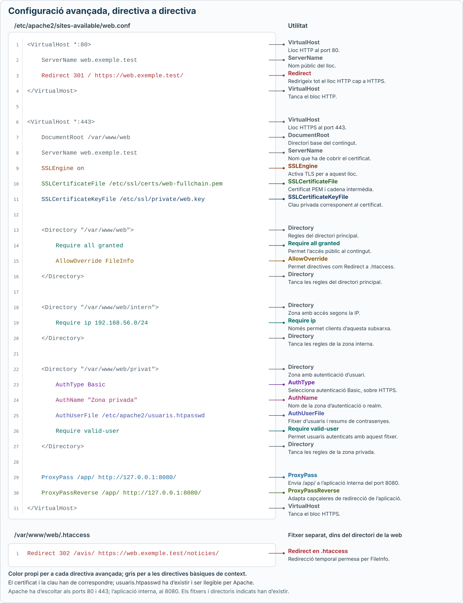

# Configuració avançada d’Apache

Aquest apartat amplia la [configuració bàsica](configuracio-basica.md) amb redireccions, regles en `.htaccess`, control d’accés, autenticació, proxy invers i HTTPS. Els exemples són fragments de configuració per a **Apache 2.4 a Ubuntu**.

## 1. Directives avançades

### Redireccions

<details class="command-card" markdown="1">
<summary><code>Redirect</code><span class="command-description">Demanar al navegador que accedeixi a una altra URL</span></summary>

```apache
Redirect 301 /antic/ https://web.exemple.test/nou/
```

Una petició a `/antic/guia.html` rep una redirecció cap a `https://web.exemple.test/nou/guia.html`. El navegador fa una nova petició i canvia l’adreça mostrada.

`301` indica un canvi permanent; `302`, un canvi temporal. Aquesta directiva pot anar dins del `VirtualHost` del lloc.

[Documentació de Redirect](https://httpd.apache.org/docs/2.4/mod/mod_alias.html#redirect).

</details>

### Regles en .htaccess

<details class="command-card" markdown="1">
<summary><code>AllowOverride</code><span class="command-description">Decidir què es pot definir als fitxers .htaccess</span></summary>

S’escriu al bloc `Directory` del fitxer del lloc:

```apache
<Directory "/var/www/web">
    AllowOverride FileInfo
</Directory>
```

| Valor | Què permet delegar a `.htaccess`? |
| --- | --- |
| `None` | Desactiva l’ús de `.htaccess` en la configuració habitual. |
| `FileInfo` | Directives de tractament de les peticions, com `Redirect`. |
| `AuthConfig` | Directives d’autenticació i autorització, com `AuthType` i `Require`. |
| `All` | Totes les categories admeses a `.htaccess`. |

Es poden combinar categories: `AllowOverride AuthConfig FileInfo`. `All` no permet directives que només poden anar al fitxer principal del lloc, com `VirtualHost`.

[Documentació d’AllowOverride](https://httpd.apache.org/docs/2.4/mod/core.html#allowoverride).

</details>

<details class="command-card" markdown="1">
<summary><code>.htaccess</code><span class="command-description">Definir regles locals per a un directori i els seus subdirectoris</span></summary>

És un fitxer de text anomenat exactament **`.htaccess`**, amb punt inicial. Es desa al directori sobre el qual han d’actuar les regles, per exemple `/var/www/web/.htaccess`.

Si el bloc `Directory` permet `AllowOverride FileInfo`, aquest fitxer pot contenir:

```apache
Redirect 302 /avis/ https://web.exemple.test/noticies/
```

Apache llegeix les regles en processar les peticions. Els canvis a `.htaccess` s’apliquen sense recarregar el servei; canviar `AllowOverride` al fitxer del lloc sí que requereix aplicar la nova configuració.

Només s’hi poden escriure les directives autoritzades. Quan es disposa d’accés al fitxer del lloc, és preferible centralitzar-hi les regles.

[Documentació de .htaccess](https://httpd.apache.org/docs/2.4/howto/htaccess.html).

</details>

### Accés per IP i autenticació

**Autoritzar** és decidir qui pot accedir; **autenticar** és comprovar la identitat d’un usuari.

<details class="command-card" markdown="1">
<summary><code>Require ip</code><span class="command-description">Permetre l’accés segons l’adreça IP del client</span></summary>

```apache
<Directory "/var/www/web/intern">
    Require ip 192.168.56.0/24
</Directory>
```

Permet clients de la subxarxa `192.168.56.0/24`. Per permetre una sola IP, es pot substituir la regla per `Require ip 192.168.56.20`.

La regla comprova la IP del client, no un nom d’usuari ni una contrasenya. Aquí substitueix l’autorització pública del directori: no s’ha d’afegir un `Require all granted` al mateix bloc, perquè podria obrir l’accés a tothom.

[Documentació de Require ip](https://httpd.apache.org/docs/2.4/mod/mod_authz_host.html#require).

</details>

<details class="command-card" markdown="1">
<summary><code>AuthType</code><span class="command-description">Seleccionar el tipus d’autenticació</span></summary>

```apache
AuthType Basic
```

`Basic` utilitza un nom d’usuari i una contrasenya que el navegador envia al servidor. Les credencials es codifiquen, però **Basic no les xifra: cal utilitzar HTTPS**.

</details>

<details class="command-card" markdown="1">
<summary><code>AuthName</code><span class="command-description">Donar un nom a la zona d’autenticació</span></summary>

```apache
AuthName "Zona privada"
```

Defineix el nom de la zona o *realm*. El client el rep en la petició d’autenticació i el pot utilitzar per identificar les credencials d’aquella zona.

[Documentació d’AuthType i AuthName](https://httpd.apache.org/docs/2.4/mod/mod_authn_core.html).

</details>

<details class="command-card" markdown="1">
<summary><code>AuthUserFile</code><span class="command-description">Indicar el fitxer d’usuaris i contrasenyes d’autenticació</span></summary>

```apache
AuthUserFile /etc/apache2/usuaris.htpasswd
```

Assenyala un fitxer amb usuaris i resums de contrasenyes, generat amb l’eina `htpasswd`. Ha de ser llegible per Apache i estar fora del directori públic de la web.

Les tres directives treballen juntes amb una regla d’autorització:

```apache
<Directory "/var/www/web/privat">
    AuthType Basic
    AuthName "Zona privada"
    AuthUserFile /etc/apache2/usuaris.htpasswd
    Require valid-user
</Directory>
```

`Require valid-user` permet qualsevol usuari que s’hagi autenticat correctament amb aquest fitxer. El fitxer ha d’existir i contenir els comptes autoritzats.

[Documentació d’AuthUserFile](https://httpd.apache.org/docs/2.4/mod/mod_authn_file.html#authuserfile).

</details>

### Proxy invers

Un **proxy invers** rep les peticions públiques i les passa a una aplicació que s’executa en un altre servidor o port.

<details class="command-card" markdown="1">
<summary><code>ProxyPass</code><span class="command-description">Enviar les peticions d’un camí a una aplicació interna</span></summary>

```apache
ProxyPass /app/ http://127.0.0.1:8080/
```

Una petició pública a `/app/productes` es transmet a `http://127.0.0.1:8080/productes`. L’aplicació ha d’estar escoltant al port `8080` del mateix servidor.

La URL pública continua sent la d’Apache. La directiva es pot posar dins del `VirtualHost`; les barres finals dels dos camins han de ser coherents.

</details>

<details class="command-card" markdown="1">
<summary><code>ProxyPassReverse</code><span class="command-description">Adaptar les capçaleres de redirecció retornades per l’aplicació interna</span></summary>

Habitualment acompanya `ProxyPass`:

```apache
ProxyPass        /app/ http://127.0.0.1:8080/
ProxyPassReverse /app/ http://127.0.0.1:8080/
```

Si l’aplicació retorna una redirecció a `http://127.0.0.1:8080/login`, Apache adapta la capçalera perquè el client continuï per `/app/login` del lloc públic.

Actua sobre determinades capçaleres de resposta, com `Location`; no reescriu els enllaços dins de l’HTML.

[Documentació de ProxyPass i ProxyPassReverse](https://httpd.apache.org/docs/2.4/mod/mod_proxy.html#proxypassreverse).

</details>

### HTTPS

Aquestes directives es defineixen al `VirtualHost` HTTPS, habitualment al port `443`. Apache ha d’estar escoltant en aquest port i disposar del certificat i la clau corresponents.

<details class="command-card" markdown="1">
<summary><code>SSLEngine</code><span class="command-description">Activar TLS per al lloc web</span></summary>

```apache
SSLEngine on
```

Activa la comunicació xifrada amb TLS. El nom de la directiva conserva «SSL», tot i que les connexions modernes utilitzen TLS.

</details>

<details class="command-card" markdown="1">
<summary><code>SSLCertificateFile</code><span class="command-description">Indicar el certificat que presenta el servidor</span></summary>

```apache
SSLCertificateFile /etc/ssl/certs/web-fullchain.pem
```

Apunta al certificat en format PEM, que pot incloure els certificats intermedis de la cadena. Ha de ser vàlid per al nom del lloc web.

</details>

<details class="command-card" markdown="1">
<summary><code>SSLCertificateKeyFile</code><span class="command-description">Indicar la clau privada associada al certificat</span></summary>

```apache
SSLCertificateKeyFile /etc/ssl/private/web.key
```

Apunta a la clau privada que correspon al certificat. És secreta: cal restringir-ne els permisos i mantenir-la fora del contingut públic.

[Documentació de les directives TLS](https://httpd.apache.org/docs/2.4/mod/mod_ssl.html).

</details>

### Fitxer de lloc amb les directives avançades

[](../assets/images/apache-directives-avancades.svg)

*Clica el gràfic per obrir-lo a mida completa i ampliar-lo. Les directives avançades tenen colors propis; les bàsiques que donen context apareixen en gris.*

## 2. Mòduls

Els **mòduls** són components que amplien les funcions d’Apache, com l’autenticació, el proxy invers o HTTPS. Algunes directives només estan disponibles quan el mòdul corresponent està carregat.
