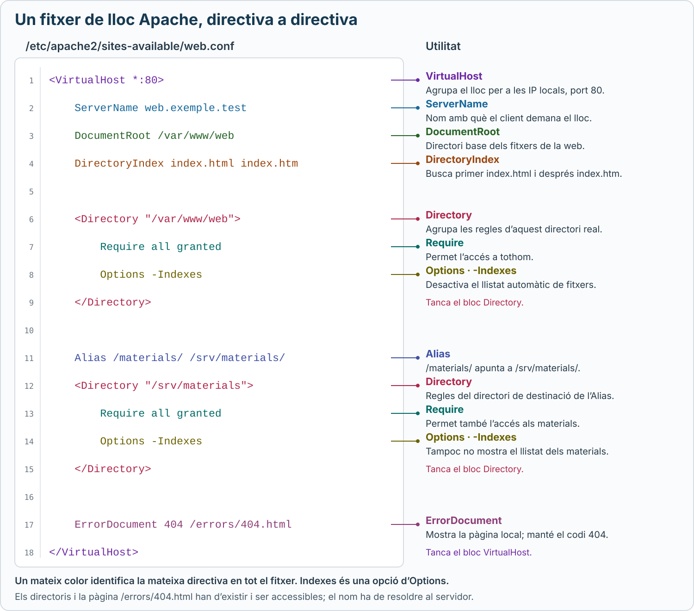

# Configuració bàsica d’Apache

Apache és un servidor web: rep peticions HTTP i retorna el contingut dels llocs que serveix. A Ubuntu, el servei es diu **`apache2`**.

Aquest apartat recull la teoria bàsica treballada a classe: directoris dels llocs, directives principals, gestió del servei i logs.

## 1. Directoris d’Apache

| Ruta | Funció |
| --- | --- |
| `/etc/apache2/` | Conté la configuració d’Apache, incloses proteccions bàsiques de seguretat. Conservarem els fitxers generals que proporciona Ubuntu. |
| `/etc/apache2/sites-available/` | Conté els fitxers `.conf` on es defineixen els llocs web. |
| `/etc/apache2/sites-enabled/` | Conté els enllaços als llocs habilitats amb `a2ensite`. |

**Disponible no vol dir habilitat:** un lloc pot tenir el seu fitxer a `sites-available` i no estar activat. Per definir un lloc, es treballa amb el seu fitxer, sense modificar la base general d’Apache.

## 2. Directives bàsiques

Una **directiva** és una instrucció que indica a Apache com ha de servir un lloc o tractar un directori.

### Definició del lloc web

<details class="command-card" markdown="1">
<summary><code>&lt;VirtualHost IP:port&gt;</code><span class="command-description">Agrupar les directives d’un lloc web</span></summary>

Defineix un lloc per a una adreça IP i un port.

```apache
<VirtualHost *:80>
    DocumentRoot /var/www/web
    ServerName web.exemple.test
</VirtualHost>
```

`*:80` indica les adreces locals aplicables al port `80`. També es pot indicar una IP concreta: `<VirtualHost 192.168.56.10:80>`. Apache ha d’estar escoltant en aquell port; el bloc no l’obre per si mateix.

</details>

<details class="command-card" markdown="1">
<summary><code>DocumentRoot</code><span class="command-description">Indicar on són els fitxers del lloc web</span></summary>

```apache
DocumentRoot /var/www/web
```

Estableix el directori base del contingut. Una petició a `/imatges/logo.png` correspon habitualment a `/var/www/web/imatges/logo.png`.

</details>

<details class="command-card" markdown="1">
<summary><code>ServerName</code><span class="command-description">Indicar el nom del lloc web</span></summary>

```apache
ServerName web.exemple.test
```

Apache utilitza aquest nom per seleccionar el lloc entre els virtual hosts de la mateixa IP i port, segons el nom demanat pel client.

La directiva no crea el nom al DNS: el client ha de poder resoldre’l a la IP del servidor.

</details>

### Regles de directori i accés

<details class="command-card" markdown="1">
<summary><code>&lt;Directory "/ruta"&gt;</code><span class="command-description">Agrupar les regles d’un directori del servidor</span></summary>

Aplica les directives que conté a una ruta del sistema de fitxers.

```apache
<Directory "/var/www/web">
    Require all granted
</Directory>
```

La ruta és un directori real del servidor, no una URL. El bloc té una etiqueta d’obertura i una de tancament.

</details>

<details class="command-card" markdown="1">
<summary><code>Require</code><span class="command-description">Permetre o denegar l’accés</span></summary>

| Directiva | Efecte |
| --- | --- |
| `Require all granted` | Permet l’accés a tothom. |
| `Require all denied` | Denega l’accés a tothom. |

S’utilitza dins del bloc corresponent, com `Directory`. Una denegació pot donar **`403 Forbidden`**. Aquesta autorització no canvia els permisos dels fitxers de Linux.

</details>

### Pàgina d’inici i llistat de fitxers

<details class="command-card" markdown="1">
<summary><code>Options</code>, <code>Indexes</code><span class="command-description">Permetre o impedir el llistat de fitxers d’un directori</span></summary>

`Options` controla funcions d’un directori. **`Indexes` és una opció de `Options`**, no una directiva independent.

```apache
Options +Indexes
```

Permet mostrar el llistat de fitxers si el directori no té una pàgina d’inici aplicable, com `index.html`.

```apache
Options -Indexes
```

Impedeix aquest llistat. Si existeix `index.html`, es pot continuar mostrant la pàgina. Desactivar el llistat no bloqueja l’accés directe a un fitxer conegut.

</details>

<details class="command-card" markdown="1">
<summary><code>DirectoryIndex</code><span class="command-description">Indicar quin fitxer es mostra en demanar un directori</span></summary>

```apache
DirectoryIndex index.html index.htm
```

Quan es demana una URL de directori, com `/` o `/materials/`, Apache busca aquests fitxers en l’ordre indicat i serveix el primer que troba.

**`DirectoryIndex` tria la pàgina d’inici; `Indexes` permet el llistat de fitxers si no hi ha cap pàgina d’inici aplicable.**

</details>

### Camins de la URL

<details class="command-card" markdown="1">
<summary><code>Alias</code><span class="command-description">Associar un camí de la URL amb un altre directori</span></summary>

```apache
Alias /materials/ /srv/materials/
```

Una petició a `/materials/guia.pdf` correspon a `/srv/materials/guia.pdf`, encara que sigui fora del `DocumentRoot`.

El directori també necessita l’autorització del seu bloc `Directory` i permisos de lectura adequats. Mantén les barres finals com a l’exemple.

</details>

<details class="command-card" markdown="1">
<summary><code>&lt;Location "/cami"&gt;</code><span class="command-description">Aplicar regles a un camí de la URL</span></summary>

`Location` agrupa directives per a un camí demanat pel client, encara que no correspongui a un directori real.

```apache
<Location "/privat">
    Require all denied
</Location>
```

Aquest exemple denega l’accés a `/privat` i als seus camins inferiors, com `/privat/informe`.

**`Directory` actua sobre una ruta del sistema de fitxers; `Location`, sobre un camí de la URL.** Per protegir un directori real independentment de la URL utilitzada, s’utilitza `Directory`.

[Documentació de Location](https://httpd.apache.org/docs/2.4/mod/core.html#location).

</details>

### Pàgines d’error

<details class="command-card" markdown="1">
<summary><code>ErrorDocument</code><span class="command-description">Indicar quina pàgina mostrar quan hi ha un error</span></summary>

```apache
ErrorDocument 404 /errors/404.html
```

Quan no es troba un recurs, Apache mostra aquesta pàgina local mantenint el codi **`404`**. El camí és dins del lloc web i el fitxer ha d’existir i ser accessible.

</details>

### Fitxer de lloc amb les directives bàsiques

[](../assets/images/apache-site-directives.svg)

*Clica el gràfic per obrir-lo a mida completa i ampliar-lo.*

## 3. Ordres bàsiques

<details class="command-card" markdown="1">
<summary><code>a2ensite</code>, <code>a2dissite</code><span class="command-description">Habilitar o deshabilitar un lloc web</span></summary>

```bash
sudo a2ensite web.conf
```

Habilita el lloc definit a `sites-available/web.conf`, creant-ne l’enllaç a `sites-enabled`.

```bash
sudo a2dissite web.conf
```

Deshabilita el lloc retirant l’enllaç, sense eliminar l’original. Per aplicar qualsevol dels dos canvis al servei actiu:

```bash
sudo systemctl reload apache2
```

</details>

<details class="command-card" markdown="1">
<summary><code>ip a</code><span class="command-description">Consultar les adreces IP del servidor</span></summary>

```bash
ip a
```

Mostra les interfícies i les seves adreces. A `inet 192.168.56.10/24`, la IP és `192.168.56.10` i `/24` és el prefix de xarxa. A la URL s’escriu la IP sense el prefix.

</details>

<details class="command-card" markdown="1">
<summary><code>systemctl</code><span class="command-description">Controlar el servei Apache</span></summary>

| Ordre | Funció |
| --- | --- |
| `sudo systemctl status apache2` | Consultar l’estat. |
| `sudo systemctl start apache2` | Engegar el servei ara. |
| `sudo systemctl stop apache2` | Aturar-lo ara. |
| `sudo systemctl reload apache2` | Rellegir la configuració sense una aturada completa. |
| `sudo systemctl restart apache2` | Aturar-lo i tornar-lo a engegar. |
| `sudo systemctl enable apache2` | Habilitar l’arrencada automàtica amb el sistema. |

**`start` i `enable` són diferents:** el primer engega el servei ara; el segon habilita l’arrencada automàtica, però no l’engega immediatament.

</details>

<details class="command-card" markdown="1">
<summary><code>service</code><span class="command-description">Reconèixer una altra manera de controlar el servei</span></summary>

```bash
sudo service apache2 restart
sudo service apache2 stop
sudo service apache2 start
sudo service apache2 status
```

Permeten reiniciar, aturar, engegar i consultar el servei. Per habilitar l’arrencada automàtica s’utilitza `systemctl enable apache2`.

</details>

<details class="command-card" markdown="1">
<summary><code>journalctl -xe</code><span class="command-description">Consultar missatges del sistema per entendre errors del servei</span></summary>

```bash
sudo journalctl -xe
```

Mostra el final del registre del sistema, amb explicacions addicionals quan estan disponibles. És útil si Apache falla en engegar-se o recarregar-se; també inclou missatges que no són errors.

Per limitar la consulta a Apache:

```bash
sudo journalctl -xeu apache2
```

Busca l’hora del problema i el missatge que n’indica la causa. Prem `q` per sortir.

</details>

## 4. Logs d’Apache

Els **logs** registren les peticions rebudes i els errors. Les rutes generals habituals a Ubuntu són:

| Fitxer | Què registra? |
| --- | --- |
| `/var/log/apache2/access.log` | Peticions rebudes i codis de resposta HTTP. |
| `/var/log/apache2/error.log` | Errors i missatges de diagnòstic d’Apache. |

En el registre d’accés, `200` indica èxit, `403` accés prohibit i `404` recurs no trobat. El registre d’errors ajuda a entendre la causa. Relaciona els missatges del mateix moment.

<details class="command-card" markdown="1">
<summary><code>tail -f nomFitxer</code><span class="command-description">Mostrar contínuament les línies noves d’un log</span></summary>

```bash
sudo tail -f /var/log/apache2/access.log
```

Mostra les últimes línies i continua mostrant les que s’afegeixen. Per seguir els errors:

```bash
sudo tail -f /var/log/apache2/error.log
```

Prem **`Ctrl+C`** per acabar el seguiment. Això tanca `tail`, no atura Apache.

</details>
