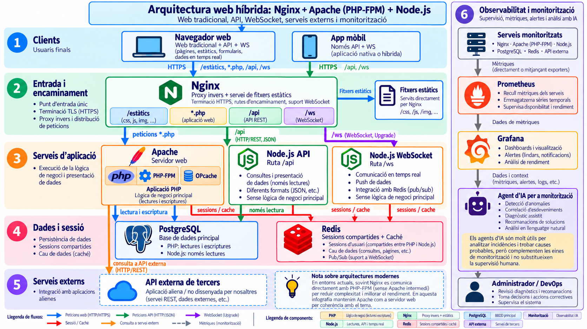

# Documentació pel mòdul de desplegament

Aquest espai recull les guies i els procediments útils pel mòdul de Desplegament d'Aplicacions Web de 2DAW de l'Institut Pedralbes.

La documentació es manté en fitxers Markdown dins del repositori. GitHub Actions genera el lloc amb MkDocs i el publica a GitHub Pages cada vegada que es pugen canvis a `main`.

## Una possible arquitectura web moderna

La imatge mostra un exemple d’arquitectura que combina un punt d’entrada amb NGINX, aplicacions amb PHP i Node.js, dades, sessions i serveis externs. Aquests components poden executar-se com a **serveis instal·lats en servidors, en contenidors o en un desplegament mixt**.

*Clica la imatge per obrir-la i ampliar-la.*

**No totes les aplicacions segueixen aquesta arquitectura ni han de fer-ho.** Cada projecte necessita les peces adequades a les seves funcions i complexitat. És un exemple del que s’ha de poder gestionar en una aplicació web moderna: encaminament de peticions, execució de serveis, comunicació en temps real, persistència de dades i integració amb altres sistemes. El repartiment de responsabilitats entre PHP i Node.js que mostra la figura és una decisió d’aquest exemple.

Un **desenvolupador ha de poder provar les peces en local** i comprovar com es comuniquen, amb dades de prova i serveis locals o substituts de les dependències externes. Els **entorns de desenvolupament i de proves també s’han de tenir presents**, juntament amb producció, amb les configuracions i les dades adequades a cada entorn.

## Autoria

Ermengol Bota i GPT-6

## Llicència

Els continguts de la documentació es distribueixen sota la llicència [Creative Commons Reconeixement-NoComercial-CompartirIgual 4.0 Internacional](https://creativecommons.org/licenses/by-nc-sa/4.0/deed.ca).

Es poden compartir i adaptar reconeixent l’autoria, sense finalitats comercials i distribuint les adaptacions amb la mateixa llicència.

