# Arquitectura de les aplicacions web

## Mapa mental

[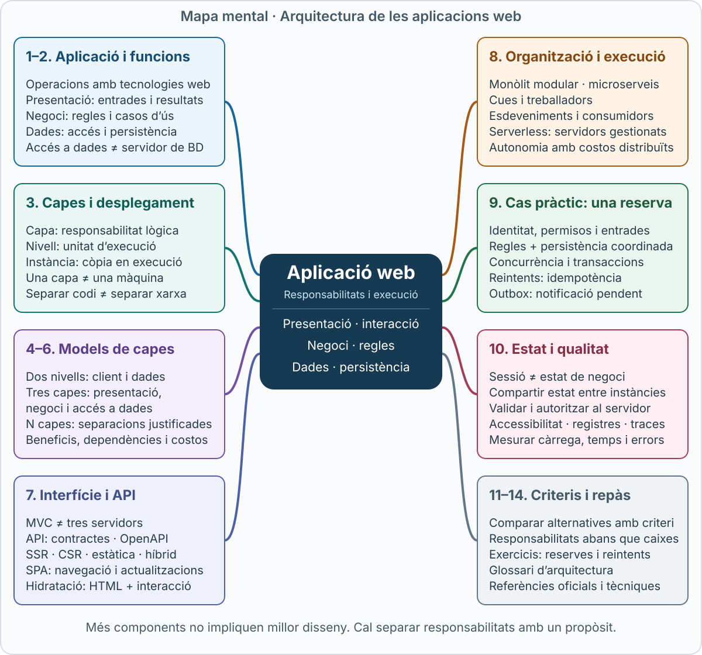](../assets/images/arquitectura-aplicacio-web-mapa-mental.svg)

*Clica el mapa per obrir-lo a mida completa i ampliar-lo amb el zoom del navegador.*

## Objectius d’aprenentatge

En acabar aquest apartat has de poder:

- Explicar què és una aplicació web i identificar-ne les responsabilitats.
- Distingir presentació, lògica de negoci i administració de dades.
- Diferenciar capes lògiques i nivells de desplegament.
- Interpretar els models de dues, tres i múltiples capes.
- Descriure el recorregut d’una operació des de la interfície fins a la persistència.
- Relacionar les capes amb MVC, API, renderització i arquitectures distribuïdes.
- Raonar sobre sessions, concurrència, seguretat, escalabilitat i tractament d’errors.
- Comparar alternatives amb criteris concrets i sense assumir que més components impliquen millor disseny.

## 1. Què és una aplicació web?

Una **aplicació web** és un sistema de programari que proporciona funcionalitats mitjançant tecnologies web. La interfície per a persones acostuma a executar-se en un navegador, mentre que les operacions poden implicar servidors, emmagatzematge i altres serveis.

Exemples:

| Aplicació | Operacions |
|---|---|
| Biblioteca | Consultar el catàleg, reservar exemplars i renovar préstecs |
| Campus virtual | Llegir materials, lliurar activitats i consultar qualificacions |
| Botiga | Cercar productes, crear una comanda i consultar-ne l’estat |
| Reserva de transport | Consultar disponibilitat, reservar una plaça i obtenir un bitllet |
| Gestió de cites | Escollir una franja, confirmar-la i cancel·lar-la |

Una aplicació web pot combinar pàgines generades al servidor, recursos estàtics, actualitzacions amb JavaScript i API. No necessita generar un document HTML complet per a cada acció ni exigeix una sessió autenticada per a totes les operacions.

Un lloc informatiu i una aplicació no són categories amb una frontera absoluta: un mateix lloc pot publicar informació i oferir operacions.

Fonts: [MDN, Introduction to the server side](https://developer.mozilla.org/en-US/docs/Learn_web_development/Extensions/Server-side/First_steps/Introduction) i [MDN, Client-server overview](https://developer.mozilla.org/en-US/docs/Learn_web_development/Extensions/Server-side/First_steps/Client-Server_overview).

## 2. Les tres responsabilitats fonamentals

Una manera útil d’estudiar una aplicació és preguntar:

1. **Com interactua l’usuari amb el sistema?** Presentació.
2. **Quines regles decideixen el resultat?** Lògica de negoci.
3. **Com es conserven i es recuperen les dades?** Administració de dades.

Aquestes responsabilitats són una classificació lògica. No indiquen, per si soles, quants servidors ni quants processos hi ha.

### 2.1. Presentació

La **presentació** recull entrades, organitza informació i comunica resultats.

Inclou formularis, navegació, missatges d’error, taules, components visuals i adaptacions per a diferents dispositius. També pot incloure codi del servidor que prepara dades per a una vista o genera HTML.

Exemple: en reservar un llibre, la presentació mostra la fitxa, ofereix el botó de reserva i informa si l’operació ha tingut èxit.

Una interfície ha de permetre entendre l’estat de l’operació. «Enviant», «Reserva confirmada» i «No s’ha pogut confirmar» expressen situacions diferents.

### 2.2. Lògica de negoci

La **lògica de negoci**, o lògica de domini, expressa regles pròpies del servei. «Negoci» no implica una activitat comercial: també s’aplica a una biblioteca pública o a una universitat.

Exemples de regles d’una biblioteca:

- Només els usuaris habilitats poden reservar.
- Un exemplar no pot tenir dues reserves actives incompatibles.
- Una persona no pot superar el límit establert.
- Una cancel·lació pot alliberar l’exemplar.

Aquestes regles no han de dependre del color d’un botó o del format HTML. Una aplicació mòbil i una interfície web haurien de respectar les mateixes regles quan utilitzen el mateix servei.

La **lògica d’aplicació** coordina un cas d’ús: obtenir la identitat, consultar dades, aplicar regles, desar el resultat i preparar la resposta. En aplicacions petites pot conviure amb la lògica de domini; en sistemes més complexos es pot separar.

### 2.3. Administració i accés a les dades

Aquesta responsabilitat inclou recuperar, crear, modificar i eliminar dades, i coordinar-ne la persistència.

Pot implicar:

| Recurs | Exemple de contingut |
|---|---|
| Base de dades relacional | Usuaris, exemplars i reserves |
| Base de dades documental | Documents amb estructura variable |
| Emmagatzematge de fitxers o objectes | Portades i materials descarregables |
| Índex de cerca | Informació preparada per cercar |
| Memòria cau | Còpies temporals per accelerar consultes |

La **capa d’accés a dades** és codi que comunica l’aplicació amb aquests sistemes. **No és la mateixa cosa que el servidor de base de dades.**

Una memòria cau tampoc s’ha de considerar automàticament la font definitiva de la informació.

Referència sobre separació de responsabilitats i accés a dades: [Microsoft Learn, Common web application architectures](https://learn.microsoft.com/en-us/dotnet/architecture/modern-web-apps-azure/common-web-application-architectures).

### 2.4. Classificar operacions

| Operació | Responsabilitat principal | Col·laboració necessària |
|---|---|---|
| Mostrar un formulari | Presentació | Pot necessitar dades |
| Comprovar un format abans d’enviar | Presentació | El servidor també ha de validar |
| Decidir si una persona pot reservar | Lògica de negoci i autorització | Identitat i dades vigents |
| Cercar reserves existents | Accés a dades | Criteri definit pel cas d’ús |
| Evitar una duplicació concurrent | Negoci i integritat de dades | Operació coordinada amb la base de dades |
| Mostrar la confirmació | Presentació | Resultat real de l’operació |

La classificació no obliga a duplicar tot el codi. Serveix per aclarir què decideix cada component i quines dependències necessita.

## 3. Capes lògiques i nivells de desplegament

### 3.1. Capa: organització del programari

Una **capa lògica** (*layer*) agrupa responsabilitats i defineix com s’utilitzen les seves funcions.

Per exemple:

[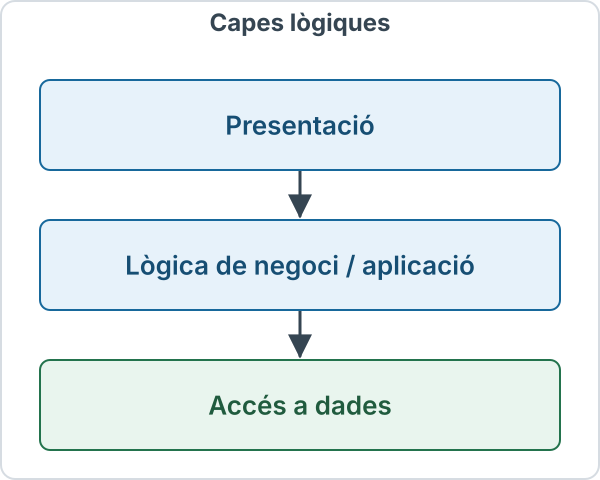](../assets/images/capes-logiques.svg)

Les fletxes representen un recorregut funcional simplificat. No impliquen tres comunicacions de xarxa.

Les tres capes poden executar-se en un únic procés. Separar-les en carpetes ajuda a organitzar-se, però no garanteix que s’hagin respectat les dependències.

### 3.2. Nivell de desplegament: organització de l’execució

Un **nivell de desplegament** (*tier*) descriu una separació operativa d’execució o infraestructura. Sovint implica processos, serveis o màquines que es comuniquen a través de la xarxa.

| Pregunta | Concepte |
|---|---|
| On s’implementa la regla de reserva? | Capa lògica |
| Quin servei executa aquesta regla? | Nivell de desplegament |
| Quantes còpies del servei hi ha? | Instàncies |
| En quina infraestructura s’executen? | Màquines, contenidors o serveis gestionats |

Una capa pot estendre’s per diversos components. Un nivell pot executar diverses capes.

Cal indicar què s’està comptant: el navegador, el frontal web, l’aplicació i la base de dades no s’agrupen igual en tots els diagrames.

Fonts: [Microsoft Learn, N-tier architecture style](https://learn.microsoft.com/en-us/azure/architecture/guide/architecture-styles/n-tier) i [Microsoft Learn, capes i desplegament](https://learn.microsoft.com/en-us/dotnet/architecture/modern-web-apps-azure/common-web-application-architectures).

### 3.3. Dos diagrames del mateix sistema

**Vista lògica del servidor d’aplicació:**

[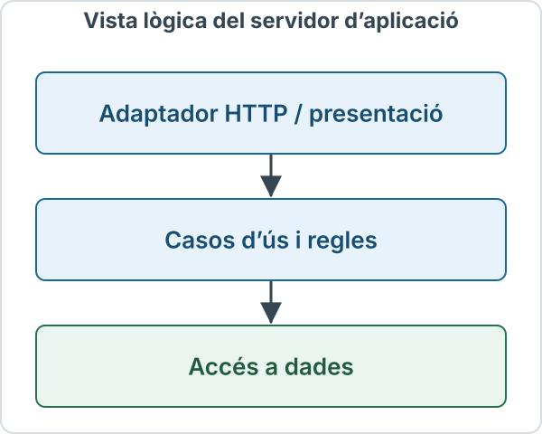](../assets/images/vista-logica-aplicacio.svg)

**Vista de desplegament del conjunt:**

[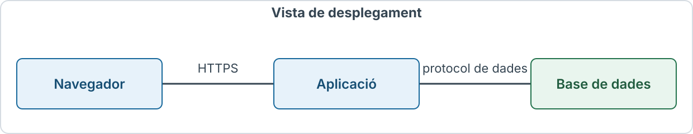](../assets/images/vista-desplegament.svg)

L’aplicació del centre pot contenir les tres capes lògiques. Si es compta el conjunt amb el navegador, el diagrama té tres nivells; si es descriu només la infraestructura del servidor, mostra aplicació i base de dades.

**Tres capes no significa tres màquines. Tres instàncies de la mateixa aplicació tampoc creen tres capes.**

## 4. El model de dos nivells

### 4.1. Client amb presentació i lògica, servidor de dades

Un model clàssic situa una part important de la presentació i de la lògica en el client:

[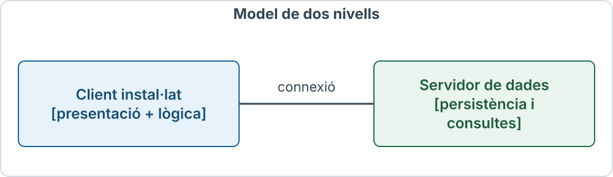](../assets/images/model-dos-nivells.svg)

Aquest client es pot anomenar **client pesant** (*thick client* o *fat client*). «Pesant» descriu el volum de funcionalitat local, no una mesura universal de consum o de qualitat.

Una aplicació d’escriptori interna que consulta una base de dades pot seguir aquest model. No és una estructura exclusiva de la Web.

### 4.2. Avantatges i limitacions

| Aspecte | Possibilitat | Límit que cal considerar |
|---|---|---|
| Simplicitat inicial | Menys serveis intermedis | L’acoblament pot créixer |
| Capacitat local | Operacions i interacció al client | Actualitzar regles pot exigir distribuir versions |
| Comunicació amb dades | Accés directe en entorns controlats | Pot multiplicar connexions i exposar detalls |
| Desplegament | Adequat per a alguns sistemes interns | Diversos clients poden mantenir regles diferents |
| Escala | Pot ser suficient per a la càrrega prevista | Depèn de consultes, connexions i infraestructura |

No és correcte afirmar que qualsevol sistema de dos nivells és poc funcional o incapaç d’escalar. Les limitacions depenen del disseny i del context.

Tampoc s’ha de deduir que qualsevol aplicació amb molt JavaScript accedeix directament a una base de dades: una SPA pot utilitzar una API que aplica les regles al servidor.

### 4.3. Precaució amb el navegador

El codi del navegador es distribueix al client. No s’hi poden confiar credencials administratives ni regles de seguretat que només s’apliquin localment.

Alguns serveis gestionats ofereixen API de dades accessibles des del navegador. En aquest cas, els permisos i les regles del servei continuen constituint una frontera de control al servidor; no equival a exposar una base de dades sense protecció.

La validació del navegador millora l’experiència, però no substitueix la validació del servidor.

Fonts: [MDN, Client-side form validation](https://developer.mozilla.org/en-US/docs/Learn_web_development/Extensions/Forms/Form_validation) i [OWASP, Authorization Cheat Sheet](https://cheatsheetseries.owasp.org/cheatsheets/Authorization_Cheat_Sheet.html).

## 5. El model de tres capes

### 5.1. Presentació, procés i dades

El model de tres capes separa:

| Capa | Funció | Exemple de biblioteca |
|---|---|---|
| Presentació | Recollir entrades i mostrar resultats | Formulari de reserva i missatge final |
| Procés, aplicació o negoci | Coordinar operacions i aplicar regles | Comprovar habilitació i disponibilitat |
| Dades | Accedir a informació i mantenir la persistència | Llegir exemplars i registrar reserves |

Els noms exactes varien. És preferible explicar què fa cada capa que limitar-se a comptar caixes.

### 5.2. Presentació al client i al servidor

La presentació pot repartir-se:

- **Al navegador:** interpretar HTML, aplicar CSS, gestionar interaccions i actualitzar la vista.
- **Al servidor:** preparar un model de vista, seleccionar una plantilla i generar HTML.

Per això «presentació = navegador» és una simplificació. Un servidor que genera una pàgina també participa en la presentació.

L’usuari pot enviar un formulari tradicional i rebre una altra pàgina, o enviar dades amb JavaScript i actualitzar només una part de la vista.

Referència: [MDN, programació al servidor](https://developer.mozilla.org/en-US/docs/Learn_web_development/Extensions/Server-side/First_steps/Introduction).

### 5.3. Recorregut d’una reserva

Exemple propi: una persona vol reservar l’exemplar 42.

```text
1. Interfície: recull la petició de reserva
2. Entrada HTTP: interpreta les dades i la identitat
3. Cas d’ús: comprova permisos i regles
4. Accés a dades: coordina la lectura i l’escriptura
5. Persistència: confirma el canvi
6. Resposta: expressa el resultat real
7. Interfície: mostra confirmació o error
```

La interfície no ha de mostrar «Confirmada» només perquè s’ha premut el botó. La confirmació exigeix que el sistema hagi acceptat i consolidat l’operació segons les seves regles.

### 5.4. Beneficis i costos

| Benefici | Per què ajuda? |
|---|---|
| Manteniment | Canviar una vista no obliga a reescriure totes les regles |
| Reutilització | Diverses interfícies poden executar el mateix cas d’ús |
| Verificació | Les regles es poden provar sense automatitzar tota la interfície |
| Control | Els permisos es comproven en una frontera de confiança |
| Evolució | L’accés a dades es pot adaptar amb impacte més localitzat |

La separació també té costos: més interfícies, decisions de dependència i coordinació. Si es converteix cada capa en un servei remot, s’hi afegeixen latència, errors de xarxa i operació.

El model és una eina de disseny, no una garantia automàtica d’escalabilitat, seguretat o qualitat.

### 5.5. Regles compartides i dependències

Una regla que existeix només a la interfície pot ser eludida per un altre client. El servei que accepta l’operació ha d’aplicar-ne les condicions.

En un disseny senzill, la lògica utilitza un component d’accés a dades. En altres dissenys, el domini defineix una interfície i la infraestructura la implementa: és una manera d’invertir dependències.

Exemple conceptual:

```text
Cas d’ús: reservarExemplar(...)
    utilitza un contracte: RepositoriReserves

Implementació de dades:
    implementa RepositoriReserves amb una base de dades
```

Això separa el contracte que necessita el cas d’ús dels detalls d’emmagatzematge. No elimina la necessitat de comprovar el comportament real de la base de dades.

Referència: [Microsoft Learn, Clean Architecture i dependències](https://learn.microsoft.com/en-us/dotnet/architecture/modern-web-apps-azure/common-web-application-architectures#clean-architecture).

## 6. Arquitectures de múltiples capes

Un model de **n capes** introdueix més separacions quan hi ha responsabilitats que ho justifiquen.

Exemple:

[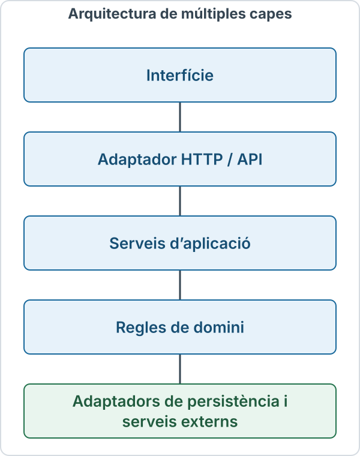](../assets/images/arquitectura-multiples-capes.svg)

No cada capa ha de ser un servei ni cada petició ha de travessar una xarxa. En una arquitectura estrictament estratificada s’utilitzen les capes adjacents; altres dissenys permeten salts controlats.

També hi ha infraestructura transversal: configuració, registres, observabilitat i seguretat. No cal dibuixar-la sempre com un esglaó entre totes les operacions.

### 6.1. Exemple de desplegament ampliat

[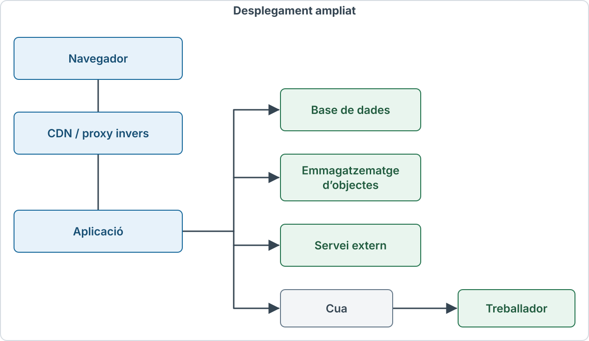](../assets/images/desplegament-ampliat.svg)

Aquest diagrama mostra components d’execució. Afegir una CDN no crea automàticament una nova capa de negoci; afegir una segona base de dades tampoc defineix una nova responsabilitat de domini.

### 6.2. Evitar la separació sense propòsit

Una separació pot ser útil si permet:

- Canviar una regla sense modificar tota la interfície.
- Aïllar una dependència externa.
- Protegir una operació amb una frontera clara.
- Dimensionar una tasca que té una càrrega diferent.
- Verificar un comportament de manera més precisa.

Si un component només reenvia una crida sense aportar una frontera útil, cal valorar-ne el cost. Cada comunicació remota introdueix possibilitats de retard i fallada.

Referència: [Microsoft Learn, N-tier architecture style](https://learn.microsoft.com/en-us/azure/architecture/guide/architecture-styles/n-tier).

## 7. Presentació, MVC, API i renderització

### 7.1. MVC no és el model de tres nivells

**MVC** significa *Model-View-Controller*:

| Element | Responsabilitat |
|---|---|
| Model | Representar dades, estat i comportaments del domini segons el disseny |
| Vista | Presentar informació |
| Controlador | Interpretar entrades i coordinar la resposta |

MVC organitza responsabilitats del programari. No obliga a tenir una màquina per element ni equival a «navegador, servidor web i base de dades».

En una aplicació amb MVC, el controlador pot cridar un servei d’aplicació i la vista pot ser una plantilla HTML. El model no és necessàriament una taula SQL.

Fonts: [MDN, MVC](https://developer.mozilla.org/en-US/docs/Glossary/MVC) i [MDN, Server-side web frameworks](https://developer.mozilla.org/en-US/docs/Learn_web_development/Extensions/Server-side/First_steps/Web_frameworks).

### 7.2. API i contractes

Una **API** defineix una interfície perquè un component utilitzi funcions d’un altre. En una API HTTP, el contracte pot incloure:

- Destinacions i mètodes.
- Estructures de les entrades i les sortides.
- Autenticació i permisos.
- Codis d’estat i significat dels errors.
- Regles de compatibilitat i de reintent.

Una API pot retornar JSON, però **JSON és un format, no una arquitectura**. Una aplicació també pot exposar HTML o altres representacions.

OpenAPI permet descriure interfícies HTTP en un format processable per eines. No aplica per si mateix les regles del servei ni garanteix que la implementació respecti el contracte.

Referència: [OpenAPI Initiative, OpenAPI Specification](https://spec.openapis.org/oas/latest.html).

### 7.3. SSR, CSR i generació estàtica

| Enfocament | On es prepara principalment la interfície? | Conseqüència |
|---|---|---|
| SSR, renderització al servidor | El servidor genera HTML per a la resposta, que també pot tenir memòria cau | El navegador rep contingut HTML ja preparat |
| CSR, renderització al client | JavaScript construeix o actualitza la interfície al navegador | Cal gestionar càrrega de codi, dades i estats locals |
| Generació estàtica | Les pàgines es preparen abans de servir-les, habitualment durant la construcció | Es poden distribuir com a recursos ja generats |
| Enfocament híbrid | Es combinen estratègies segons ruta o component | No totes les parts del lloc tenen el mateix recorregut |

**SPA** significa *Single-page application*: una aplicació que pot actualitzar contingut i navegar sense descarregar un document complet en cada canvi de vista. No implica que tot el sistema estigui dins del navegador ni que no existeixi lògica al servidor.

Fonts: [MDN, SSR](https://developer.mozilla.org/en-US/docs/Glossary/SSR), [MDN, CSR](https://developer.mozilla.org/en-US/docs/Glossary/CSR), [MDN, SSG](https://developer.mozilla.org/en-US/docs/Glossary/SSG) i [MDN, SPA](https://developer.mozilla.org/en-US/docs/Glossary/SPA).

### 7.4. Hidratació i distribució de responsabilitats

La **hidratació** connecta comportament del client amb HTML generat prèviament. Per exemple, una interfície pot arribar com a HTML del servidor i adquirir després gestors d’esdeveniments.

La documentació de Vue descriu aquest mecanisme amb una aplicació creada amb `createSSRApp` i muntada sobre l’HTML existent. És un exemple d’implementació, no una obligació d’utilitzar Vue per construir una aplicació web. En projectes amb renderització al servidor, Nuxt ofereix aquesta integració de manera habitual.

La tria de renderització no decideix automàticament on viuen les regles de negoci. Una pàgina generada estàticament pot enviar una reserva a una API; una SPA pot recolzar-se en un servei amb tres capes internes.

Referències: [Vue, hydration](https://vuejs.org/guide/scaling-up/ssr.html#client-hydration) i [Nuxt, rendering modes](https://nuxt.com/docs/guide/concepts/rendering).

## 8. Formes actuals d’organitzar i executar l’aplicació

### 8.1. Aplicació monolítica i monòlit modular

Una **aplicació monolítica** desplega habitualment el nucli funcional com una unitat. Pot estar ben organitzada en capes i mòduls.

En un **monòlit modular**, les funcions es delimiten, per exemple, en catàleg, reserves i usuaris, encara que es publiquin conjuntament.

[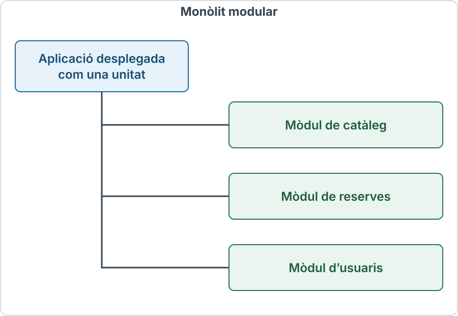](../assets/images/monolit-modular.svg)

Un monòlit pot tenir diverses instàncies darrere d’un balancejador. Per tant, «monolític» no vol dir «una sola còpia» ni «incapaç d’escalar».

La limitació és que la publicació i, sovint, el dimensionament afecten la unitat conjunta. Els límits interns continuen sent importants.

Referència: [Microsoft Learn, arquitectures d’aplicacions web](https://learn.microsoft.com/en-us/dotnet/architecture/modern-web-apps-azure/common-web-application-architectures).

### 8.2. Microserveis

Els **microserveis** separen funcionalitats en serveis que es poden desplegar amb més independència. La separació acostuma a seguir capacitats del domini, no a convertir cada capa tècnica en un microservei.

Exemple conceptual:

[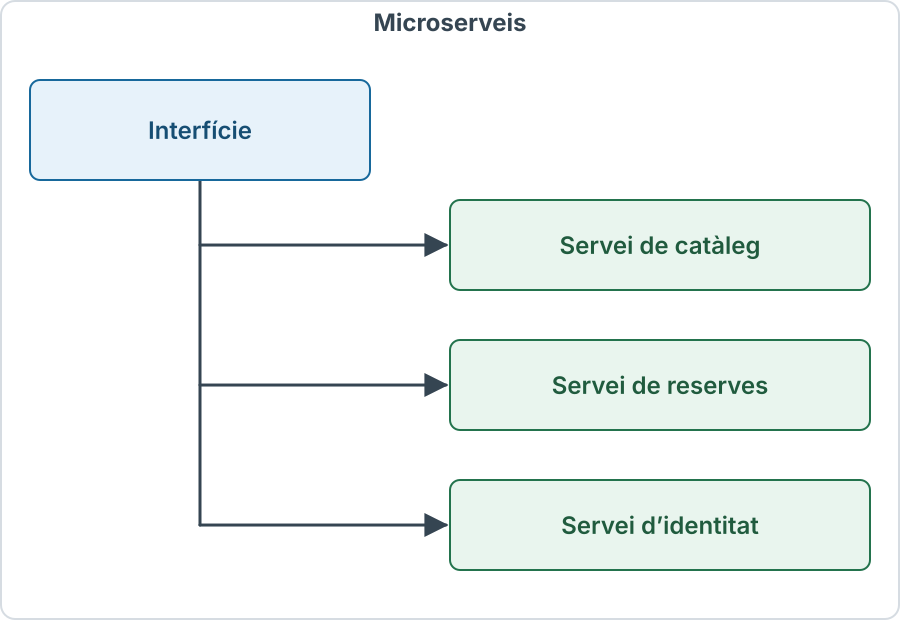](../assets/images/microserveis.svg)

Cada servei necessita límits clars, contractes i responsabilitat sobre les dades que gestiona.

| Possibilitat | Cost |
|---|---|
| Publicar un servei sense publicar tot el sistema | Compatibilitat entre versions |
| Dimensionar funcions de manera diferenciada | Més infraestructura i comunicacions |
| Repartir responsabilitats entre equips | Coordinació de canvis transversals |
| Aïllar algunes fallades | Errors parcials i tractament distribuït |

Dividir serveis no garanteix autonomia si tots depenen de la mateixa estructura interna de dades. També complica les operacions que han de mantenir coherència entre serveis.

Referència: [Microsoft Learn, Microservices architecture style](https://learn.microsoft.com/en-us/azure/architecture/guide/architecture-styles/microservices).

### 8.3. Treball en segon pla i cues

Una resposta interactiva no ha d’esperar sempre totes les tasques complementàries.

[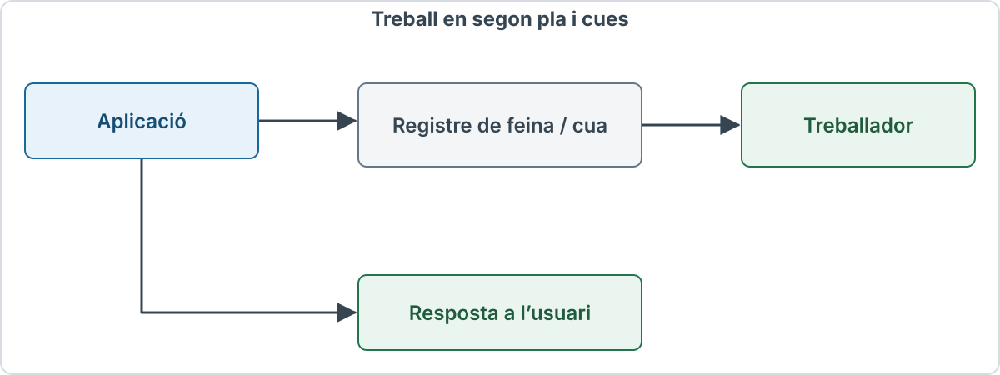](../assets/images/cua-treballador.svg)

Una **cua** conserva o distribueix feines; un **treballador** les processa. Pot servir per generar informes, transformar imatges o enviar notificacions.

Cal distingir «petició acceptada» i «feina completada». Si el resultat encara no existeix, la interfície ha de mostrar un estat pendent i oferir una manera de consultar-lo.

Els reintents i la possible duplicació de missatges s’han de contemplar en el disseny.

Font: [Microsoft Learn, Web-Queue-Worker architecture style](https://learn.microsoft.com/en-us/azure/architecture/guide/architecture-styles/web-queue-worker).

### 8.4. Arquitectures orientades a esdeveniments

Un **esdeveniment** descriu un fet, com `ReservaConfirmada`. Diversos consumidors poden reaccionar-hi: notificacions, estadístiques o actualització d’un índex.

[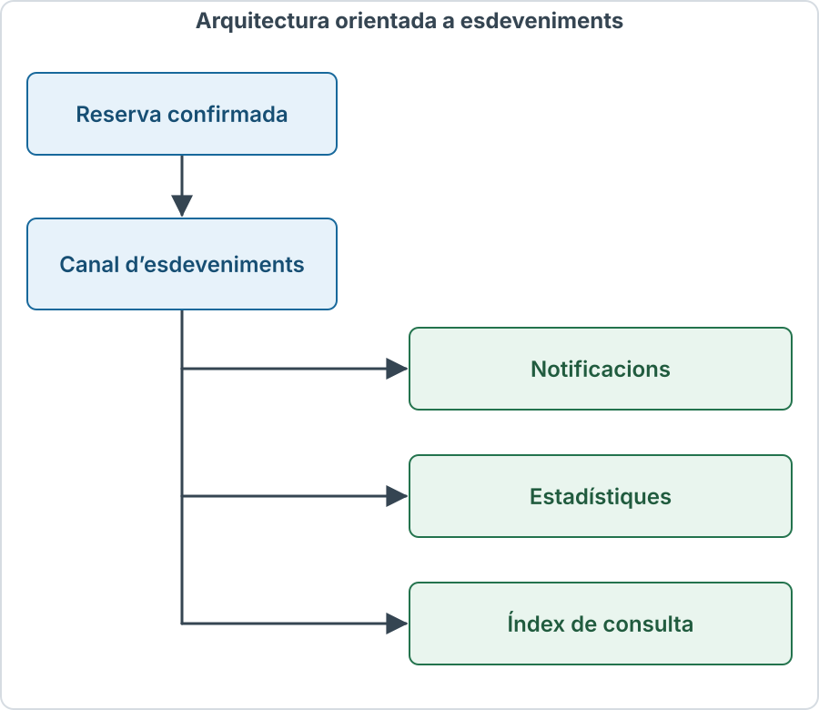](../assets/images/arquitectura-esdeveniments.svg)

Aquesta separació pot evitar que el productor conegui tots els consumidors. Però les diferents vistes poden actualitzar-se en moments diferents.

La **consistència eventual** implica que determinades còpies o vistes convergeixen amb el temps, sota les condicions del sistema. No és un permís per perdre operacions ni garanteix una espera màxima sense un compromís addicional.

Una confirmació de reserva i la seva aparició a l’índex de cerca poden tenir requisits temporals diferents.

Referència: [Microsoft Learn, Event-driven architecture style](https://learn.microsoft.com/en-us/azure/architecture/guide/architecture-styles/event-driven).

### 8.5. Serverless i serveis gestionats

En un model **serverless**, el proveïdor gestiona bona part de l’aprovisionament i l’operació de la infraestructura d’execució. Pot incloure funcions i altres serveis gestionats.

Continuen existint servidors. L’equip continua sent responsable de les regles, els permisos, els contractes i les dades, segons el repartiment de responsabilitats del servei.

Els límits d’execució, la concurrència, els costos i el comportament d’inici depenen del producte. No és una manera d’eliminar les capes lògiques ni una garantia automàtica de menor cost.

Referència de proveïdor: [AWS, Serverless](https://aws.amazon.com/serverless/).

### 8.6. Eixos de decisió diferents

| Eix | Pregunta |
|---|---|
| Capes | Com se separen responsabilitats? |
| Mòduls | Com s’organitzen funcions del domini? |
| Desplegament | Quines unitats s’executen i es publiquen? |
| Renderització | On i quan es prepara la interfície? |
| Comunicació | Peticions directes, cues o esdeveniments? |
| Infraestructura | Màquines, contenidors o serveis gestionats? |

Una aplicació pot ser alhora modular, organitzada en tres capes, amb SSR i desplegada en infraestructura gestionada. Aquestes etiquetes no són alternatives excloents.

## 9. Cas pràctic: reservar un exemplar

### 9.1. Requisits de l’exemple

Considerem una biblioteca amb aquestes regles:

- Cal una identitat vàlida.
- La persona ha d’estar habilitada.
- Cada persona pot tenir com a màxim tres reserves actives.
- Un exemplar només pot tenir una reserva activa.
- Els reintents d’una mateixa operació no han de crear duplicats.

Són regles didàctiques d’aquest exemple; cada servei pot definir-ne unes altres.

### 9.2. Entrada i resposta

La interfície envia una petició `POST` a `/api/reserves`, amb la credencial aplicable i aquest cos JSON:

```json
{
  "exemplarId": 42,
  "operacioId": "reserva-demo-001"
}
```

La identitat s’obté del context d’autenticació validat. No es confia en un identificador de persona que el client pugui manipular.

`operacioId` és un camp definit per aquesta API. No és un camp universal d’HTTP.

Si es crea la reserva, el servei pot retornar `201 Created`, indicar `Location: /api/reserves/817` i oferir:

```json
{
  "reservaId": 817,
  "exemplarId": 42,
  "estat": "confirmada"
}
```

Els blocs JSON mostren només cossos de missatge; no són missatges HTTP complets.

Fonts de semàntica: [IETF, RFC 9110](https://httpwg.org/specs/rfc9110.html) i [MDN, 201 Created](https://developer.mozilla.org/en-US/docs/Web/HTTP/Reference/Status/201).

### 9.3. Repartiment de la feina

| Component | Tasca |
|---|---|
| Interfície | Recollir l’acció i mostrar l’estat |
| Adaptador HTTP | Interpretar JSON, validar-ne l’estructura i construir la resposta |
| Autenticació i autorització | Establir la identitat i els permisos |
| Cas d’ús | Coordinar la reserva i aplicar les regles |
| Accés a dades | Executar operacions sota les condicions de concurrència necessàries |
| Base de dades | Conservar el resultat i fer complir restriccions |
| Treballador | Processar una notificació pendent, si s’ha previst |

El proxy, si n’hi ha, pot encaminar la petició sense decidir la regla del màxim de reserves.

### 9.4. La concurrència exigeix coordinació

Dues persones poden veure l’exemplar com a disponible al mateix temps:

[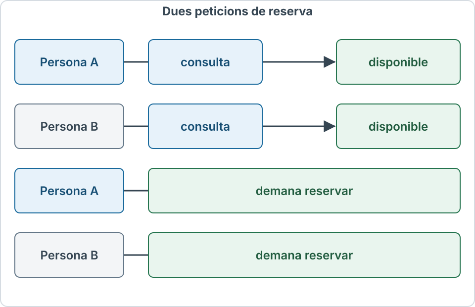](../assets/images/concurrencia-reserves.svg)

Comprovar al navegador o fer una lectura seguida d’una escriptura independent no evita necessàriament la doble reserva.

Una **transacció** agrupa canvis perquè es confirmin conjuntament o es desfacin. El nivell d’aïllament, els bloquejos i les restriccions determinen com es coordinen operacions concurrents.

Una transacció, per si sola i sense aquestes decisions, no fa desaparèixer totes les condicions de cursa.

Fonts: [PostgreSQL, Transactions](https://www.postgresql.org/docs/current/tutorial-transactions.html) i [PostgreSQL, Explicit locking](https://www.postgresql.org/docs/current/explicit-locking.html).

### 9.5. Pseudocodi de coordinació

L’esquema següent és **pseudocodi**, no una implementació executable:

```text
identitat = autenticar petició
validar estructura de les dades

iniciar transacció

    bloquejar registre de la persona
    bloquejar registre de l’exemplar

    comprovar si aquesta operació ja té un resultat guardat
        si existeix:
            comprovar que correspon a la mateixa petició
            retornar el resultat guardat i tancar la transacció

    comprovar habilitació i nombre de reserves actives
    comprovar que l’exemplar existeix i és reservable

    crear la reserva
    marcar l’exemplar com a reservat
    guardar el resultat associat a persona + operacioId
    registrar la notificació pendent, si escau

confirmar transacció
retornar confirmació
```

Els bloquejos es mantenen fins al final de la transacció. Tots els camins que modifiquin les condicions protegides han de seguir una coordinació compatible i un ordre coherent per reduir interbloquejos.

Si una regla falla, es desfà la transacció i es retorna un error adequat. La implementació també ha de tractar excepcions i conflictes de concurrència.

La base de dades pot reforçar el disseny amb claus, referències i restriccions d’unicitat. La restricció «una reserva activa per exemplar» ha de reflectir exactament què es considera activa; una unicitat sobre tot l’historial impediria reserves futures legítimes.

Font: [PostgreSQL, Constraints](https://www.postgresql.org/docs/current/ddl-constraints.html).

### 9.6. Reintents i idempotència de l’operació

Pot passar que el servidor confirmi la transacció però la resposta no arribi al navegador. Una pèrdua de connexió no demostra que la reserva hagi fallat.

La parella `persona + operacioId` permet identificar un reintent:

- Si l’operació i el contingut coincideixen, es recupera el resultat consolidat.
- Si es reutilitza l’identificador amb contingut incompatible, el servei ho rebutja segons el contracte.
- Una restricció persistent i una coordinació adequada eviten que dues execucions simultànies creïn dos resultats.

POST no és idempotent en general. Aquesta propietat s’implementa al nivell del servei, amb un contracte explícit.

Desactivar el botó després del primer clic pot millorar la interfície, però no resol reintents de xarxa ni altres clients.

Referència: [AWS Builders’ Library, Making retries safe with idempotent APIs](https://aws.amazon.com/builders-library/making-retries-safe-with-idempotent-APIs/).

### 9.7. Notificacions i resultat principal

Enviar un correu i confirmar una transacció de base de dades són dues operacions diferents. Si primer es desa i després s’envia, una fallada pot deixar la reserva confirmada sense notificació.

Una opció és registrar la feina pendent **en la mateixa transacció** que la reserva. Després, un procés la publica o l’executa. Aquest enfocament es coneix com a **transactional outbox**.

El procés posterior ha de tractar reintents i possibles duplicats. Registrar la feina de manera atòmica no garanteix per si sol que un destinatari rebi exactament un correu.

Referència: [AWS, Transactional outbox pattern](https://docs.aws.amazon.com/prescriptive-guidance/latest/cloud-design-patterns/transactional-outbox.html).

### 9.8. Errors expressats amb sentit

| Situació | Exemple de resposta |
|---|---|
| Estructura d’entrada invàlida | `400 Bad Request` |
| Falta autenticació vàlida en un esquema d’autenticació HTTP | `401 Unauthorized`, amb el repte pertinent |
| Identitat sense permís | `403 Forbidden` |
| Exemplar que ha deixat d’estar disponible | `409 Conflict` |
| Error inesperat | `500 Internal Server Error` |

El contracte ha d’aclarir com s’expressen les altres regles de negoci. No cal reduir tots els errors a «alguna cosa ha fallat», però tampoc exposar detalls interns.

La interfície pot oferir una alternativa davant d’un conflicte i distingir un error confirmat d’un resultat encara desconegut.

Referències: [RFC 9110, codis d’estat](https://httpwg.org/specs/rfc9110.html#status.codes) i [MDN, 409 Conflict](https://developer.mozilla.org/en-US/docs/Web/HTTP/Reference/Status/409).

## 10. Estat, escalabilitat i qualitat

### 10.1. HTTP, sessió i estat de negoci

HTTP és sense estat en la seva semàntica de peticions. Una aplicació pot mantenir estat mitjançant sessions, bases de dades i altres mecanismes.

| Estat | Exemple | Tractament |
|---|---|---|
| Interfície local | Formulari encara no enviat | Memòria del navegador |
| Sessió | Identitat associada a una interacció | Mecanisme d’autenticació i emmagatzematge pertinent |
| Negoci | Reserva confirmada | Persistència autoritativa |
| Feina pendent | Correu per enviar | Registre durable o cua segons el disseny |

Una cookie pot transportar un identificador de sessió. No és necessàriament tota la sessió ni tota la informació de l’usuari.

Fonts: [RFC 9110](https://httpwg.org/specs/rfc9110.html) i [MDN, Using HTTP cookies](https://developer.mozilla.org/en-US/docs/Web/HTTP/Guides/Cookies).

### 10.2. Múltiples instàncies

Si hi ha aplicacions A i B darrere d’un balancejador, una petició pot arribar a A i la següent a B.

Guardar informació imprescindible només a la memòria d’A pot impedir que B resolgui l’operació. Cal una estratègia coherent per compartir o recuperar estat.

La metodologia Twelve-Factor proposa processos sense estat persistent local i serveis externs per a la informació que ha de sobreviure. És un criteri de disseny, no una obligació universal ni una garantia de rendiment.

Escalar l’aplicació no resol automàticament una base de dades saturada, una dependència lenta o una consulta mal dissenyada.

Referència: [The Twelve-Factor App, Processes](https://12factor.net/processes).

### 10.3. Memòria cau i operacions

Una còpia del catàleg pot tolerar cert retard. La confirmació d’una reserva necessita comprovar les dades amb les garanties adequades.

La política de memòria cau ha de distingir recursos públics, contingut personalitzat i resultats d’operacions. Una resposta d’una persona no s’ha de compartir accidentalment amb una altra.

La memòria cau no substitueix les restriccions de persistència ni la comprovació de disponibilitat en el moment de reservar.

Font: [MDN, HTTP caching](https://developer.mozilla.org/en-US/docs/Web/HTTP/Guides/Caching).

### 10.4. Seguretat al llarg del recorregut

Les fronteres de confiança existeixen encara que totes les funcions apareguin al mateix diagrama.

Cal validar les entrades, comprovar permisos en cada operació protegida i limitar l’accés a les dades. Els secrets del servidor no s’han de distribuir al navegador.

HTTPS protegeix el transport; no determina si una persona té permís per modificar una reserva. CORS tampoc substitueix aquesta decisió.

Els errors i els registres han de donar informació útil sense exposar credencials o dades personals innecessàries.

Referències: [OWASP, Authorization](https://cheatsheetseries.owasp.org/cheatsheets/Authorization_Cheat_Sheet.html) i [MDN, Website security](https://developer.mozilla.org/en-US/docs/Learn_web_development/Extensions/Server-side/First_steps/Website_security).

### 10.5. Accessibilitat i observabilitat

L’arquitectura també condiciona la qualitat que percep l’usuari. Una interfície ha de permetre navegar amb teclat, identificar camps i entendre errors i canvis d’estat.

En operacions asíncrones, cal comunicar que la feina és pendent i anunciar-ne el resultat de manera accessible.

Per entendre el funcionament del sistema:

| Senyal | Utilitat |
|---|---|
| Registres | Descriure fets concrets |
| Mètriques | Mesurar volum, temps i errors |
| Traces | Seguir un recorregut entre components |

Un identificador de correlació ajuda a relacionar la petició, la reserva i la feina posterior. No ha de ser una credencial de sessió.

Fonts: [W3C, WCAG 2.2](https://www.w3.org/TR/WCAG22/) i [OpenTelemetry, Observability primer](https://opentelemetry.io/docs/concepts/observability-primer/).

## 11. Criteris que cal retenir el 2026

| Qüestió | Criteri correcte |
|---|---|
| Aplicació web | Pot combinar pàgines, API i actualitzacions parcials |
| Capa | Separa responsabilitats lògiques |
| Nivell de desplegament | Separa unitats d’execució o infraestructura |
| Presentació | Pot executar-se al navegador i al servidor |
| Model de dues capes o nivells | Cal aclarir què s’agrupa i què es compta |
| Model de tres capes | És una eina de disseny, no una estructura obligatòria de tota aplicació |
| Accés a dades | És codi; no equival a una màquina de base de dades |
| MVC | És un patró d’organització, no tres servidors |
| Monòlit | Pot ser modular i tenir múltiples instàncies |
| Microserveis | Afegeixen autonomia possible i costos distribuïts |
| SPA i SSR | Descriuen aspectes d’interfície i renderització, no totes les regles del sistema |
| Serverless | Continua utilitzant servidors i requereix dissenyar permisos i dades |
| Concurrència | Necessita garanties explícites; una lectura prèvia no basta |
| Reintents | Una resposta perduda pot correspondre a una operació confirmada |
| Seguretat | El client no és l’única frontera de validació |
| Estat | Una sessió i una connexió HTTP no són el mateix |

La taula recapitula les explicacions i fonts dels apartats anteriors.

## 12. Exercicis d’autoavaluació amb solució

### Exercici 1. Capes i màquines

Una aplicació té presentació, negoci i accés a dades dins d’un únic procés. Té tres capes?

<details class="command-card" markdown="1">
<summary>Solució</summary>

Pot tenir-ne tres de lògiques si les responsabilitats i dependències estan separades. No necessita tres servidors.

</details>

### Exercici 2. Presentació al servidor

Una plantilla genera HTML al servidor. Forma part de la presentació?

<details class="command-card" markdown="1">
<summary>Solució</summary>

Sí. La presentació també inclou preparació i generació de la vista al servidor.

</details>

### Exercici 3. Client amb molta interacció

Una SPA utilitza una API que valida reserves. És necessàriament un model clàssic de client pesant connectat directament a dades?

<details class="command-card" markdown="1">
<summary>Solució</summary>

No. El volum d’interacció del navegador no elimina la capa de procés al servidor.

</details>

### Exercici 4. MVC

Un sistema té model, vista i controlador. Podem afirmar que té tres nivells físics?

<details class="command-card" markdown="1">
<summary>Solució</summary>

No. Els tres elements poden executar-se dins del mateix procés.

</details>

### Exercici 5. Doble reserva

Dues persones consulten disponibilitat i totes dues intenten reservar. N’hi ha prou amb haver mostrat un botó només quan l’exemplar estava lliure?

<details class="command-card" markdown="1">
<summary>Solució</summary>

No. El servidor ha de coordinar la comprovació i el canvi sota garanties de concurrència i integritat.

</details>

### Exercici 6. Reintent després d’una desconnexió

El navegador perd la connexió abans de rebre la resposta. Pot afirmar que la reserva no s’ha creat?

<details class="command-card" markdown="1">
<summary>Solució</summary>

No. Cal consultar el resultat o reintentar sota el contracte d’identificació d’operacions, evitant duplicats.

</details>

### Exercici 7. Monòlit i escala

Es despleguen quatre còpies del mateix monòlit modular. S’ha convertit en quatre microserveis?

<details class="command-card" markdown="1">
<summary>Solució</summary>

No. Són quatre instàncies de la mateixa unitat funcional, no quatre serveis amb responsabilitats independents.

</details>

### Exercici 8. Notificació

La reserva està confirmada però l’enviament de correu falla. És correcte informar que la reserva no existeix?

<details class="command-card" markdown="1">
<summary>Solució</summary>

No. Cal distingir el resultat de negoci de la notificació. Un registre durable de feina pendent permet reintentar la comunicació.

</details>

### Exercici 9. Classificar una decisió

«Generarem el catàleg com a HTML estàtic i enviarem les reserves a una API». Quins eixos s’hi descriuen?

<details class="command-card" markdown="1">
<summary>Solució</summary>

La generació de la presentació i la interfície de comunicació. Encara falta descriure les capes internes i el desplegament.

</details>

### Exercici 10. Autorització

El client envia `usuariId=5` i demana veure les reserves d’aquesta persona. S’ha d’acceptar l’identificador com a prova d’identitat?

<details class="command-card" markdown="1">
<summary>Solució</summary>

No. El servei ha d’establir la identitat amb un mecanisme validat i comprovar el permís sobre les dades demanades.

</details>

## 13. Glossari

| Terme | Definició |
|---|---|
| Accés a dades | Codi que comunica l’aplicació amb sistemes d’informació |
| Acoblament | Grau de dependència entre components |
| API | Interfície que permet utilitzar funcionalitats d’un component |
| Aplicació web | Sistema que proporciona funcionalitats amb tecnologies web |
| Autenticació | Comprovació d’una identitat o credencial |
| Autorització | Decisió sobre quines operacions estan permeses |
| Backend | Components que executen funcions del servei al costat del servidor |
| Capa lògica | Agrupació de responsabilitats de programari |
| Cas d’ús | Operació coordinada que resol una necessitat |
| Client pesant | Client amb una part important de funcionalitat local |
| Concurrència | Execució que se solapa entre diverses operacions |
| Consistència eventual | Convergència posterior de determinades còpies o vistes |
| Contracte | Regles d’interacció entre components |
| CSR | Renderització de la interfície al client |
| Cua | Mecanisme de distribució o conservació de feines |
| Domini | Àmbit de conceptes i regles que modela l’aplicació |
| Frontend | Part orientada a la interacció amb l’usuari |
| Hidratació | Connexió de comportament del client amb HTML preparat prèviament |
| Idempotència | Propietat de mantenir el mateix efecte intencionat en repetir una operació |
| Instància | Execució concreta d’una unitat de programari |
| Integritat | Compliment de les condicions de validesa de les dades |
| Interbloqueig | Espera circular entre operacions que retenen recursos |
| Lògica d’aplicació | Coordinació dels passos d’un cas d’ús |
| Lògica de negoci | Regles pròpies del servei o domini |
| Microservei | Servei delimitat que es pot desplegar amb independència segons el disseny |
| Monòlit | Aplicació publicada habitualment com una unitat funcional |
| Monòlit modular | Monòlit amb límits interns explícits entre mòduls |
| MVC | Patró de model, vista i controlador |
| Nivell de desplegament | Separació operativa d’execució o infraestructura |
| Observabilitat | Capacitat d’entendre el sistema a partir de senyals |
| OpenAPI | Especificació per descriure interfícies HTTP |
| Outbox transaccional | Registre de feina o esdeveniments consolidat amb els canvis de negoci |
| Persistència | Conservació de dades més enllà de l’execució immediata |
| Presentació | Responsabilitat de recollir entrades i comunicar informació |
| Repositori | Abstracció que ofereix operacions d’accés a dades del domini |
| Serverless | Model en què el proveïdor gestiona bona part de la infraestructura d’execució |
| Sessió | Context d’interacció mantingut per l’aplicació |
| SPA | Aplicació que actualitza vistes sense exigir un document complet en cada navegació |
| SSR | Renderització de la interfície al servidor |
| SSG | Generador de llocs estàtics; associat a preparar pàgines abans de servir-les |
| Transacció | Grup d’operacions que es confirmen o es desfan conjuntament |
| Treballador | Procés que executa feines, habitualment en segon pla |
| Validador de dades | Mecanisme que comprova estructura o condicions d’una entrada |

## 14. Referències oficials i documentació tècnica

**Data de consulta: 12 d’octubre de 2026.** Les arquitectures són models de disseny; no hi ha un únic estàndard que imposi tres capes a totes les aplicacions web.

### Fonaments i capes

- [MDN: Introduction to the server side](https://developer.mozilla.org/en-US/docs/Learn_web_development/Extensions/Server-side/First_steps/Introduction).
- [MDN: Client-server overview](https://developer.mozilla.org/en-US/docs/Learn_web_development/Extensions/Server-side/First_steps/Client-Server_overview).
- [MDN: Server-side web frameworks](https://developer.mozilla.org/en-US/docs/Learn_web_development/Extensions/Server-side/First_steps/Web_frameworks).
- [Microsoft Learn: N-tier architecture style](https://learn.microsoft.com/en-us/azure/architecture/guide/architecture-styles/n-tier).
- [Microsoft Learn: Common web application architectures](https://learn.microsoft.com/en-us/dotnet/architecture/modern-web-apps-azure/common-web-application-architectures).
- [MDN: MVC](https://developer.mozilla.org/en-US/docs/Glossary/MVC).

### Interfícies i renderització

- [OpenAPI Initiative: OpenAPI Specification](https://spec.openapis.org/oas/latest.html).
- [IETF RFC 9110: HTTP Semantics](https://httpwg.org/specs/rfc9110.html).
- [MDN: 201 Created](https://developer.mozilla.org/en-US/docs/Web/HTTP/Reference/Status/201).
- [MDN: 409 Conflict](https://developer.mozilla.org/en-US/docs/Web/HTTP/Reference/Status/409).
- [MDN: SPA](https://developer.mozilla.org/en-US/docs/Glossary/SPA).
- [MDN: SSR](https://developer.mozilla.org/en-US/docs/Glossary/SSR).
- [MDN: CSR](https://developer.mozilla.org/en-US/docs/Glossary/CSR).
- [MDN: SSG](https://developer.mozilla.org/en-US/docs/Glossary/SSG).
- [Vue: Client Hydration](https://vuejs.org/guide/scaling-up/ssr.html#client-hydration). Exemple oficial d’un mecanisme d’hidratació.

### Distribució, execució i reintents

- [Microsoft Learn: Microservices architecture style](https://learn.microsoft.com/en-us/azure/architecture/guide/architecture-styles/microservices).
- [Microsoft Learn: Web-Queue-Worker architecture style](https://learn.microsoft.com/en-us/azure/architecture/guide/architecture-styles/web-queue-worker).
- [Microsoft Learn: Event-driven architecture style](https://learn.microsoft.com/en-us/azure/architecture/guide/architecture-styles/event-driven).
- [AWS: Serverless](https://aws.amazon.com/serverless/).
- [AWS Builders’ Library: Making retries safe with idempotent APIs](https://aws.amazon.com/builders-library/making-retries-safe-with-idempotent-APIs/).
- [AWS: Transactional outbox pattern](https://docs.aws.amazon.com/prescriptive-guidance/latest/cloud-design-patterns/transactional-outbox.html).
- [The Twelve-Factor App: Processes](https://12factor.net/processes). Metodologia d’organització i execució d’aplicacions.

### Dades, seguretat i qualitat

- [PostgreSQL: Transactions](https://www.postgresql.org/docs/current/tutorial-transactions.html).
- [PostgreSQL: Constraints](https://www.postgresql.org/docs/current/ddl-constraints.html).
- [PostgreSQL: Explicit locking](https://www.postgresql.org/docs/current/explicit-locking.html).
- [MDN: Client-side form validation](https://developer.mozilla.org/en-US/docs/Learn_web_development/Extensions/Forms/Form_validation).
- [OWASP: Authorization Cheat Sheet](https://cheatsheetseries.owasp.org/cheatsheets/Authorization_Cheat_Sheet.html).
- [MDN: Website security](https://developer.mozilla.org/en-US/docs/Learn_web_development/Extensions/Server-side/First_steps/Website_security).
- [MDN: Using HTTP cookies](https://developer.mozilla.org/en-US/docs/Web/HTTP/Guides/Cookies).
- [MDN: HTTP caching](https://developer.mozilla.org/en-US/docs/Web/HTTP/Guides/Caching).
- [W3C: Web Content Accessibility Guidelines 2.2](https://www.w3.org/TR/WCAG22/).
- [OpenTelemetry: Observability primer](https://opentelemetry.io/docs/concepts/observability-primer/).

Els RFC i les especificacions aporten el marc pertinent als protocols i formats. MDN ofereix documentació didàctica. Les guies de Microsoft, AWS, Vue i PostgreSQL descriuen criteris o implementacions concretes; els seus detalls no s’han d’extrapolar automàticament a tots els productes.


