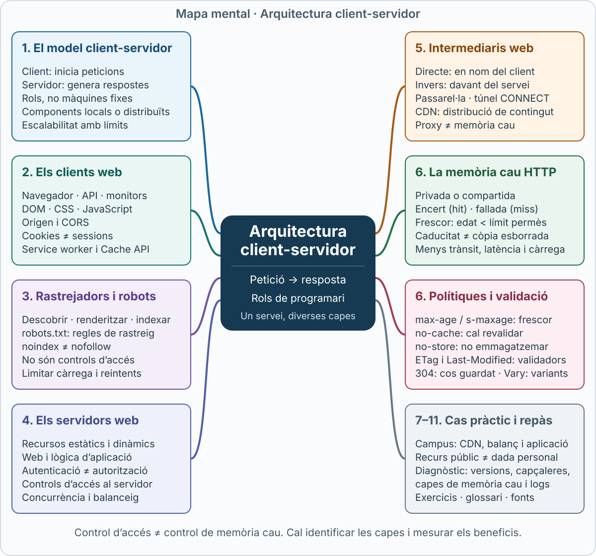
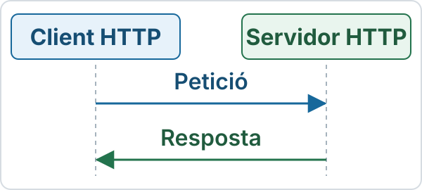
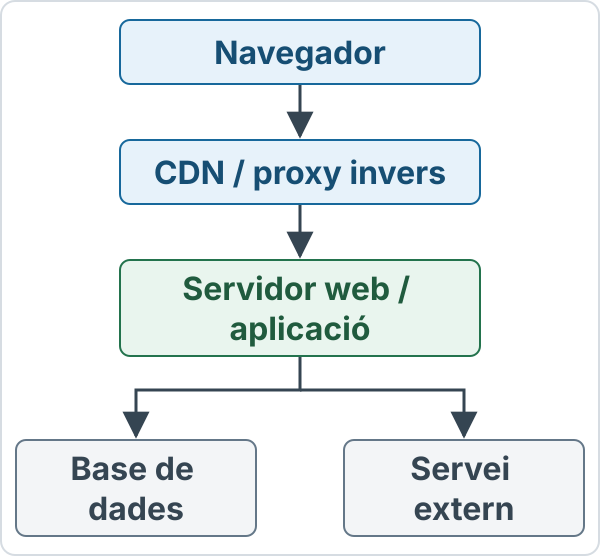
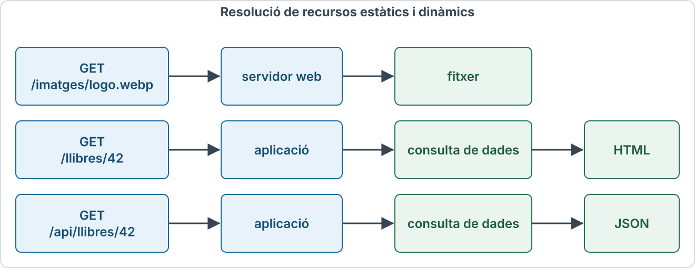
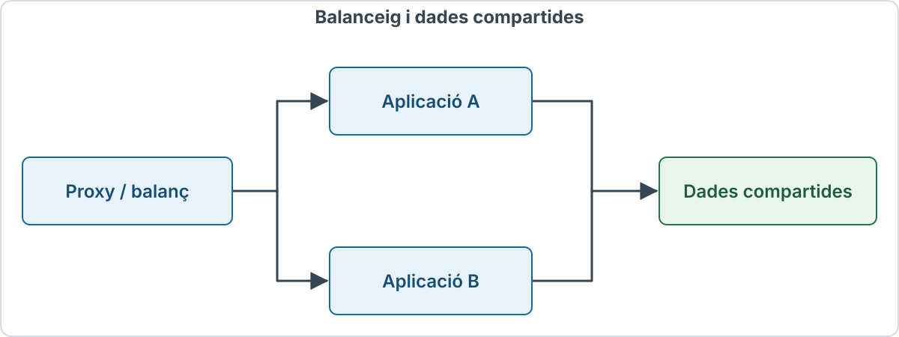
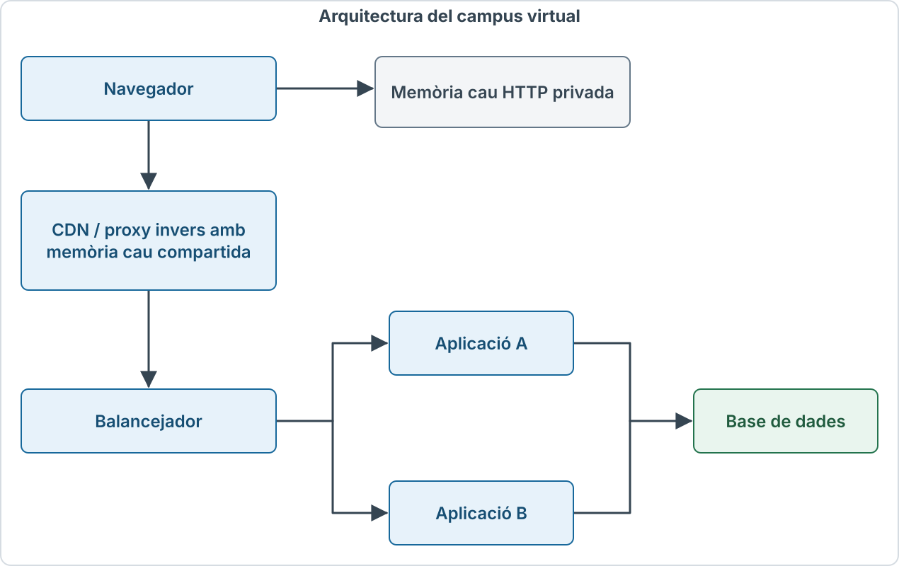

# Arquitectura Client-Servidor

## Mapa mental

[](../assets/images/arquitectura-client-servidor-mapa-mental.svg)

*Clica el mapa per obrir-lo a mida completa i ampliar-lo amb el zoom del navegador.*

## Objectius d’aprenentatge

En acabar aquest apartat has de poder:

- Explicar el model client-servidor i distingir un rol de programari d’una màquina física.
- Descriure les funcions d’un navegador i d’un client automatitzat.
- Diferenciar rastreig, renderització i indexació.
- Explicar com un servidor resol recursos estàtics i dinàmics.
- Distingir autenticació i autorització.
- Comparar proxy directe, proxy invers, passarel·la, túnel i CDN.
- Interpretar la frescor, la revalidació i les directives de memòria cau HTTP.
- Analitzar un recorregut complet de petició i resposta.

## 1. El model client-servidor

### 1.1. Els rols de client i servidor

Un **client HTTP** és un programa que inicia peticions. Un **servidor HTTP** és un programa que rep peticions i hi respon. Aquests noms descriuen rols dins d’una comunicació.

El navegador d’un ordinador pot ser client d’un servidor web. Alhora, el servidor web pot actuar com a client d’un altre servei. Una mateixa màquina pot executar diversos programes amb rols diferents.



El **servidor d’origen** és el programa que pot proporcionar respostes autoritatives per al recurs de destinació. Entre el client i aquest origen hi pot haver intermediaris.

Un servidor no és necessàriament un ordinador de grans prestacions. Pot executar-se en un portàtil, una màquina virtual, un contenidor o una infraestructura distribuïda.

Referència terminològica: [IETF, RFC 9110, §3](https://httpwg.org/specs/rfc9110.html#terminology).

### 1.2. Un model distribuït

En un servei real podem trobar:



Les fletxes indiquen interaccions; cada petició té la seva resposta. No totes aquestes comunicacions han d’utilitzar HTTP: l’aplicació pot parlar amb la base de dades mitjançant un protocol específic.

Les funcions es poden agrupar en un mateix procés o repartir entre màquines. El diagrama representa una possibilitat, no una estructura obligatòria.

### 1.3. Beneficis i límits

| Propietat | Què aporta la separació de rols? | Condició o límit |
|---|---|---|
| Interoperabilitat | Clients i servidors diferents poden comunicar-se | Han de respectar protocols i formats compatibles |
| Manteniment | Una part pot evolucionar sense redistribuir tot el client | Cal conservar els contractes de comunicació |
| Escalabilitat | Es poden repartir peticions entre instàncies | També cal dimensionar bases de dades i dependències |
| Flexibilitat | Diversos clients poden consumir un servei | La interfície no ha de dependre d’un únic navegador |
| Disponibilitat | Es pot introduir redundància | Els punts únics de fallada continuen sent un risc |
| Eficiència | La memòria cau pot evitar treball repetit | Cal decidir què es pot reutilitzar i durant quant temps |

Per exemple, duplicar les instàncies d’una aplicació no duplica necessàriament la capacitat si totes esperen una base de dades saturada.

Font de context: [MDN, Client-server overview](https://developer.mozilla.org/en-US/docs/Learn_web_development/Extensions/Server-side/First_steps/Client-Server_overview).

## 2. Els clients web

### 2.1. Tipus de clients

Un client web no ha de ser necessàriament un navegador amb interfície gràfica.

| Tipus | Qui inicia la feina? | Exemple d’ús |
|---|---|---|
| Navegador | Persona i lògica de la pàgina | Consultar un campus virtual |
| Rastrejador o crawler | Planificador automatitzat | Descobrir pàgines per a un cercador |
| Client d’API | Programa o aplicació | Consultar disponibilitat de productes |
| Eina de diagnòstic | Persona o procés tècnic | Inspeccionar una resposta HTTP |
| Monitor | Sistema automatitzat | Comprovar periòdicament un servei |
| Navegador automatitzat | Un programa de control | Verificar una interacció completa |

Un script executat al navegador pot iniciar peticions sense que cada una correspongui a un clic. També hi pot haver precàrregues o altres peticions automàtiques.

L’**agent d’usuari** és el client que inicia una interacció en nom d’un usuari, en el sentit ampli del protocol.

Fonts: [RFC 9110, agents d’usuari](https://httpwg.org/specs/rfc9110.html#user.agent) i [MDN, Overview of HTTP](https://developer.mozilla.org/en-US/docs/Web/HTTP/Guides/Overview).

### 2.2. Funcions del navegador

El navegador coordina tasques diferents:

1. Interpreta l’adreça i les referències dels recursos.
2. Gestiona comunicacions i peticions.
3. Aplica polítiques de seguretat i privadesa.
4. Interpreta HTML i construeix el DOM.
5. Processa CSS i calcula la presentació.
6. Executa JavaScript quan correspon.
7. Gestiona imatges, fonts, àudio i vídeo.
8. Manté cookies i diferents formes d’emmagatzematge.
9. Ofereix navegació, historial i eines d’interacció.

**DOM** significa *Document Object Model*: una representació estructurada del document que els programes poden consultar i modificar.

La pàgina visible no és una fotografia exacta de la resposta HTML inicial. JavaScript pot afegir contingut, CSS pot adaptar la disposició i el navegador pot presentar una versió accessible segons les necessitats de l’usuari.

Font: [MDN, How browsers work](https://developer.mozilla.org/en-US/docs/Web/Performance/Guides/How_browsers_work).

### 2.3. De la URL a la pàgina

Suposem que una persona obre:

```text
https://campus.example.org/materials/tema2
```

Un recorregut de xarxa possible és:

| Pas | Què passa? |
|---|---|
| 1. Interpretació | Es descompon la URL i es determina la destinació |
| 2. Reutilització local | Es comprova si hi ha una resposta reutilitzable o un mecanisme local que pugui respondre |
| 3. Resolució | Si cal, s’obtenen adreces de l’amfitrió mitjançant DNS |
| 4. Connexió | S’estableix o es reutilitza una connexió apropiada |
| 5. Protecció | En HTTPS, la comunicació incorpora TLS |
| 6. Petició i resposta | El client envia la petició i rep el resultat HTTP |
| 7. Processament | Es processa el contingut i es poden sol·licitar més recursos |
| 8. Presentació | Es construeix i actualitza allò que veu l’usuari |

No s’ha d’interpretar com vuit operacions noves i estrictament separades per a cada fitxer. Hi ha reutilització, paral·lelisme i treball que se solapa.

En HTTP/1.1 i HTTP/2 s’utilitza habitualment TCP; HTTP/3 funciona sobre QUIC, basat en UDP i amb TLS 1.3 integrat. La connexió no s’ha de tornar a crear per cada recurs.

Fonts: [MDN, How browsers work](https://developer.mozilla.org/en-US/docs/Web/Performance/Guides/How_browsers_work) i [MDN, Evolution of HTTP](https://developer.mozilla.org/en-US/docs/Web/HTTP/Guides/Evolution_of_HTTP).

### 2.4. Tipus de contingut i seguretat

El camp HTTP `Content-Type` ajuda a determinar el tractament de la resposta. El navegador no s’ha de guiar només per l’extensió del camí.

| Tipus de contingut | Tractament habitual |
|---|---|
| `text/html` | Interpretar un document HTML |
| `text/css` | Processar un full d’estil |
| `application/json` | Exposar dades estructurades a qui les ha demanat |
| `image/webp` | Descodificar una imatge |
| `video/mp4` | Reproduir vídeo si el format i els còdecs són compatibles |

L’**origen** d’una URL HTTP(S) es defineix amb esquema, amfitrió i port. Dos camins del mateix origen no són dos orígens diferents.

Les polítiques del navegador poden limitar l’accés de JavaScript a respostes d’un altre origen. **CORS** permet que un servidor declari determinats accessos entre orígens; no substitueix l’autenticació ni impedeix que altres clients HTTP intentin fer peticions.

Referències: [MDN, Content-Type](https://developer.mozilla.org/en-US/docs/Web/HTTP/Reference/Headers/Content-Type), [MDN, CORS](https://developer.mozilla.org/en-US/docs/Web/HTTP/Guides/CORS) i [WHATWG, Fetch Standard](https://fetch.spec.whatwg.org/).

### 2.5. Cookies i sessions

Una **cookie** és una dada que el servidor pot demanar al navegador que desi i que aquest pot enviar en peticions posteriors compatibles amb el seu abast i les polítiques aplicables.

Exemple de capçalera de resposta:

```http
Set-Cookie: __Host-sessio=identificador-opac; Path=/; Secure; HttpOnly; SameSite=Lax
```

- `Secure`: restringeix l’enviament a connexions segures, amb les excepcions d’entorn que defineixen els navegadors.
- `HttpOnly`: impedeix l’accés a la cookie des d’API JavaScript com `document.cookie`.
- `SameSite=Lax`: limita l’enviament en determinats contextos entre llocs.
- `Path=/`: estableix l’abast de camí.
- El prefix `__Host-` exigeix, en navegadors que l’apliquen, `Secure`, `Path=/` i absència de `Domain`.

El valor d’exemple no és una credencial real. En una sessió, l’identificador pot referenciar dades mantingudes al servidor. **Cookie i sessió no són sinònims**: també hi ha cookies de preferències i altres mecanismes de sessió.

Font: [MDN, Using HTTP cookies](https://developer.mozilla.org/en-US/docs/Web/HTTP/Guides/Cookies).

### 2.6. Service workers i emmagatzematge local

Un **service worker** és un programa associat a un origen i a un abast que pot interceptar determinades peticions de les pàgines que controla. Permet, entre altres funcions, oferir respostes locals i estratègies de funcionament sense connexió. Requereix un context segur, amb les excepcions locals previstes per al desenvolupament.

La **Cache API** permet emmagatzemar parelles de petició i resposta. És diferent de la memòria cau HTTP automàtica: l’aplicació decideix quan afegir, recuperar o eliminar entrades. La Cache API no aplica automàticament les directives HTTP de caducitat.

Per això una resposta antiga pot provenir de diverses capes, no només d’un proxy. En diagnosticar un problema cal identificar quina capa ha respost.

Referències: [MDN, Service Worker API](https://developer.mozilla.org/en-US/docs/Web/API/Service_Worker_API), [MDN, Cache API](https://developer.mozilla.org/en-US/docs/Web/API/Cache) i [W3C, especificació de Service Workers](https://w3c.github.io/ServiceWorker/).

## 3. Clients automatitzats: rastrejadors i robots

### 3.1. Rastreig, renderització i indexació

Un **rastrejador** descobreix i recupera recursos de manera automatitzada. Pot obtenir adreces d’enllaços, mapes del lloc o altres fonts.

Cal separar tres processos:

| Procés | Què fa? |
|---|---|
| Rastreig | Descobrir URL i recuperar-ne recursos |
| Renderització | Processar contingut i, si el sistema ho permet, executar JavaScript |
| Indexació | Analitzar informació i incorporar-la a un índex de cerca |

Un recurs **dinàmic** pot ser indexable. El fet que un servidor utilitzi PHP, Java, Python o qualsevol altre llenguatge no impedeix que retorni HTML accessible.

Google documenta que el seu sistema pot processar JavaScript, però això no vol dir que qualsevol robot executi tot el codi d’un navegador, ni que tot contingut recuperat s’indexi.

Referència específica sobre aquest cercador: [Google Search Central, JavaScript SEO basics](https://developers.google.com/search/docs/crawling-indexing/javascript/javascript-seo-basics).

### 3.2. robots.txt: regles de rastreig

El **Robots Exclusion Protocol**, especificat a l’**RFC 9309**, permet publicar regles per als rastrejadors cooperatius.

Exemple de fitxer a `https://example.org/robots.txt`:

```text
User-agent: *
Disallow: /administracio/
Disallow: /cerca-interna/
Allow: /administracio/ajuda-publica/
```

`User-agent: *` defineix un grup general. Les regles indiquen camins que el rastrejador hauria de respectar; quan coincideixen regles aplicables, la més específica té prioritat segons el protocol.

**robots.txt no és un control d’accés.** Un programa que ignori les regles pot intentar consultar els camins. Un recurs privat necessita controls reals al servidor.

Referència: [IETF, RFC 9309, Robots Exclusion Protocol](https://www.rfc-editor.org/rfc/rfc9309.html).

### 3.3. noindex i nofollow

Per demanar que una pàgina HTML no s’incorpori a l’índex, es pot utilitzar:

```html
<meta name="robots" content="noindex">
```

Per a recursos que no són HTML, també existeix la capçalera:

```http
X-Robots-Tag: noindex
```

El robot ha de poder recuperar la resposta per veure aquesta instrucció. Si el mateix recurs està bloquejat a `robots.txt`, pot no arribar a llegir el `noindex`. Google adverteix que una URL bloquejada per al rastreig encara pot aparèixer als resultats a partir d’informació d’altres llocs.

`nofollow` afecta el seguiment dels enllaços segons les regles del cercador. No equival a `noindex`, no protegeix la pàgina i no garanteix que la destinació no es descobreixi per altres vies.

Fonts: [Google, robots.txt](https://developers.google.com/search/docs/crawling-indexing/robots/intro), [Google, noindex](https://developers.google.com/search/docs/crawling-indexing/block-indexing) i [Google, robots meta tags](https://developers.google.com/search/docs/crawling-indexing/robots-meta-tag). Aquests detalls descriuen el comportament documentat de Google; altres robots poden tenir capacitats i polítiques diferents.

### 3.4. Càrrega i comportament dels robots

La freqüència de peticions s’ha d’ajustar a la capacitat del servei. Un robot ben dissenyat limita concurrència, evita bucles de descobriment i reintenta amb pauses quan hi ha errors temporals.

`Retry-After` pot indicar quant cal esperar:

```http
HTTP/1.1 503 Service Unavailable
Retry-After: 120
Content-Length: 0

```

Aquest missatge complet d’HTTP/1.1 indica una indisponibilitat temporal i una espera de 120 segons. No existeix una velocitat universal adequada per a tots els robots i servidors.

Referència: [MDN, Retry-After](https://developer.mozilla.org/en-US/docs/Web/HTTP/Reference/Headers/Retry-After).

## 4. Els servidors web

### 4.1. Què fa un servidor?

Un servidor rep una petició, determina com tractar-la i construeix o obté la resposta.

Un recorregut possible inclou:

1. Acceptar una comunicació nova o reutilitzar-ne una d’existent.
2. Interpretar el mètode, la destinació i les capçaleres.
3. Seleccionar el lloc virtual o la ruta.
4. Validar dades i aplicar controls d’accés.
5. Llegir un recurs, executar lògica o consultar serveis.
6. Construir l’estat, les capçaleres i el contingut de resposta.
7. Enviar la resposta i registrar informació operativa.

Una resposta també pot ser una redirecció, un error o una confirmació sense cos. El servidor no ha de buscar sempre un fitxer físic amb el mateix nom que el camí.

Font: [MDN, Client-server overview](https://developer.mozilla.org/en-US/docs/Learn_web_development/Extensions/Server-side/First_steps/Client-Server_overview).

### 4.2. Recursos estàtics i dinàmics

| Aspecte | Estàtic | Dinàmic |
|---|---|---|
| Obtenció habitual | Llegir contingut ja preparat | Executar lògica per generar o seleccionar contingut |
| Exemple | Imatge del logotip | Resultats d’una cerca |
| Dependències | Sistema de fitxers o emmagatzematge d’objectes | Aplicació, dades i altres serveis |
| Memòria cau | Sovint senzilla si es versiona el recurs | Possible si la política i la personalització ho permeten |
| Extensió visible | No determina per si sola el tractament | No cal una extensió de llenguatge |

El contingut estàtic pot canviar quan es publica una versió nova. El contingut dinàmic no ha de ser sempre diferent: dues peticions poden produir el mateix resultat i aquest resultat pot ser reutilitzable.

### 4.3. Servidor web i servidor d’aplicacions

Un **servidor web** pot servir fitxers, gestionar TLS i reenviar peticions. Un **servidor d’aplicacions** executa la lògica que resol operacions del servei. Les funcions es poden integrar.

Exemple conceptual:

[](../assets/images/resolucio-recursos-web.svg)

CGI és una interfície que permet al servidor executar programes externs i utilitzar-ne la sortida. FastCGI permet treballar amb processos persistents. Altres desplegaments utilitzen aplicacions persistents accessibles per HTTP o altres interfícies.

El llenguatge del servidor no s’identifica necessàriament per l’extensió de la URL. Ni `.html` garanteix absència de generació dinàmica, ni un camí sense extensió implica que sigui estàtic.

Referències: [Apache, contingut dinàmic amb CGI](https://httpd.apache.org/docs/2.4/howto/cgi.html) i [NGINX, contingut estàtic, proxy i FastCGI](https://nginx.org/en/docs/beginners_guide.html).

### 4.4. Autenticació i autorització

| Concepte | Pregunta | Exemple |
|---|---|---|
| Autenticació | Qui ets o quina identitat acredites? | Validar una sessió o una credencial |
| Autorització | Quina operació pots fer? | Permetre editar només els materials assignats |

Una persona pot estar autenticada i no tenir permís per modificar un recurs. El control s’ha d’aplicar al servidor: amagar un botó al navegador no impedeix enviar una petició manual.

En autenticació HTTP, `401` indica que cal una autenticació vàlida i s’associa al repte corresponent; `403` expressa una negativa a satisfer la petició. Les aplicacions també poden oferir fluxos amb formularis i sessions. No tots els inicis de sessió són autenticació HTTP Basic.

Font: [MDN, HTTP authentication](https://developer.mozilla.org/en-US/docs/Web/HTTP/Guides/Authentication).

### 4.5. Concurrència i desplegaments distribuïts

Atendre diverses peticions no exigeix un fil per connexió. Es poden utilitzar processos, fils, bucles d’esdeveniments i combinacions d’aquests models.

NGINX documenta un model basat en esdeveniments amb processos de treball. Apache disposa, entre altres opcions, del mòdul de multiprocessament `event`. Per tant, la concurrència depèn de la implementació i la configuració.

Un **balancejador de càrrega** distribueix peticions entre instàncies. Pot aplicar torns, pesos o criteris basats en connexions, segons el producte.

[](../assets/images/balanceig-dades-compartides.svg)

Si les sessions només viuen a la memòria d’A, una petició posterior dirigida a B pot perdre el context. Cal decidir com compartir-lo o com encaminar les peticions. L’afinitat de sessió ajuda en alguns dissenys, però no substitueix una estratègia de disponibilitat de les dades.

Fonts: [NGINX, model de processos](https://nginx.org/en/docs/beginners_guide.html), [Apache, event MPM](https://httpd.apache.org/docs/2.4/mod/event.html) i [NGINX, balanceig HTTP](https://nginx.org/en/docs/http/load_balancing.html).

## 5. Intermediaris web

### 5.1. Proxy directe, proxy invers, passarel·la i túnel

| Component | Perspectiva principal | Funció |
|---|---|---|
| Proxy directe (*forward proxy*) | Costat del client | Fer peticions en nom de clients cap a destinacions diverses |
| Proxy invers (*reverse proxy*) | Costat del servei | Rebre peticions al punt públic i reenviar-les a servidors interns |
| Passarel·la (*gateway*) | Interfície cap a un altre sistema | Actuar com a servidor davant del client i adaptar la comunicació posterior |
| Túnel | Transport entre extrems | Reenviar dades sense actuar com a intèrpret HTTP de les dades transportades |
| Memòria cau | Reutilització | Conservar respostes per satisfer peticions posteriors compatibles |

En la terminologia HTTP de l’RFC 9110, una passarel·la també es coneix com a proxy invers. En usos d’arquitectura, «API gateway» pot afegir encaminament, autenticació o transformacions. El nom no implica una única implementació.

Un proxy pot actuar com a servidor respecte al client i com a client respecte al servei següent. **Ser intermediari no obliga a fer memòria cau.**

Fonts: [RFC 9110, intermediaris](https://httpwg.org/specs/rfc9110.html#intermediaries) i [MDN, Proxy servers and tunneling](https://developer.mozilla.org/en-US/docs/Web/HTTP/Guides/Proxy_servers_and_tunneling).

### 5.2. Funcions d’un proxy invers

Un proxy invers pot:

- Encaminar peticions segons domini o camí.
- Repartir càrrega entre instàncies.
- Terminar TLS i, si es configura, protegir també el tram posterior.
- Servir recursos estàtics o respostes de memòria cau.
- Aplicar límits i controls.
- Registrar informació operativa.

Per exemple, `/imatges/` pot anar a un servidor de fitxers i `/api/` a una aplicació. El navegador continua utilitzant el punt públic del servei.

Referències: [MDN, proxies](https://developer.mozilla.org/en-US/docs/Web/HTTP/Guides/Proxy_servers_and_tunneling) i [NGINX, balanceig de càrrega](https://nginx.org/en/docs/http/load_balancing.html).

### 5.3. HTTPS a través d’un túnel

En HTTP/1.1, un client pot demanar a un proxy directe que estableixi un túnel:

```http
CONNECT example.org:443 HTTP/1.1
Host: example.org:443

```

Una resposta satisfactòria pot ser:

```http
HTTP/1.1 200 Connection Established

```

A partir d’aquí, el client pot negociar TLS amb la destinació a través del túnel. En un túnel HTTPS sense intercepció TLS, el proxy no llegeix el contingut HTTP xifrat.

Un sistema amb intercepció TLS és una situació diferent: termina i recrea connexions TLS amb les condicions de confiança corresponents.

Referència: [MDN, mètode CONNECT](https://developer.mozilla.org/en-US/docs/Web/HTTP/Reference/Methods/CONNECT).

### 5.4. Proxy i privadesa

Utilitzar un proxy **no garanteix anonimat**. Encara poden existir cookies, comptes, registres i altres identificadors. El proxy coneix almenys part de la comunicació i pot registrar-la.

Una capçalera com `Forwarded` pot transmetre informació del client original:

```http
Forwarded: for=192.0.2.10;proto=https;host=example.org
```

L’adreça és il·lustrativa. El servidor només hauria de confiar en aquestes dades quan provenen d’intermediaris coneguts i configurats per establir-les correctament. Un client pot enviar capçaleres falses.

Referència: [MDN, Forwarded](https://developer.mozilla.org/en-US/docs/Web/HTTP/Reference/Headers/Forwarded).

### 5.5. CDN: distribució del contingut

Una **CDN** (*Content Delivery Network*) distribueix punts de servei en diverses ubicacions. Pot respondre des d’un punt pròxim al client i reduir viatges fins a l’origen.

Una CDN pot combinar encaminament, memòria cau i altres funcions. No tot el contingut ha de quedar emmagatzemat als nodes: una resposta personalitzada pot necessitar arribar a l’aplicació.

Apropar una còpia als usuaris pot reduir latència, però la millora depèn de la ubicació, la connectivitat, l’encert de memòria cau i el cost de generar el contingut.

Font: [MDN, CDN](https://developer.mozilla.org/en-US/docs/Glossary/CDN).

## 6. La memòria cau HTTP

### 6.1. Què conserva una memòria cau?

Una **memòria cau HTTP** conserva respostes i metadades per reutilitzar-les en peticions posteriors compatibles.

| Tipus | Qui la utilitza? | Ubicació habitual |
|---|---|---|
| Privada | Un usuari o client | Navegador |
| Compartida | Diversos usuaris | Proxy, proxy invers o CDN |

No s’ha de confondre una memòria cau HTTP amb una memòria cau de consultes de base de dades, amb la Cache API o amb l’historial del navegador.

Una resposta emmagatzemada no sempre es pot reutilitzar immediatament. Cal comprovar que correspon a la petició i que les directives en permeten l’ús.

Referència: [IETF, RFC 9111, HTTP Caching](https://httpwg.org/specs/rfc9111.html).

### 6.2. Encert, fallada, frescor i revalidació

| Terme | Significat |
|---|---|
| Encert (*hit*) | Hi ha una resposta emmagatzemada aplicable; convé indicar si s’ha pogut reutilitzar directament |
| Fallada (*miss*) | No hi ha una resposta emmagatzemada aplicable |
| Resposta fresca (*fresh*) | L’edat és inferior al temps de frescor permès |
| Resposta caducada (*stale*) | Ja no és fresca segons la política |
| Revalidació | Consultar si una representació emmagatzemada continua sent vàlida |

«Fresca» no garanteix que el contingut sigui idèntic al que l’origen generaria en aquell instant. Vol dir que la política permet reutilitzar-lo dins d’un interval.

«Caducada» no vol dir «esborrada» ni «necessàriament incorrecta». La còpia pot continuar al disc i servir després d’una revalidació o sota una excepció permesa.

Fonts: [MDN, HTTP caching](https://developer.mozilla.org/en-US/docs/Web/HTTP/Guides/Caching) i [MDN, Cache-Control](https://developer.mozilla.org/en-US/docs/Web/HTTP/Reference/Headers/Cache-Control).

### 6.3. Un recorregut de decisió

[](../assets/images/decisio-memoria-cau.svg)

És un esquema didàctic: hi pot haver altres estats, errors i regles de reutilització de contingut caducat.

Una petició condicional segueix utilitzant la xarxa. Una resposta `304` pot estalviar la transferència del cos, però no elimina el viatge de revalidació.

### 6.4. Cache-Control: directives principals

La taula següent descriu directives **en una resposta**. Algunes també existeixen en peticions amb un abast propi.

| Directiva | Efecte |
|---|---|
| `max-age=N` | Estableix N segons de frescor |
| `s-maxage=N` | Estableix frescor per a memòries cau compartides i preval sobre `max-age` en aquest àmbit |
| `private` | Impedeix l’emmagatzematge en memòries cau compartides; pot permetre el privat |
| `public` | Autoritza explícitament l’emmagatzematge, subjecte a les altres regles aplicables |
| `no-cache` | Permet emmagatzemar, però exigeix validació abans de reutilitzar |
| `no-store` | Prohibeix emmagatzemar la resposta a les memòries cau HTTP |
| `must-revalidate` | Quan la resposta caduca, exigeix validar-la abans de reutilitzar-la |

**no-cache i no-store no són sinònims.** Tampoc `private` significa «xifrat» ni constitueix un control d’accés.

No s’ha de reiniciar el comptador de frescor quan una resposta passa d’una memòria cau a una altra. Cal tenir en compte l’edat acumulada.

Font: [MDN, Cache-Control](https://developer.mozilla.org/en-US/docs/Web/HTTP/Reference/Headers/Cache-Control).

### 6.5. Edat i exemple temporal

`Age` indica una estimació, en segons, del temps transcorregut des que la resposta es va generar o es va validar a l’origen, segons el càlcul de memòria cau.

Suposem que un client rep:

```http
Cache-Control: max-age=600
Age: 120
```

Per simplificar, considerem negligibles el retard de xarxa i els desajustos dels rellotges.

| Instant | Edat simplificada | Situació |
|---|---:|---|
| En rebre-la | 120 s | Fresca; resten aproximadament 480 s |
| 180 s després | 300 s | Fresca; resten aproximadament 300 s |
| 480 s després | 600 s | Ja no és fresca |

La frescor compara l’edat amb el límit; no compta 600 segons nous a partir de cada recepció.

L’absència d’`Age` no demostra que no hi hagi cap reutilització local. `Expires` pot expressar una caducitat absoluta, mentre que `Date` ajuda al càlcul temporal. Si hi ha `max-age`, aquest preval sobre `Expires`; sense política explícita, algunes respostes poden tenir frescor heurística.

Referències: [MDN, Age](https://developer.mozilla.org/en-US/docs/Web/HTTP/Reference/Headers/Age) i [RFC 9111, càlcul de frescor i edat](https://httpwg.org/specs/rfc9111.html#calculating.freshness.lifetime).

### 6.6. Validadors: ETag i Last-Modified

Un **validador** permet comparar la representació guardada amb la seleccionada actualment pel servidor.

| Validador | Exemple | Petició condicional habitual |
|---|---|---|
| `ETag` | `"tema2-v3"` | `If-None-Match: "tema2-v3"` |
| `Last-Modified` | `Mon, 12 Oct 2026 09:00:00 GMT` | `If-Modified-Since: Mon, 12 Oct 2026 09:00:00 GMT` |

Una **ETag** és una etiqueta opaca: no cal que sigui un hash ni una data. El client no n’ha de deduir l’estructura interna.

- Una ETag forta, com `"v3"`, acredita identitat de la representació sota les regles de validació forta.
- Una ETag feble, com `W/"v3"`, permet una equivalència semàntica menys estricta.
- `If-None-Match` utilitza comparació feble, adequada per a revalidacions de GET.

La distinció entre validador fort i feble no és una classificació general de «consistència forta o feble» de tota la memòria cau.

Fonts: [MDN, ETag](https://developer.mozilla.org/en-US/docs/Web/HTTP/Reference/Headers/ETag), [MDN, Last-Modified](https://developer.mozilla.org/en-US/docs/Web/HTTP/Reference/Headers/Last-Modified) i [MDN, If-None-Match](https://developer.mozilla.org/en-US/docs/Web/HTTP/Reference/Headers/If-None-Match).

### 6.7. Exemple de revalidació

Primera resposta: es mostren només l’estat i les capçaleres rellevants; el cos HTML s’omet.

```http
HTTP/1.1 200 OK
Date: Mon, 12 Oct 2026 10:00:00 GMT
Content-Type: text/html; charset=utf-8
Cache-Control: no-cache
ETag: "tema2-v3"
```

En una petició posterior, el client pot enviar:

```http
GET /materials/tema2 HTTP/1.1
Host: campus.example.org
If-None-Match: "tema2-v3"

```

Si la representació no ha canviat, el servidor pot respondre:

```http
HTTP/1.1 304 Not Modified
Date: Mon, 12 Oct 2026 10:05:00 GMT
Cache-Control: no-cache
ETag: "tema2-v3"

```

`304` **no conté el cos de la representació**. El client actualitza les metadades pertinents i utilitza el cos que ja tenia.

Si ha canviat, una resposta `200` pot incloure el contingut nou i una ETag nova. Si també s’envia `If-Modified-Since`, `If-None-Match` té prioritat en aquesta avaluació.

Font: [MDN, If-None-Match](https://developer.mozilla.org/en-US/docs/Web/HTTP/Reference/Headers/If-None-Match).

### 6.8. La clau de memòria cau i Vary

No n’hi ha prou amb dir que totes les respostes de la mateixa URL són intercanviables. La identificació d’una entrada considera el mètode, la destinació i, segons `Vary`, camps de la petició.

Exemple:

```http
Vary: Accept-Language
```

Si el servidor selecciona una representació segons `Accept-Language`, la memòria cau ha de tenir en compte aquest camp. La versió en català no s’ha de reutilitzar indiscriminadament per a una petició amb una selecció de llengua diferent.

`Vary: Accept-Encoding` és habitual quan es negocien codificacions de contingut. Un nombre elevat de variants pot reduir els encerts.

**Vary no és un substitut de private ni de l’autorització.** La personalització i les regles de compartició s’han de dissenyar explícitament.

Font: [MDN, Vary](https://developer.mozilla.org/en-US/docs/Web/HTTP/Reference/Headers/Vary).

### 6.9. Polítiques segons el tipus de resposta

Aquests exemples són decisions il·lustratives que s’han d’ajustar al servei.

| Recurs | Exemple de política | Raó |
|---|---|---|
| CSS amb hash al nom | `public, max-age=31536000, immutable` | Una publicació nova utilitza una URL nova |
| HTML públic que cal validar | `no-cache` | Permet conservar el cos i consultar si ha canviat |
| HTML personalitzat que es pot desar localment | `private, no-cache` | Evita compartició i obliga a validar abans de reutilitzar |
| Resposta que no s’ha d’emmagatzemar | `no-store` | Prohibeix conservar-la a la memòria cau HTTP |
| Dades públiques amb frescor diferenciada | `public, max-age=60, s-maxage=300` | Un minut al navegador i cinc en memòria cau compartida |

`immutable` indica que la representació no canviarà durant la seva frescor. Només té sentit amb una estratègia coherent, com un nom versionat:

```text
/assets/app.8f31c2.css
```

Canviar el contingut mantenint aquesta URL pot deixar còpies antigues als clients. Cal publicar una URL nova quan canvia el recurs.

Referències: [RFC 8246, immutable](https://www.rfc-editor.org/rfc/rfc8246.html) i [MDN, HTTP caching](https://developer.mozilla.org/en-US/docs/Web/HTTP/Guides/Caching).

### 6.10. Personalització i altres precaucions de correcció

La presència de `Set-Cookie` **no prohibeix per si sola** l’emmagatzematge d’una resposta segons la semàntica HTTP. Tampoc s’ha de suposar que qualsevol resposta a una petició amb cookies queda automàticament exclosa d’una memòria cau compartida.

Les peticions amb `Authorization` tenen restriccions específiques de reutilització compartida, amb excepcions explícites. El servei ha d’emetre una política adequada.

A més:

- `no-store` no esborra retroactivament totes les còpies que ja existien.
- La Cache API requereix gestió explícita de l’aplicació.
- La restauració de l’historial, inclosa la *back/forward cache*, pot recuperar una vista sense equivaldre a una nova petició HTTP.
- Una memòria cau pot conservar còpies fresques després d’un canvi a l’origen fins que la política n’exigeixi validació.

Referències: [RFC 9111, reutilització i consideracions de seguretat](https://httpwg.org/specs/rfc9111.html), [MDN, HTTP caching](https://developer.mozilla.org/en-US/docs/Web/HTTP/Guides/Caching) i [MDN, Cache API](https://developer.mozilla.org/en-US/docs/Web/API/Cache).

### 6.11. Ús controlat de respostes caducades

Algunes extensions permeten un ús limitat de contingut caducat:

| Directiva | Possibilitat |
|---|---|
| `stale-while-revalidate=N` | Servir contingut caducat durant una finestra mentre es revalida en segon pla |
| `stale-if-error=N` | Utilitzar contingut caducat dins del límit indicat davant de determinats errors |

Exemple:

```http
Cache-Control: max-age=300, stale-while-revalidate=30
```

La resposta pot ser fresca durant 300 segons i, després, reutilitzar-se sota aquesta extensió durant una finestra addicional de 30 segons mentre es valida.

No significa que una memòria cau faci una consulta exactament en complir-se el segon 300: la revalidació pot ser desencadenada per una petició. Aquestes directives no s’han de combinar a cegues amb altres regles que prohibeixen servir contingut caducat.

Referència: [RFC 5861, extensions per a contingut caducat](https://www.rfc-editor.org/rfc/rfc5861.html), document de categoria informativa de la sèrie RFC.

### 6.12. Beneficis i límits quantitatius

La memòria cau pot reduir:

- **Latència:** temps d’espera fins a rebre la resposta.
- **Trànsit:** bytes transferits pels trams evitats.
- **Càrrega d’origen:** peticions i treball que no arriben al servidor inicial.

No existeix un percentatge universal de millora. Cal mesurar la proporció d’encerts, la mida dels recursos i el cost de les fallades.

**Exemple numèric propi.** Suposem 1.000 consultes d’un recurs de 100 kB, sense comptar capçaleres ni revalidacions:

| Escenari | Descàrregues des de l’origen | Dades des de l’origen |
|---|---:|---:|
| Sense reutilització | 1.000 | 100.000 kB = 100 MB |
| 80% d’encerts que eviten l’origen | 200 | 20.000 kB = 20 MB |

Amb unitats decimals, l’estalvi d’aquest tram és del 80%. No és necessàriament el mateix estalvi al tram final entre CDN i usuari.

Si un encert tarda 20 ms i una fallada 200 ms, una mitjana simplificada és:

```text
0,80 × 20 + 0,20 × 200 = 56 ms
```

Aquest càlcul no prediu el temps de càrrega d’una pàgina completa: una pàgina pot combinar recursos, dependències i execució de codi.

## 7. Exemple integrat: un campus virtual

### 7.1. Arquitectura

[](../assets/images/campus-virtual-arquitectura.svg)

És un disseny d’estudi. Una instal·lació petita podria agrupar diverses funcions.

### 7.2. Petició d’un recurs públic

La persona demana `/assets/campus.a31f.css`.

1. Si el navegador té una còpia fresca i reutilitzable, la fa servir.
2. Si no, envia la petició al servei.
3. Una còpia compartida aplicable pot evitar arribar a l’aplicació.
4. En cas de fallada, es consulta el següent servidor.
5. La resposta pot quedar emmagatzemada segons la seva política.

La URL versionada permet mantenir una frescor llarga sense confondre publicacions diferents.

### 7.3. Petició d’informació personal

La persona demana `/expedient`.

1. El navegador envia les credencials de sessió aplicables.
2. L’aplicació comprova la identitat i els permisos.
3. Recupera només les dades autoritzades.
4. Retorna la resposta amb una política de memòria cau adequada, per exemple `no-store` si el servei decideix que no se n’han de conservar còpies HTTP.
5. El proxy no ha de reutilitzar aquesta resposta per a una altra persona.

El control de memòria cau i el control d’accés resolen problemes diferents i tots dos són necessaris.

### 7.4. Diagnòstic d’una resposta antiga

Si una persona veu contingut antic, cal identificar:

| Comprovació | Què pot aclarir? |
|---|---|
| URL i versió del recurs | Si la pàgina continua referenciant una publicació anterior |
| `Cache-Control`, `Age` i validadors | Si la política permet reutilització i si hi ha revalidació |
| Origen de la resposta a les eines del navegador | Si s’ha recuperat localment o des de la xarxa |
| Service worker i Cache API | Si l’aplicació gestiona una còpia pròpia |
| Logs del proxy i de l’aplicació | Si la petició ha arribat als components esperats |
| Selecció de variants | Si la clau de memòria cau correspon a llengua, format o altres camps |

Aquest exemple aplica els mecanismes explicats als apartats anteriors; no hi ha una única causa per a tot contingut antic.

## 8. Criteris que cal retenir el 2026

| Qüestió | Criteri correcte |
|---|---|
| Client i servidor | Són rols de programari, no categories fixes de màquines |
| Clients web | Inclouen navegadors, robots, API i altres programes |
| Connexions | Es poden reutilitzar; HTTP/3 no utilitza TCP com a transport |
| Navegació | Una pàgina pot requerir moltes peticions i actualitzacions posteriors |
| Robots | Rastrejar, renderitzar i indexar són processos diferents |
| Contingut dinàmic | Pot ser indexable |
| robots.txt | Regula robots cooperatius; no autentica ni protegeix dades |
| Servidors | Poden combinar processos, fils i esdeveniments |
| Proxy | Pot reenviar sense fer memòria cau; no garanteix anonimat |
| Passarel·la | En terminologia HTTP, també s’anomena proxy invers |
| Frescor | És un permís temporal de reutilització, no una garantia de sincronització instantània |
| `no-cache` | Permet emmagatzemar i exigeix validar abans de reutilitzar |
| `no-store` | Prohibeix emmagatzemar a la memòria cau HTTP |
| `304` | Permet reutilitzar el cos guardat i no inclou el cos de la representació |
| Beneficis | Depenen de les càrregues i s’han de mesurar |

La taula recapitula les explicacions i referències dels apartats anteriors.

## 9. Exercicis d’autoavaluació amb solució

### Exercici 1. Identificar els rols

Un navegador parla amb un proxy invers que consulta una aplicació. Quin rol fa el proxy?

**Solució:** actua com a servidor davant del navegador i com a client davant de l’aplicació. No cal que emmagatzemi respostes.

### Exercici 2. Rastreig i indexació

S’ha bloquejat `/materials/` a `robots.txt`. Això garanteix que les adreces no apareguin en un cercador?

**Solució:** no. El bloqueig de rastreig no equival a exclusió de l’índex. El cercador pot descobrir URL per altres fonts. Perquè un robot llegeixi `noindex`, ha de poder recuperar la resposta; per protegir informació cal autorització real.

### Exercici 3. Cookies i seguretat

Amagar al navegador el botó «Edita» és suficient per impedir modificacions?

**Solució:** no. El servidor ha de comprovar els permisos quan rep la petició de modificació. La interfície no substitueix l’autorització.

### Exercici 4. no-cache o no-store

Es vol conservar el cos d’un document i consultar si ha canviat abans de reutilitzar-lo. Quina directiva s’hi ajusta?

**Solució:** `no-cache`, acompanyada de validadors si es vol aprofitar la revalidació condicional. `no-store` impediria l’emmagatzematge HTTP.

### Exercici 5. Frescor privada i compartida

Una resposta té `max-age=60, s-maxage=300` i edat de 90 segons. És fresca?

**Solució:** per a la memòria cau privada, ja no: 90 ≥ 60. Per a la compartida, sí: 90 < 300. Li resten aproximadament 210 segons de frescor compartida, assumint que no hi ha altres restriccions.

### Exercici 6. Revalidació i transferència

Un client envia `If-None-Match: "v7"` i rep `304 Not Modified`. Ha de descarregar de nou el cos?

**Solució:** no. Utilitza la representació que ja tenia i actualitza les metadades pertinents. Sí que hi ha hagut un intercanvi de xarxa.

### Exercici 7. Variants

Una URL retorna HTML en català o anglès segons `Accept-Language`. Quina capçalera ajuda a separar variants?

**Solució:** `Vary: Accept-Language`. Això no resol per si sol la personalització per usuari.

### Exercici 8. Mesurar l’estalvi

Hi ha 500 consultes d’un recurs de 200 kB. El 70% es resol sense consultar l’origen. Quants bytes de cos es demanen a l’origen?

**Solució:** el 30% de 500 són 150 consultes. 150 × 200 kB = 30.000 kB = 30 MB decimals. Sense memòria cau serien 100 MB; l’estalvi d’aquest tram és del 70%, sota les simplificacions de l’exercici.

## 10. Glossari

| Terme | Definició |
|---|---|
| Agent d’usuari | Client que inicia interaccions en nom d’un usuari |
| Aplicació web | Programari que ofereix operacions a través de tecnologies web |
| Autenticació | Comprovació d’una identitat o credencial |
| Autorització | Decisió sobre les operacions permeses |
| Balanceig de càrrega | Distribució de peticions entre instàncies |
| Cache API | API d’emmagatzematge de peticions i respostes gestionada per l’aplicació |
| CDN | Xarxa distribuïda de punts de servei de contingut |
| Client | Programa que inicia peticions en una comunicació |
| Concurrència | Gestió de diverses tasques amb execució que se solapa |
| Cookie | Dada que el navegador desa i pot enviar segons el seu abast |
| CORS | Mecanisme de control d’accés entre orígens aplicat pels navegadors |
| DOM | Representació del document com una estructura d’objectes |
| ETag | Validador opac associat a una representació |
| Frescor | Estat que permet reutilitzar temporalment una resposta segons la política |
| Gateway | Passarel·la; en terminologia HTTP, també proxy invers |
| Hit | Encert de memòria cau, amb necessitat de precisar si hi ha reutilització directa |
| Indexació | Incorporació de contingut analitzat a un índex |
| Instància | Execució concreta d’un component de programari |
| Last-Modified | Data de modificació utilitzable com a validador temporal |
| Memòria cau compartida | Memòria cau utilitzada per diversos usuaris |
| Memòria cau privada | Memòria cau destinada a un únic usuari o client |
| Miss | Absència d’una resposta emmagatzemada aplicable |
| Origen web | Combinació d’esquema, amfitrió i port en URL HTTP(S) |
| Passarel·la | Intermediari que presenta una interfície de servidor cap a un altre sistema |
| Petició condicional | Petició que aplica condicions com la coincidència d’un validador |
| Proxy directe | Intermediari que actua en nom de clients davant de destinacions diverses |
| Proxy invers | Intermediari que representa un servei davant dels clients |
| QUIC | Transport d’HTTP/3 basat en UDP i amb seguretat integrada |
| Rastrejador | Client automatitzat que descobreix i recupera recursos |
| Renderització | Processament de contingut per construir una representació presentada |
| Revalidació | Comprovació de validesa d’una representació emmagatzemada |
| robots.txt | Fitxer de regles de rastreig per a robots cooperatius |
| Servidor | Programa que rep peticions i genera respostes |
| Servidor d’origen | Servidor que proporciona respostes autoritatives per al recurs |
| Service worker | Programa que pot controlar determinades peticions dins del seu abast |
| Sessió | Context d’interacció mantingut per l’aplicació |
| Stale | Estat d’una resposta que ha superat la frescor permesa |
| TLS | Protocol de protecció criptogràfica de comunicacions |
| Túnel | Intermediació que transporta dades entre extrems sense interpretar-ne el protocol intern |
| Vary | Camp de resposta que indica quins camps de petició intervenen en la selecció de variants |

## 11. Referències oficials i documentació tècnica

**Data de consulta: 12 d’octubre de 2026.** Les especificacions vives i la documentació de productes poden evolucionar. Un RFC pot tenir errates, actualitzacions o un estat normatiu diferent d’un altre.

### Protocol i memòria cau

- [IETF RFC 9110: HTTP Semantics](https://httpwg.org/specs/rfc9110.html). Terminologia, missatges, intermediaris i validadors.
- [IETF RFC 9111: HTTP Caching](https://httpwg.org/specs/rfc9111.html). Emmagatzematge i reutilització de respostes.
- [RFC 8246: HTTP Immutable Responses](https://www.rfc-editor.org/rfc/rfc8246.html). Extensió `immutable`.
- [RFC 5861: HTTP Cache-Control Extensions for Stale Content](https://www.rfc-editor.org/rfc/rfc5861.html). Document informatiu sobre les extensions per a contingut caducat.
- [WHATWG: Fetch Standard](https://fetch.spec.whatwg.org/). Obtenció de recursos i mecanismes web relacionats.
- [MDN: Overview of HTTP](https://developer.mozilla.org/en-US/docs/Web/HTTP/Guides/Overview).
- [MDN: Evolution of HTTP](https://developer.mozilla.org/en-US/docs/Web/HTTP/Guides/Evolution_of_HTTP).
- [MDN: HTTP caching](https://developer.mozilla.org/en-US/docs/Web/HTTP/Guides/Caching).
- [MDN: Cache-Control](https://developer.mozilla.org/en-US/docs/Web/HTTP/Reference/Headers/Cache-Control).
- [MDN: Age](https://developer.mozilla.org/en-US/docs/Web/HTTP/Reference/Headers/Age).
- [MDN: ETag](https://developer.mozilla.org/en-US/docs/Web/HTTP/Reference/Headers/ETag).
- [MDN: Last-Modified](https://developer.mozilla.org/en-US/docs/Web/HTTP/Reference/Headers/Last-Modified).
- [MDN: If-None-Match](https://developer.mozilla.org/en-US/docs/Web/HTTP/Reference/Headers/If-None-Match).
- [MDN: Vary](https://developer.mozilla.org/en-US/docs/Web/HTTP/Reference/Headers/Vary).
- [MDN: Content-Type](https://developer.mozilla.org/en-US/docs/Web/HTTP/Reference/Headers/Content-Type).
- [MDN: Retry-After](https://developer.mozilla.org/en-US/docs/Web/HTTP/Reference/Headers/Retry-After).

### Navegadors i seguretat

- [MDN: How browsers work](https://developer.mozilla.org/en-US/docs/Web/Performance/Guides/How_browsers_work).
- [MDN: Using HTTP cookies](https://developer.mozilla.org/en-US/docs/Web/HTTP/Guides/Cookies).
- [MDN: HTTP authentication](https://developer.mozilla.org/en-US/docs/Web/HTTP/Guides/Authentication).
- [MDN: CORS](https://developer.mozilla.org/en-US/docs/Web/HTTP/Guides/CORS).
- [W3C: Service Workers, especificació en desenvolupament](https://w3c.github.io/ServiceWorker/).
- [MDN: Service Worker API](https://developer.mozilla.org/en-US/docs/Web/API/Service_Worker_API).
- [MDN: Cache API](https://developer.mozilla.org/en-US/docs/Web/API/Cache).

### Robots i cercadors

- [IETF RFC 9309: Robots Exclusion Protocol](https://www.rfc-editor.org/rfc/rfc9309.html).
- [Google Search Central: introducció a robots.txt](https://developers.google.com/search/docs/crawling-indexing/robots/intro).
- [Google Search Central: noindex](https://developers.google.com/search/docs/crawling-indexing/block-indexing).
- [Google Search Central: robots meta tags i X-Robots-Tag](https://developers.google.com/search/docs/crawling-indexing/robots-meta-tag).
- [Google Search Central: JavaScript SEO basics](https://developers.google.com/search/docs/crawling-indexing/javascript/javascript-seo-basics).

### Servidors i intermediaris

- [MDN: Client-server overview](https://developer.mozilla.org/en-US/docs/Learn_web_development/Extensions/Server-side/First_steps/Client-Server_overview).
- [MDN: Proxy servers and tunneling](https://developer.mozilla.org/en-US/docs/Web/HTTP/Guides/Proxy_servers_and_tunneling).
- [MDN: CONNECT](https://developer.mozilla.org/en-US/docs/Web/HTTP/Reference/Methods/CONNECT).
- [MDN: Forwarded](https://developer.mozilla.org/en-US/docs/Web/HTTP/Reference/Headers/Forwarded).
- [MDN: CDN](https://developer.mozilla.org/en-US/docs/Glossary/CDN).
- [NGINX: Beginner’s Guide](https://nginx.org/en/docs/beginners_guide.html).
- [NGINX: HTTP load balancing](https://nginx.org/en/docs/http/load_balancing.html).
- [Apache HTTP Server: event MPM](https://httpd.apache.org/docs/2.4/mod/event.html).
- [Apache HTTP Server: contingut dinàmic amb CGI](https://httpd.apache.org/docs/2.4/howto/cgi.html).

Les especificacions IETF, WHATWG i W3C defineixen el marc pertinent. MDN ofereix explicacions d’ús. La documentació de Google, NGINX i Apache descriu sistemes concrets i no s’ha d’extrapolar automàticament a totes les implementacions.


