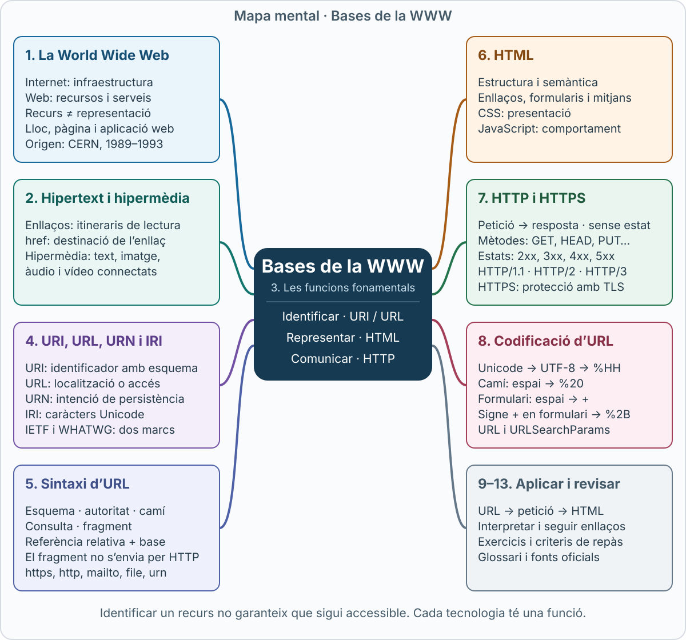
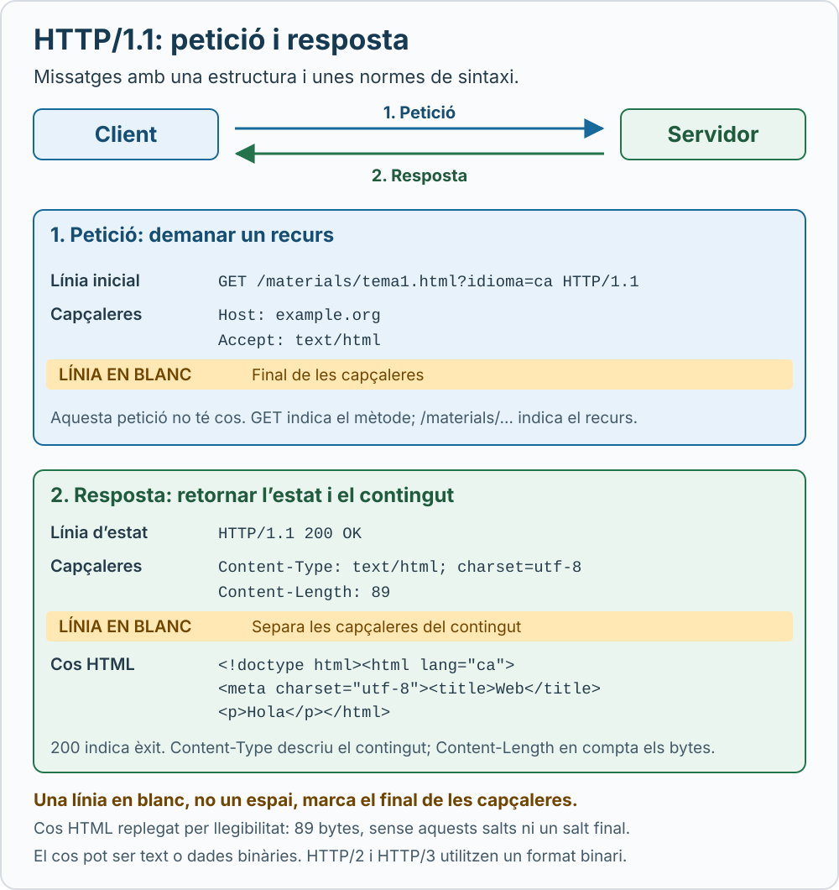

# Bases de la WWW

## Mapa mental

[](../assets/images/bases-www-mapa-mental.svg)

*Clica el mapa per obrir-lo a mida completa i ampliar-lo amb el zoom del navegador.*

## Objectius d’aprenentatge

En acabar aquest apartat has de poder:

- Distingir Internet, la World Wide Web, un lloc web i una pàgina web.
- Explicar hipertext i hipermèdia amb exemples.
- Relacionar identificació de recursos, representacions i intercanvi de missatges.
- Diferenciar URI, URL i URN sense confondre identificació amb disponibilitat.
- Interpretar els components d’una URL i resoldre referències relatives.
- Explicar les funcions d’HTML i HTTP en una navegació.
- Aplicar correctament percent-encoding, UTF-8 i `application/x-www-form-urlencoded`.

## 1. La World Wide Web

### 1.1. Què és la Web?

La **World Wide Web**, abreujada **WWW** o **Web**, és un sistema de recursos relacionats mitjançant enllaços. Permet consultar informació i interactuar amb serveis a través d’agents, com ara navegadors i altres programes.

**Internet** és la infraestructura de xarxes interconnectades que transporta dades. La **Web** és un dels sistemes que hi funcionen. El correu electrònic, per exemple, també utilitza Internet, però no es converteix en Web pel fet d’utilitzar aquesta infraestructura.

| Concepte | Significat | Exemple |
|---|---|---|
| Internet | Infraestructura de comunicació entre xarxes | Xarxa que connecta un ordinador amb un servidor remot |
| Web | Sistema de recursos identificables i interrelacionats | Portal d’una biblioteca i els recursos que ofereix |
| Lloc web | Conjunt coherent de pàgines i serveis | Catàleg, informació i formularis d’una biblioteca |
| Pàgina web | Document que el navegador presenta, sovint combinant diversos recursos | Fitxa d’un llibre amb text, imatge i enllaços |
| Aplicació web | Servei amb interacció i operacions | Cercar un llibre i reservar-lo |
| Navegador | Programa que interpreta i presenta contingut web | Firefox, Chrome, Safari o Edge |

La Web també pot existir en una intranet. Una pàgina accessible únicament dins d’una organització continua utilitzant tecnologies web.

Un **recurs** és allò que s’identifica: un document, una imatge, una col·lecció de dades o un servei. La **representació** és la forma concreta de dades que se n’obté: HTML, JSON, una imatge, etc. La fitxa d’un llibre pot tenir una representació HTML per a persones i una representació JSON per a programes.

Font conceptual: [W3C, Architecture of the World Wide Web](https://www.w3.org/TR/webarch/).

### 1.2. Origen i desenvolupament

Tim Berners-Lee va presentar al CERN una proposta de gestió d’informació el març de 1989. El 1990 es van desenvolupar el primer navegador/editor i el primer servidor del projecte. El 1991 el projecte es va difondre fora del seu entorn inicial. El 1993 el CERN va permetre l’ús lliure de la tecnologia.

La proposta combinava identificadors, enllaços i mecanismes de comunicació per compartir informació entre sistemes diferents. L’hipertext ja tenia antecedents: la Web el va portar a un entorn distribuït d’abast mundial.

Font històrica: [W3C, A Little History of the World Wide Web](https://www.w3.org/History.html).

## 2. Hipertext i hipermèdia

### 2.1. Hipertext

L’**hipertext** organitza informació mitjançant enllaços que permeten seguir diferents itineraris de lectura. No exigeix llegir el contingut en un únic ordre.

Un hiperenllaç relaciona un punt d’origen amb una destinació. Pot portar a una altra pàgina, a un altre lloc web, a un fitxer o a una secció del document actual.

Exemple HTML:

```html
<p>
  Consulta la
  <a href="https://developer.mozilla.org/en-US/docs/Web/HTML">
    guia d’HTML de MDN
  </a>.
</p>
```

L’atribut `href` indica la destinació. El text visible descriu l’enllaç. És preferible escriure «guia d’HTML» que «fes clic aquí», perquè expressa millor què hi trobarà el lector.

Font: [MDN, Hypertext](https://developer.mozilla.org/en-US/docs/Glossary/Hypertext).

### 2.2. Hipermèdia

La **hipermèdia** amplia la idea d’hipertext a diversos mitjans: text, imatge, àudio, vídeo i altres continguts relacionats.

Un material sobre astronomia pot combinar una explicació escrita, una imatge interactiva, una animació i enllaços a observacions. El component hipertextual és la xarxa de relacions; el component multimèdia és la diversitat de mitjans.

| Concepte | Element principal | Exemple didàctic |
|---|---|---|
| Text lineal | Ordre de lectura establert | Capítol que es llegeix de principi a fi |
| Hipertext | Navegació entre nodes d’informació | Glossari amb enllaços a les definicions |
| Multimèdia | Combinació de mitjans | Explicació amb vídeo i àudio |
| Hipermèdia | Mitjans diversos connectats per relacions navegables | Mapa amb fitxes, fotografies i vídeos enllaçats |

Exemple de mitjans i enllaços en HTML:

```html
<figure>
  
  <figcaption>
    La Lluna.
    <a href="/astronomia/lluna">Consulta’n la fitxa completa</a>.
  </figcaption>
</figure>

<video controls>
  <source src="/videos/orbita.mp4" type="video/mp4">
  <track kind="captions" src="/videos/orbita-ca.vtt"
         srclang="ca" label="Català" default>
  <a href="/videos/orbita.mp4">Descarrega el vídeo de l’òrbita</a>.
</video>
```

Aquests fragments són exemples independents: els recursos amb camins locals són il·lustratius. HTML ofereix elements per integrar mitjans, mentre que els enllaços connecten les explicacions i els recursos. Referència: [MDN, HTML](https://developer.mozilla.org/en-US/docs/Web/HTML).

## 3. Tres funcions fonamentals: identificar, representar i comunicar

La Web es pot estudiar relacionant tres preguntes:

| Pregunta | Tecnologia fonamental | Funció |
|---|---|---|
| Quin recurs volem? | URI / URL | Identificar-lo |
| Com n’expressarem el contingut? | HTML i altres formats | Representar-lo |
| Com hi interactuem a la xarxa? | HTTP | Intercanviar peticions i respostes |

Per exemple, en una biblioteca:

1. `https://biblioteca.example.org/llibres/42` identifica la fitxa.
2. Una petició HTTP demana una representació d’aquesta fitxa.
3. La resposta pot contenir HTML.
4. El navegador interpreta l’HTML i demana, si cal, imatges o altres recursos.
5. Un enllaç permet passar a una altra fitxa.

La URL no és el contingut; l’HTML no és el protocol; HTTP no és exclusiu dels documents HTML. Una API pot retornar JSON i una petició pot recuperar una imatge.

La distinció entre recurs, representació i interacció forma part de l’[arquitectura de la Web del W3C](https://www.w3.org/TR/webarch/). El funcionament pràctic de les peticions i respostes es descriu a [MDN, Overview of HTTP](https://developer.mozilla.org/en-US/docs/Web/HTTP/Guides/Overview).

## 4. URI, URL, URN i IRI

### 4.1. URI: identificador uniforme de recurs

Un **URI** (*Uniform Resource Identifier*) és un identificador que segueix una sintaxi comuna. El marc general de l’IETF es defineix a l’**RFC 3986**.

Identificar no implica poder descarregar el recurs, ni que el recurs sigui públic. Tampoc significa que cada recurs només pugui tenir un identificador.

Exemples:

```text
https://example.org/articles/42
mailto:docencia@example.org
urn:isbn:9780131103627
```

### 4.2. URL: identificació associada a una localització o accés

En la terminologia de l’RFC 3986, una **URL** (*Uniform Resource Locator*) és un URI que, a més d’identificar, proporciona un mitjà per localitzar el recurs descrivint-ne el mecanisme principal d’accés.

`https://example.org/articles/42` indica un esquema HTTPS, un amfitrió i un camí. No revela necessàriament el fitxer físic, la base de dades ni la màquina que acaba generant la resposta.

No convé memoritzar URI, URL i URN com tres categories completament separades i excloents: un identificador pot tenir propietats de nom i de localitzador. Referència: [IETF, RFC 3986, §1.1.3](https://www.rfc-editor.org/rfc/rfc3986.html#section-1.1.3).

### 4.3. URN: nom persistent independent de la localització

Un **URN** (*Uniform Resource Name*) utilitza l’esquema `urn:` i un espai de noms gestionat amb intenció de persistència i independència de la localització.

```text
urn:isbn:9780131103627
```

En aquest exemple, `isbn` és l’identificador de l’espai de noms; la resta és el nom dins d’aquest espai. No és l’adreça d’una llibreria ni un enllaç directe a una descàrrega.

Un URN no garanteix que existeixi un servei públic que el resolgui. La persistència també depèn de les regles d’assignació i de la gestió de l’espai de noms. No és una tecnologia experimental: l’**RFC 8141**, de 2017, en defineix l’especificació actual i substitueix l’RFC 2141.

Referència: [IETF, RFC 8141](https://www.rfc-editor.org/rfc/rfc8141.html).

### 4.4. Dues perspectives complementàries: IETF i WHATWG

L’IETF aporta la sintaxi general d’URI. Per al comportament real dels navegadors, la referència és el **URL Standard de WHATWG**, que defineix algoritmes d’anàlisi i serialització i les API `URL` i `URLSearchParams`.

WHATWG utilitza el terme **URL** amb un abast més ampli que la classificació tradicional i concreta com es tracten entrades que els navegadors accepten o normalitzen. Que un navegador accepti una cadena no demostra que compleixi estrictament la sintaxi de l’RFC 3986.

Per tant:

- En estudiar l’arquitectura i la sintaxi genèrica, cal conèixer **URI**.
- En programar URL al navegador, cal aplicar **WHATWG** i les API web.

Referència: [WHATWG, URL Standard, objectius](https://url.spec.whatwg.org/#goals).

### 4.5. IRI i caràcters internacionals

Un **IRI** (*Internationalized Resource Identifier*) amplia els identificadors a caràcters Unicode, com descriu l’RFC 3987. La sintaxi genèrica d’URI de l’RFC 3986 es basa en un repertori ASCII.

A la pràctica web, podem escriure o veure adreces amb caràcters internacionals. Cal distingir aquesta forma llegible de la forma serialitzada que produeix una API.

Els dominis internacionals utilitzen mecanismes IDNA; no s’han de tractar simplement com un camí amb percent-encoding. En camins i consultes, els caràcters no ASCII es representen habitualment amb bytes UTF-8 i percent-encoding.

Referències: [IETF, RFC 3987](https://www.rfc-editor.org/rfc/rfc3987.html) i [WHATWG, tractament dels amfitrions](https://url.spec.whatwg.org/#hosts-domains-and-ip-addresses).

## 5. Sintaxi d’URI i URL

### 5.1. Estructura general

L’estructura genèrica es pot representar així:

```text
scheme ":" hier-part [ "?" query ] [ "#" fragment ]
```

Els claudàtors indiquen parts opcionals i no s’escriuen literalment.

En la sintaxi de l’RFC 3986, un URI inclou un esquema. Una **referència relativa**, com `../imatges/logo.svg`, no té esquema propi i necessita una base per obtenir la destinació. Cal distingir el component obligatori d’un URI de les parts que es poden ometre en una referència relativa.

Una forma freqüent amb autoritat és:

```text
esquema://autoritat/camí?consulta#fragment
```

No tots els esquemes utilitzen `//` ni tenen un servidor. Per exemple, `mailto:docencia@example.org` no segueix l’estructura d’una URL HTTPS. Referències: [RFC 3986, §3](https://www.rfc-editor.org/rfc/rfc3986.html#section-3) i [MDN, URI reference](https://developer.mozilla.org/en-US/docs/Web/URI/Reference).

### 5.2. Descomposició d’una URL HTTPS

```text
https://campus.example.org:8443/materials/tema1.html?idioma=ca&vista=estudi#glossari
```

| Component | Valor | Interpretació |
|---|---|---|
| Esquema | `https` | Accés HTTP protegit amb TLS |
| Autoritat | `campus.example.org:8443` | Amfitrió i port explícit |
| Amfitrió (*host*) | `campus.example.org` | Nom que participa en l’adreçament del servei |
| Port | `8443` | Port especificat per aquest exemple |
| Camí (*path*) | `/materials/tema1.html` | Identificació jeràrquica dins de l’autoritat |
| Consulta (*query*) | `idioma=ca&vista=estudi` | Dades que interpreta l’aplicació |
| Fragment | `glossari` | Referència a una part de la representació |

Els delimitadors `?` i `#` introdueixen components, però no formen part del seu valor en la terminologia genèrica. Algunes API sí que els inclouen en propietats com `search` i `hash`.

Referència: [MDN, What is a URL?](https://developer.mozilla.org/en-US/docs/Learn_web_development/Howto/Web_mechanics/What_is_a_URL).

### 5.3. Autoritat, amfitrió i port

La sintaxi genèrica de l’autoritat és:

```text
[ userinfo "@" ] host [ ":" port ]
```

Una informació d’usuari, quan l’esquema la permet, pot tenir la forma `usuari:contrasenya`; el separador no és un punt i coma. En URL HTTP(S) modernes s’ha d’evitar incorporar credencials a l’adreça, i no s’ha de confondre aquesta sintaxi amb un sistema general d’inici de sessió.

Un amfitrió pot ser un domini o una adreça IP. En el cas d’IPv6, els claudàtors delimiten l’adreça:

```text
https://[2001:db8::1]:8443/
```

Els ports per defecte són **80 per a HTTP** i **443 per a HTTPS**. Quan s’utilitza el port per defecte no cal escriure’l.

Referències: [MDN, URI authority](https://developer.mozilla.org/en-US/docs/Web/URI/Reference/Authority) i [RFC 9110, esquemes HTTP i HTTPS](https://httpwg.org/specs/rfc9110.html#http.uri).

### 5.4. Camí

El camí pot contenir segments separats per `/`:

```text
/cursos/web/introduccio
```

Això no obliga a tenir tres carpetes físiques. Una aplicació pot interpretar el camí com una ruta i generar la resposta a partir d’una base de dades.

L’extensió `.html` no és obligatòria. Tampoc permet deduir amb certesa el format retornat: en HTTP, `Content-Type` informa del tipus de contingut.

El punt i coma `;` pot aparèixer en un segment de camí i algunes aplicacions l’utilitzen per a paràmetres. **No és un component genèric addicional** que totes les URL hagin de tenir.

Referència: [MDN, URI path](https://developer.mozilla.org/en-US/docs/Web/URI/Reference/Path).

### 5.5. Consulta

Una consulta pot seguir la convenció de parelles nom-valor:

```text
?categoria=web&idioma=ca
```

En aquesta convenció, `&` separa parelles i `=` separa nom i valor. Però la sintaxi general d’URI no obliga a representar totes les consultes així: el significat depèn del servei.

No s’ha d’assumir que reordenar paràmetres o eliminar-ne duplicats mantindrà el resultat. Per exemple, `?tema=html&tema=http` pot representar una selecció múltiple.

Referència: [MDN, URI query](https://developer.mozilla.org/en-US/docs/Web/URI/Reference/Query).

### 5.6. Fragment

En una pàgina HTML, `#glossari` pot dirigir a l’element:

```html
<h2 id="glossari">Glossari</h2>
```

El fragment **no s’envia al servidor com a part de la destinació de la petició HTTP**. El client l’interpreta després, segons el tipus de representació o la lògica de l’aplicació.

Canviar només el fragment no exigeix una nova petició HTTP al recurs. Ara bé, JavaScript pot reaccionar al canvi i iniciar peticions addicionals.

Referència: [MDN, URI fragment](https://developer.mozilla.org/en-US/docs/Web/URI/Reference/Fragment).

### 5.7. Referències absolutes i relatives

Una referència relativa necessita una URL base. Amb aquesta base:

```text
https://example.org/cursos/web/introduccio.html
```

| Referència | Resultat |
|---|---|
| `https://example.net/ajuda` | `https://example.net/ajuda` |
| `exemples.html` | `https://example.org/cursos/web/exemples.html` |
| `../index.html` | `https://example.org/cursos/index.html` |
| `/contacte` | `https://example.org/contacte` |
| `?idioma=ca` | `https://example.org/cursos/web/introduccio.html?idioma=ca` |
| `#resum` | `https://example.org/cursos/web/introduccio.html#resum` |

La barra final importa: `https://example.org/cursos/web/` és una base diferent de `https://example.org/cursos/web`. En el segon cas, la resolució de `exemples.html` substitueix l’últim segment `web`.

Referència i eina de comprovació: [MDN, API URL](https://developer.mozilla.org/en-US/docs/Web/API/URL).

### 5.8. Esquemes habituals i esquema file

| Esquema | Funció | Exemple |
|---|---|---|
| `https` | HTTP protegit amb TLS | `https://example.org/` |
| `http` | HTTP sense protecció TLS pròpia | `http://example.org/` |
| `mailto` | Identificar una destinació de correu | `mailto:docencia@example.org` |
| `file` | Identificar un fitxer en un sistema de fitxers | `file:///home/anna/apunts.html` |
| `urn` | Nom dins d’un espai de noms URN | `urn:isbn:9780131103627` |

L’esquema no és sempre el nom d’un protocol de transferència. Activar un enllaç `mailto:` pot obrir un gestor de correu; no equival a descarregar una pàgina. Vegeu [MDN, URI schemes](https://developer.mozilla.org/en-US/docs/Web/URI/Reference/Schemes).

L’**RFC 8089** especifica l’esquema `file`. Exemples:

```text
file:///home/anna/apunts/tema1.html
file:///C:/Users/Anna/Documents/tema1.html
file:///C:/Users/Anna/Documents/apunts%20web.html
```

Les tres barres reflecteixen `file:`, el marcador d’autoritat `//`, una autoritat buida i un camí que comença amb `/`. Una ruta Windows amb barres inverses no és, per si mateixa, una URI `file` normalitzada.

Per a noms Unicode, l’RFC recomana UTF-8 abans del percent-encoding. Una adreça `file` no publica el fitxer a Internet ni garanteix que un altre ordinador el pugui obrir. L’accés a fitxers locals depèn de l’entorn i dels permisos.

Referència: [IETF, RFC 8089, The “file” URI Scheme](https://www.rfc-editor.org/rfc/rfc8089.html).

## 6. HTML: estructura i significat dels documents

**HTML** significa *HyperText Markup Language*: llenguatge de marques d’hipertext. Expressa estructura i significat amb elements com `h1`, `p`, `nav`, `main`, `a` i `form`.

| Tecnologia | Funció principal | Exemple |
|---|---|---|
| HTML | Contingut, estructura i semàntica | Títol, paràgraf, camp d’un formulari |
| CSS | Presentació | Colors, espaiat, disposició |
| JavaScript | Lògica i interacció programada | Actualitzar resultats d’una cerca |

HTML no està restringit a ASCII. Un document modern pot contenir català i altres llengües mitjançant Unicode, habitualment codificat en UTF-8. L’especificació actual és l’**HTML Living Standard de WHATWG**; «HTML5» és una denominació històrica molt estesa, però no identifica una última versió tancada i immutable.

El W3C i WHATWG van acordar el 2019 col·laborar sobre una única línia de desenvolupament d’HTML i DOM. Referències: [WHATWG, HTML Living Standard](https://html.spec.whatwg.org/multipage/) i [W3C, acord de col·laboració](https://www.w3.org/blog/2019/w3c-and-whatwg-to-work-together-to-advance-the-open-web-platform/).

Exemple mínim complet, que cal desar en UTF-8:

```html
<!doctype html>
<html lang="ca">
<head>
  <meta charset="utf-8">
  <meta name="viewport" content="width=device-width, initial-scale=1">
  <title>Introducció a la Web</title>
</head>
<body>
  <header>
    <h1>Introducció a la Web</h1>
  </header>

  <main>
    <p>La Web relaciona recursos mitjançant enllaços.</p>
    <p><a href="#glossari">Ves al glossari</a></p>

    <section aria-labelledby="glossari">
      <h2 id="glossari">Glossari</h2>
      <p>URL: identificador utilitzat per adreçar recursos.</p>
    </section>
  </main>
</body>
</html>
```

`lang="ca"` declara la llengua; `meta charset` declara la codificació, però no converteix automàticament un fitxer desat amb una altra codificació. La semàntica dels elements ajuda a interpretar i navegar el document.

Referència didàctica: [MDN, HTML](https://developer.mozilla.org/en-US/docs/Web/HTML).

## 7. HTTP: peticions i respostes

### 7.1. Funció i semàntica

**HTTP** significa *Hypertext Transfer Protocol*. És un protocol de la capa d’aplicació per interactuar amb recursos mitjançant peticions i respostes. L’**RFC 9110** defineix la semàntica compartida per les versions modernes.

Una petició combina un mètode, una destinació, camps de capçalera i, quan pertoca, contingut. La resposta inclou un codi d’estat, capçaleres i, segons el cas, contingut.

HTTP és **sense estat** en la seva semàntica de peticions: una connexió reutilitzada no constitueix per si sola una sessió d’usuari. Les aplicacions poden mantenir sessions amb cookies o altres mecanismes.

Referència: [IETF, RFC 9110, HTTP Semantics](https://httpwg.org/specs/rfc9110.html).

### 7.2. Exemple d’intercanvi

Per consultar:

```text
https://example.org/materials/tema1.html?idioma=ca#glossari
```

Podem representar un intercanvi HTTP/1.1 simplificat així:

[](../assets/images/http-peticio-resposta.svg)

*Clica el gràfic per obrir-lo a mida completa i ampliar-lo. La franja groga assenyala la línia en blanc; el text de la franja és una anotació, no forma part del missatge.*

```http
GET /materials/tema1.html?idioma=ca HTTP/1.1
Host: example.org
Accept: text/html

```

```http
HTTP/1.1 200 OK
Content-Type: text/html; charset=utf-8
Content-Length: 89

<!doctype html><html lang="ca"><meta charset="utf-8"><title>Web</title><p>Hola</p></html>
```

En aquest exemple, `Content-Length: 89` compta els bytes del cos mostrat, sense afegir-hi un salt de línia final. Les línies buides separen capçaleres i cos. En HTTPS, aquests missatges viatgen protegits amb TLS; el fragment `#glossari` queda al client.

`Content-Type` expressa el tipus de contingut. `charset=utf-8` indica com interpretar el text. No s’ha de confondre amb `Content-Encoding`, que pot indicar una compressió com gzip.

Aquest format textual és propi d’HTTP/1.1. HTTP/2 i HTTP/3 utilitzen representacions binàries dels missatges. Referències: [MDN, Overview of HTTP](https://developer.mozilla.org/en-US/docs/Web/HTTP/Guides/Overview) i [MDN, Content-Type](https://developer.mozilla.org/en-US/docs/Web/HTTP/Reference/Headers/Content-Type).

### 7.3. Mètodes i estats bàsics

| Mètode | Intenció |
|---|---|
| `GET` | Obtenir una representació |
| `HEAD` | Obtenir informació com amb GET, sense contingut de resposta |
| `POST` | Demanar que el recurs processi el contingut enviat |
| `PUT` | Crear o substituir l’estat del recurs de destinació |
| `DELETE` | Demanar l’eliminació de l’associació del recurs amb la funcionalitat actual |

**Segur** significa que el client no demana un canvi d’estat; no significa «xifrat». GET i HEAD són segurs. Això no impedeix efectes secundaris com registrar la petició als logs. **Idempotent** significa que repetir una petició idèntica té el mateix efecte intencionat que executar-la una vegada; no exigeix rebre respostes idèntiques. GET, HEAD, PUT i DELETE són idempotents; POST no ho és en general.

Referències: [RFC 9110, propietats dels mètodes](https://httpwg.org/specs/rfc9110.html#common.method.properties) i [MDN, HTTP request methods](https://developer.mozilla.org/en-US/docs/Web/HTTP/Reference/Methods).

| Estat | Significat habitual |
|---|---|
| `200 OK` | Petició satisfeta |
| `201 Created` | S’ha creat un recurs |
| `301 Moved Permanently` | Redirecció permanent |
| `304 Not Modified` | Una consulta condicional permet reutilitzar la representació emmagatzemada |
| `400 Bad Request` | Petició que el servidor no pot o no vol processar per un error atribuït al client |
| `401 Unauthorized` | Cal autenticació vàlida |
| `403 Forbidden` | El servidor refusa satisfer la petició |
| `404 Not Found` | El servidor no troba la representació o no vol revelar-ne l’existència |
| `500 Internal Server Error` | Error inesperat al servidor |

Font: [MDN, HTTP response status codes](https://developer.mozilla.org/en-US/docs/Web/HTTP/Reference/Status).

### 7.4. Versions i HTTPS

| Versió | Aspecte que cal retenir |
|---|---|
| HTTP/1.1 | Sintaxi textual de missatges i connexions persistents |
| HTTP/2 | Trames binàries i múltiples fluxos sobre una connexió TCP |
| HTTP/3 | HTTP sobre QUIC, que utilitza UDP i integra TLS 1.3 |

Les versions comparteixen conceptes com mètodes i estats. És incorrecte afirmar que HTTP sempre utilitza TCP.

HTTPS protegeix la comunicació en trànsit i permet autenticar el servidor mitjançant certificats. No certifica que totes les afirmacions o ofertes d’un lloc siguin fiables.

Referència: [MDN, Evolution of HTTP](https://developer.mozilla.org/en-US/docs/Web/HTTP/Guides/Evolution_of_HTTP).

## 8. Codificació d’URL: tres conceptes diferents

### 8.1. Primer, triar la capa adequada

| Mecanisme | Què transforma? | Exemple |
|---|---|---|
| UTF-8 | Caràcters Unicode en bytes | `é` → `C3 A9` |
| Percent-encoding | Un byte en una seqüència ASCII `%HH` | `C3 A9` → `%C3%A9` |
| `application/x-www-form-urlencoded` | Parelles nom-valor en una cadena amb regles pròpies | `q=web+moderna` |

UTF-8 i percent-encoding es poden aplicar consecutivament. La codificació de formularis utilitza percent-encoding, però afegeix convencions com representar l’espai amb `+`.

### 8.2. Percent-encoding

El **percent-encoding** representa un byte amb `%` seguit de dues xifres hexadecimals. `%20` representa el byte hexadecimal 20, corresponent a l’espai ASCII. `%2B` representa `+`; `%26`, `&`.

Els caràcters **no reservats** de l’RFC 3986 són:

```text
A-Z a-z 0-9 - . _ ~
```

Els reservats inclouen:

```text
: / ? # [ ] @ ! $ & ' ( ) * + , ; =
```

«Reservat» no significa «sempre s’ha de codificar». Si `/` separa segments del camí, cal conservar-lo. Si un caràcter ha de ser una dada que es podria confondre amb un delimitador, cal aplicar la codificació del component corresponent.

Referències: [RFC 3986, §2](https://www.rfc-editor.org/rfc/rfc3986.html#section-2) i [MDN, Percent-encoding](https://developer.mozilla.org/en-US/docs/Glossary/Percent-encoding).

Exemple propi: el valor de cerca `R+D & innovació` ha de continuar sent **un sol valor**. L’ampersand del text no pot quedar com un separador de paràmetres.

### 8.3. UTF-8 abans de percent-encoding

UTF-8 codifica un caràcter Unicode amb un o diversos bytes. Per tant, un caràcter visible pot originar diverses seqüències `%HH`.

| Caràcter | Punt de codi | Bytes UTF-8 | Percent-encoding dels bytes |
|---|---|---|---|
| `é` | U+00E9 | `C3 A9` | `%C3%A9` |
| `ñ` | U+00F1 | `C3 B1` | `%C3%B1` |
| `ú` | U+00FA | `C3 BA` | `%C3%BA` |
| `€` | U+20AC | `E2 82 AC` | `%E2%82%AC` |

Així, `%F1` no és la codificació UTF-8 de `ñ`; correspon al byte F1, utilitzat per aquest caràcter en altres codificacions. Percent-encoding no indica per si sol quina codificació de text s’ha utilitzat.

Font sobre el mecanisme: [MDN, UTF-8](https://developer.mozilla.org/en-US/docs/Glossary/UTF-8).

### 8.4. Espais: %20 i + no són una regla universal

En un camí, un espai es representa amb `%20`:

```text
https://example.org/apunts/tema%201.html
```

Aquest altre camí conté un signe més literal:

```text
https://example.org/apunts/tema+1.html
```

No s’ha d’assumir que designen el mateix recurs.

En canvi, en **application/x-www-form-urlencoded**:

- Un espai es serialitza com `+`.
- Un signe `+` literal es serialitza com `%2B`.
- `&` separa parelles; dins d’un valor es codifica com `%26`.
- `=` separa nom i valor; dins d’un valor es codifica com `%3D`.

Aquesta codificació s’utilitza en formularis i en les consultes que es processen amb aquestes convencions. No tota consulta té necessàriament aquest format.

Referència normativa: [WHATWG, application/x-www-form-urlencoded](https://url.spec.whatwg.org/#application/x-www-form-urlencoded).

### 8.5. Comparació amb dades concretes

La columna central mostra `encodeURIComponent`; l’última mostra la serialització d’un valor amb `URLSearchParams`.

| Dada original | `encodeURIComponent` | Valor en formulari |
|---|---|---|
| `web moderna` | `web%20moderna` | `web+moderna` |
| `C++` | `C%2B%2B` | `C%2B%2B` |
| `a&b` | `a%26b` | `a%26b` |
| `x=y` | `x%3Dy` | `x%3Dy` |
| `~*` | `~*` | `%7E*` |

La darrera fila mostra que no n’hi ha prou amb substituir `%20` per `+` per reproduir sempre tota la serialització d’un formulari. `encodeURIComponent` deixa sense codificar alguns caràcters que el format de formularis sí que codifica.

Referències: [MDN, encodeURIComponent](https://developer.mozilla.org/en-US/docs/Web/JavaScript/Reference/Global_Objects/encodeURIComponent) i [MDN, URLSearchParams](https://developer.mozilla.org/en-US/docs/Web/API/URLSearchParams).

Exemple amb accents:

```text
Text original:
Núñez & Cía.

Resultat d’encodeURIComponent:
N%C3%BA%C3%B1ez%20%26%20C%C3%ADa.

Parella q serialitzada amb URLSearchParams:
q=N%C3%BA%C3%B1ez+%26+C%C3%ADa.
```

La codificació s’aplica a les dades; els separadors estructurals es mantenen. No s’ha de percent-codificar una URL completa com si fos un únic component.

### 8.6. Formularis GET i POST

```html
<form action="https://example.org/cerca" method="get"
      accept-charset="UTF-8">
  <label for="q">Cerca</label>
  <input id="q" name="q" value="C++ i català">
  <button type="submit">Cerca</button>
</form>
```

Aquest exemple produeix una consulta de la forma:

```text
https://example.org/cerca?q=C%2B%2B+i+catal%C3%A0
```

Amb `method="post"` i `enctype="application/x-www-form-urlencoded"`, les parelles es poden enviar al cos de la petició:

```http
Content-Type: application/x-www-form-urlencoded

q=C%2B%2B+i+catal%C3%A0
```

GET i POST són mètodes HTTP; no són codificacions. Un POST també pot portar JSON o dades `multipart/form-data`, segons com es construeixi la petició. Els formularis que envien fitxers solen utilitzar `multipart/form-data`.

Font: [MDN, element form](https://developer.mozilla.org/en-US/docs/Web/HTML/Reference/Elements/form).

### 8.7. URL i URLSearchParams en JavaScript

És preferible construir consultes amb valors originals i deixar que l’API els serialitzi:

```javascript
const url = new URL("https://example.org/cerca");
url.searchParams.set("q", "C++ i català");
url.searchParams.set("categoria", "R+D & innovació");

console.log(url.href);
// https://example.org/cerca?q=C%2B%2B+i+catal%C3%A0&categoria=R%2BD+%26+innovaci%C3%B3
```

No cal aplicar `encodeURIComponent` als valors abans de passar-los a `set`. Fer-ho pot provocar doble codificació:

```javascript
const params = new URLSearchParams();
params.set("q", "caf%C3%A8");
console.log(params.toString());
// q=caf%25C3%25A8
```

Aquí s’ha passat un text que ja contenia signes `%`; l’API els tracta com a dades i els codifica com `%25`.

Cal diferenciar construir parelles de dades i analitzar una cadena:

```javascript
new URLSearchParams("q=C++").get("q");
// "C  " : cadascun dels dos signes + es descodifica com un espai

new URLSearchParams({ q: "C++" }).toString();
// "q=C%2B%2B"
```

Font: [MDN, URLSearchParams](https://developer.mozilla.org/en-US/docs/Web/API/URLSearchParams).

### 8.8. No confondre URL, HTML i descodificació

En un atribut HTML es poden escriure els separadors de consulta amb `&amp;`:

```html
<a href="https://example.org/cerca?q=web&amp;idioma=ca">
  Cerca material en català
</a>
```

`&amp;` és una referència de caràcter d’HTML que representa `&`. No és percent-encoding. En una cadena JavaScript que representa directament la URL s’utilitza `&`, no `&amp;`.

Tampoc s’ha de descodificar indiscriminadament tota l’adreça abans d’identificar-ne els components. Un `%26` que era una dada podria acabar tractat com un separador. De manera semblant, `/a%2Fb` no s’ha de considerar automàticament equivalent a `/a/b`: el tractament de la barra codificada depèn del servidor i de l’aplicació.

La normalització no consisteix a convertir-ho tot en minúscules: l’esquema i els dominis DNS no distingeixen majúscules, però el camí i la consulta poden distingir-les.

Referències: [WHATWG, sintaxi HTML](https://html.spec.whatwg.org/multipage/syntax.html) i [MDN, URI path](https://developer.mozilla.org/en-US/docs/Web/URI/Reference/Path).

## 9. Exemple integrat: d’un enllaç a una pàgina

Considerem:

```html
<a href="https://example.org/cerca?q=caf%C3%A8+de+comer%C3%A7+just#resultats">
  Cerca cafè de comerç just
</a>
```

1. **Interpretació de l’enllaç.** El navegador obté una URL HTTPS.
2. **Components.** L’amfitrió és `example.org`, el camí és `/cerca`, la consulta conté `q` i el fragment és `resultats`.
3. **Comunicació.** Si cal accedir a la xarxa, el navegador resol l’amfitrió i estableix o reutilitza una connexió adequada. La memòria cau pot evitar alguns intercanvis.
4. **Petició.** La destinació HTTP inclou el camí i la consulta, sense `#resultats`.
5. **Interpretació de dades.** Si el servei aplica les regles de formularis, el valor de `q` és `cafè de comerç just`.
6. **Resposta.** El servei retorna una representació, per exemple HTML amb els resultats.
7. **Presentació.** El navegador processa l’HTML, obté els recursos necessaris i pot situar la vista a l’element amb `id="resultats"`.

Aquest recorregut relaciona identificació, codificació, HTTP i HTML. No implica una connexió nova per cada recurs ni una única petició per pàgina.

Fonts de suport: [MDN, Overview of HTTP](https://developer.mozilla.org/en-US/docs/Web/HTTP/Guides/Overview) i [MDN, URI fragment](https://developer.mozilla.org/en-US/docs/Web/URI/Reference/Fragment).

## 10. Criteris que cal retenir el 2026

| Qüestió | Criteri correcte |
|---|---|
| Web i Internet | La Web utilitza la infraestructura d’Internet, però són conceptes diferents |
| HTML | Llenguatge de marques amb Unicode; especificació viva de WHATWG |
| URN | Esquema normalitzat; RFC 8141 com a referència |
| URI i URL | Conèixer el marc IETF i el tractament dels navegadors definit per WHATWG |
| Sintaxi | Un URI té esquema, però no sempre utilitza `//` ni identifica un servidor o fitxer; una referència relativa necessita una base |
| Camí | No revela necessàriament una ubicació física |
| Consulta | Les parelles nom-valor són una convenció, no una obligació de tota URI |
| Fragment | No forma part de la destinació enviada en una petició HTTP |
| Espai | `%20` en la codificació de components; `+` sota les regles de formularis |
| Accents | UTF-8 i, quan pertoqui, percent-encoding dels bytes |
| HTTP | Semàntica moderna definida a RFC 9110; HTTP/3 funciona sobre QUIC |
| HTTPS | Protegeix el transport; no garanteix la fiabilitat del contingut |

Aquests criteris recapitulen les explicacions i fonts dels apartats anteriors.

## 11. Exercicis d’autoavaluació amb solució

### Exercici 1. Separar components

Analitza:

```text
https://example.org:8443/apunts/tema%201.html?q=C%2B%2B#resum
```

**Solució:** esquema `https`; autoritat `example.org:8443`; amfitrió `example.org`; port `8443`; camí `/apunts/tema%201.html`; consulta `q=C%2B%2B`; fragment `resum`. Amb un analitzador de formularis, el valor de `q` és `C++`. El fragment no s’envia com a part de la destinació HTTP.

### Exercici 2. Resoldre una referència

Base: `https://example.org/materials/web/index.html`.
Referència: `../imatges/logo.svg`.

**Solució:** `https://example.org/materials/imatges/logo.svg`.

### Exercici 3. Codificar un valor de formulari

Construeix la parella `q` per al text `a+b & cafè`.

**Solució:** `q=a%2Bb+%26+caf%C3%A8`. El més literal és `%2B`; els espais són `+`; l’ampersand és `%26`; `è` es representa amb els bytes UTF-8 `C3 A8`.

### Exercici 4. Distingir dos camins

Són automàticament equivalents `/tema+1` i `/tema%201`?

**Solució:** no. El primer conté un més literal i el segon representa un espai. La regla que converteix `+` en espai pertany al format de formularis.

### Exercici 5. Identificació i accés

Què permet afirmar `urn:isbn:9780131103627`?

**Solució:** identifica un recurs dins de l’espai de noms ISBN. No proporciona per si sol una URL de descàrrega ni garanteix disponibilitat pública.

### Exercici 6. Separar formats

És HTML el protocol que envia una pàgina al navegador?

**Solució:** no. HTML és un llenguatge de marques. HTTP és el protocol de peticions i respostes; HTTPS hi afegeix protecció del transport.

## 12. Glossari

| Terme | Definició |
|---|---|
| Agent d’usuari | Programa que actua en nom d’un usuari, com un navegador |
| Amfitrió / host | Component que identifica un domini o una adreça IP en una autoritat |
| Autoritat | Component que pot incloure informació d’usuari, amfitrió i port |
| Byte / octet | Unitat de vuit bits sobre la qual s’aplica percent-encoding |
| Camí / path | Component jeràrquic format habitualment per segments |
| Capçalera HTTP | Camp amb informació sobre el missatge o la representació |
| Consulta / query | Component introduït per `?`, interpretat segons el servei |
| DOM | Model d’objectes que representa el document i permet manipular-lo |
| Esquema | Component inicial, com `https`, `file` o `urn`, que determina regles d’interpretació |
| Fragment | Component introduït per `#` que referencia una part o vista de la representació |
| Hiperenllaç | Connexió navegable entre un origen i una destinació |
| Hipermèdia | Organització de mitjans diversos mitjançant relacions navegables |
| Hipertext | Informació textual interconnectada mitjançant enllaços |
| HTML | Llenguatge de marques per estructurar documents web |
| HTTP | Protocol de peticions i respostes per interactuar amb recursos |
| HTTPS | Ús d’HTTP amb protecció TLS |
| IDNA | Mecanismes per tractar noms de domini internacionalitzats |
| Idempotència | Propietat d’una operació que manté el mateix efecte intencionat en repetir-la |
| IETF | Organització que desenvolupa estàndards d’Internet, inclosos els RFC citats |
| IRI | Identificador internacionalitzat que admet caràcters Unicode |
| Percent-encoding | Representació de bytes mitjançant seqüències `%HH` |
| Port | Número que participa en la identificació del punt d’accés a un servei |
| QUIC | Transport utilitzat per HTTP/3 sobre UDP, amb seguretat integrada |
| Recurs | Allò que s’identifica i amb què es pot relacionar una interacció |
| Referència relativa | Referència que necessita una base per obtenir la destinació |
| Representació | Dades que expressen un estat d’un recurs en un format concret |
| RFC | Document de la sèrie Request for Comments; el seu estat determina el paper normatiu |
| Serialització | Conversió d’una estructura de dades a una representació textual o binària |
| TLS | Protocol de protecció criptogràfica de comunicacions |
| Unicode | Estàndard d’identificació i representació de caràcters |
| URI | Identificador uniforme de recurs en el marc general de l’IETF |
| URL | Identificador associat a localització o accés; també terme general de WHATWG |
| URN | Identificador amb esquema `urn` i un espai de noms amb intenció de persistència |
| UTF-8 | Codificació de caràcters Unicode en seqüències de bytes |
| W3C | World Wide Web Consortium, organisme d’estàndards web |
| WHATWG | Organització que manté, entre altres, els estàndards vius d’HTML i URL |
| WWW | World Wide Web: sistema de recursos interrelacionats |
| x-www-form-urlencoded | Format de parelles nom-valor amb percent-encoding i espais representats amb `+` |

## 13. Referències oficials i documentació tècnica

**Data de consulta: 12 d’octubre de 2026.** Els estàndards vius poden canviar. Els RFC tenen versions fixes, amb possibles errates o actualitzacions posteriors.

### Arquitectura, història i HTML

- [W3C: Architecture of the World Wide Web, Volume One](https://www.w3.org/TR/webarch/). Referència arquitectònica de 2004; útil per als conceptes de recurs i representació, sense prendre’n les cites de protocols antics com a especificacions actuals.
- [W3C: A Little History of the World Wide Web](https://www.w3.org/History.html). Cronologia dels orígens.
- [W3C: col·laboració amb WHATWG per a HTML i DOM](https://www.w3.org/blog/2019/w3c-and-whatwg-to-work-together-to-advance-the-open-web-platform/).
- [WHATWG: HTML Living Standard](https://html.spec.whatwg.org/multipage/).
- [WHATWG: sintaxi HTML](https://html.spec.whatwg.org/multipage/syntax.html).
- [MDN: HTML](https://developer.mozilla.org/en-US/docs/Web/HTML).
- [MDN: Hypertext](https://developer.mozilla.org/en-US/docs/Glossary/Hypertext).
- [MDN: element form](https://developer.mozilla.org/en-US/docs/Web/HTML/Reference/Elements/form).

### Identificadors, URL i codificació

- [IETF RFC 3986: Uniform Resource Identifier — Generic Syntax](https://www.rfc-editor.org/rfc/rfc3986.html).
- [IETF RFC 3987: Internationalized Resource Identifiers](https://www.rfc-editor.org/rfc/rfc3987.html).
- [IETF RFC 8141: Uniform Resource Names](https://www.rfc-editor.org/rfc/rfc8141.html).
- [IETF RFC 8089: The “file” URI Scheme](https://www.rfc-editor.org/rfc/rfc8089.html).
- [WHATWG: URL Standard](https://url.spec.whatwg.org/).
- [WHATWG: application/x-www-form-urlencoded](https://url.spec.whatwg.org/#application/x-www-form-urlencoded).
- [MDN: What is a URL?](https://developer.mozilla.org/en-US/docs/Learn_web_development/Howto/Web_mechanics/What_is_a_URL).
- [MDN: URI reference](https://developer.mozilla.org/en-US/docs/Web/URI/Reference).
- [MDN: URI authority](https://developer.mozilla.org/en-US/docs/Web/URI/Reference/Authority).
- [MDN: URI path](https://developer.mozilla.org/en-US/docs/Web/URI/Reference/Path).
- [MDN: URI query](https://developer.mozilla.org/en-US/docs/Web/URI/Reference/Query).
- [MDN: URI fragment](https://developer.mozilla.org/en-US/docs/Web/URI/Reference/Fragment).
- [MDN: URI schemes](https://developer.mozilla.org/en-US/docs/Web/URI/Reference/Schemes).
- [MDN: Percent-encoding](https://developer.mozilla.org/en-US/docs/Glossary/Percent-encoding).
- [MDN: UTF-8](https://developer.mozilla.org/en-US/docs/Glossary/UTF-8).
- [MDN: encodeURIComponent](https://developer.mozilla.org/en-US/docs/Web/JavaScript/Reference/Global_Objects/encodeURIComponent).
- [MDN: API URL](https://developer.mozilla.org/en-US/docs/Web/API/URL).
- [MDN: URLSearchParams](https://developer.mozilla.org/en-US/docs/Web/API/URLSearchParams).

### HTTP

- [IETF RFC 9110: HTTP Semantics](https://httpwg.org/specs/rfc9110.html). Edició HTML publicada pel grup de treball HTTP de l’IETF.
- [MDN: Overview of HTTP](https://developer.mozilla.org/en-US/docs/Web/HTTP/Guides/Overview).
- [MDN: Evolution of HTTP](https://developer.mozilla.org/en-US/docs/Web/HTTP/Guides/Evolution_of_HTTP).
- [MDN: HTTP request methods](https://developer.mozilla.org/en-US/docs/Web/HTTP/Reference/Methods).
- [MDN: HTTP response status codes](https://developer.mozilla.org/en-US/docs/Web/HTTP/Reference/Status).
- [MDN: Content-Type](https://developer.mozilla.org/en-US/docs/Web/HTTP/Reference/Headers/Content-Type).

Les especificacions W3C, WHATWG i IETF aporten el marc normatiu pertinent. MDN aporta documentació tècnica i exemples d’ús; no substitueix les especificacions.

