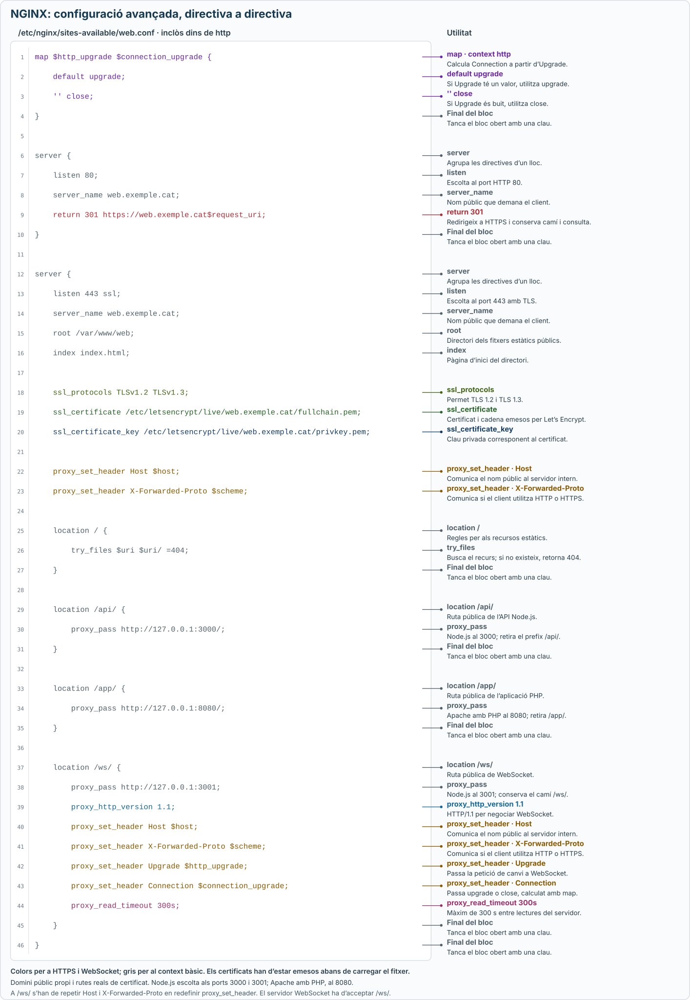

# Configuració avançada de NGINX

Aquest apartat amplia el [lloc bàsic](configuracio-basica.md) amb **HTTPS mitjançant Let’s Encrypt** i un **proxy invers per a WebSockets**.

El nom `web.exemple.cat` és un marcador: substitueix-lo pel domini públic que controlis. El nom local `.test` de l’article bàsic no serveix per obtenir un certificat de Let’s Encrypt.

## 1. HTTPS amb Let’s Encrypt

**Let’s Encrypt** emet certificats TLS. **Certbot** és una eina que en gestiona l’obtenció, la instal·lació i la renovació.

Per a la validació HTTP utilitzada aquí, el domini ha de resoldre al servidor i el lloc HTTP ha de ser accessible des d’Internet al port `80`. Si hi ha registres IPv4 i IPv6, tots dos han d’apuntar correctament. El port `443` ha de ser accessible per servir HTTPS.

### Obtenció i renovació

<details class="command-card" markdown="1">
<summary><code>certbot --nginx</code><span class="command-description">Obtenir el certificat i adaptar el lloc per servir HTTPS</span></summary>

Amb `snapd` disponible i sense una altra instal·lació de Certbot, es pot instal·lar l’eina així:

```bash
sudo snap install --classic certbot
```

Primer, el lloc HTTP ha de tenir el domini real a `server_name`, estar habilitat i superar `sudo nginx -t`. Després:

```bash
sudo /snap/bin/certbot --nginx -d web.exemple.cat --redirect
```

Certbot valida el domini, obté el certificat i modifica la configuració de NGINX per activar HTTPS i redirigir HTTP. Cal completar les preguntes que mostri.

Els fitxers TLS de l’exemple següent només es poden referenciar **després d’obtenir el certificat**. Comprova les rutes reals amb:

```bash
sudo /snap/bin/certbot certificates
```

[Instruccions oficials de Certbot per a NGINX](https://certbot.eff.org/instructions?os=snap&ws=nginx).

</details>

<details class="command-card" markdown="1">
<summary><code>certbot renew --dry-run</code><span class="command-description">Comprovar que la renovació automàtica pot funcionar</span></summary>

```bash
sudo /snap/bin/certbot renew --dry-run
```

Prova el procés de renovació amb certificats de prova. La instal·lació amb Snap programa les renovacions automàtiques; aquesta ordre permet comprovar-ne el funcionament.

El certificat renovat també s’ha de carregar a NGINX. El connector NGINX de Certbot gestiona l’aplicació dels certificats en la instal·lació descrita.

[Renovació amb Certbot](https://eff-certbot.readthedocs.io/en/stable/using.html#renewing-certificates).

</details>

### Directives HTTPS

<details class="command-card" markdown="1">
<summary><code>listen 443 ssl</code>, <code>ssl_certificate</code>, <code>ssl_certificate_key</code><span class="command-description">Activar HTTPS i indicar el certificat i la clau privada</span></summary>

Dins del bloc `server` HTTPS:

```nginx
listen 443 ssl;
ssl_protocols TLSv1.2 TLSv1.3;
ssl_certificate /etc/letsencrypt/live/web.exemple.cat/fullchain.pem;
ssl_certificate_key /etc/letsencrypt/live/web.exemple.cat/privkey.pem;
```

`fullchain.pem` conté el certificat i els intermedis. `privkey.pem` conté la clau privada corresponent i s’ha de mantenir protegida.

`ssl_protocols` limita les connexions a TLS 1.2 i TLS 1.3.

Per redirigir el lloc HTTP, s’utilitza un altre bloc `server` al port `80`:

```nginx
return 301 https://web.exemple.cat$request_uri;
```

`$request_uri` conserva el camí i els paràmetres de la petició. El nom del certificat ha de correspondre al domini públic.

[Configuració HTTPS de NGINX](https://nginx.org/en/docs/http/configuring_https_servers.html).

</details>

## 2. Proxy invers per a WebSockets

**WebSocket** permet mantenir una connexió bidireccional entre client i servidor després d’una negociació HTTP. Des d’una pàgina HTTPS s’utilitza `wss://`.

L’exemple afegeix `/ws/`, que apunta a un servidor WebSocket Node.js al port `3001` de la mateixa màquina. Aquest servidor ha d’acceptar connexions al camí `/ws/`.

### Negociació de la connexió

<details class="command-card" markdown="1">
<summary><code>map</code><span class="command-description">Preparar el valor de Connection segons la petició del client</span></summary>

```nginx
map $http_upgrade $connection_upgrade {
    default upgrade;
    '' close;
}
```

Si el client envia la capçalera `Upgrade`, el valor serà `upgrade`; si no l’envia, serà `close`.

`map` va en el context **`http`**, fora dels blocs `server`. A Ubuntu, els fitxers de `sites-enabled` s’inclouen habitualment dins de `http`, per això pot anar al principi del fitxer del lloc.

</details>

<details class="command-card" markdown="1">
<summary><code>proxy_http_version</code>, <code>proxy_set_header</code><span class="command-description">Reenviar la negociació WebSocket a Node.js</span></summary>

Dins de `location /ws/`:

```nginx
proxy_pass http://127.0.0.1:3001;
proxy_http_version 1.1;
proxy_set_header Host $host;
proxy_set_header X-Forwarded-Proto $scheme;
proxy_set_header Upgrade $http_upgrade;
proxy_set_header Connection $connection_upgrade;
```

S’indica explícitament HTTP/1.1 i es passen `Upgrade` i `Connection` al servidor intern. Aquí `proxy_pass` no té barra final: **conserva el camí `/ws/`**.

Es repeteixen `Host` i `X-Forwarded-Proto` perquè, en definir capçaleres en aquest bloc, les del nivell `server` no s’hereten automàticament.

</details>

<details class="command-card" markdown="1">
<summary><code>proxy_read_timeout</code><span class="command-description">Establir el temps màxim sense rebre dades del servidor intern</span></summary>

```nginx
proxy_read_timeout 300s;
```

Permet fins a 300 segons entre lectures del servidor intern. No és la durada màxima total de la connexió. L’aplicació pot enviar missatges periòdics per mantenir-la activa.

</details>

[Proxy WebSocket a NGINX](https://nginx.org/en/docs/http/websocket.html) i [capçaleres de proxy](https://nginx.org/en/docs/http/ngx_http_proxy_module.html#proxy_set_header).

## 3. Fitxer d’exemple

Aquest fitxer conserva els estàtics, `/api/` i `/app/`, i afegeix HTTPS i `/ws/`. Mostra l’estructura resultant; Certbot pot generar altres línies auxiliars que cal conservar.

El certificat i la clau indicats han d’existir. Substitueix el domini i les rutes pels que mostri `certbot certificates`; no carreguis aquest exemple abans d’emetre el certificat.

```nginx
map $http_upgrade $connection_upgrade {
    default upgrade;
    '' close;
}

server {
    listen 80;
    server_name web.exemple.cat;
    return 301 https://web.exemple.cat$request_uri;
}

server {
    listen 443 ssl;
    server_name web.exemple.cat;
    root /var/www/web;
    index index.html;

    ssl_protocols TLSv1.2 TLSv1.3;
    ssl_certificate /etc/letsencrypt/live/web.exemple.cat/fullchain.pem;
    ssl_certificate_key /etc/letsencrypt/live/web.exemple.cat/privkey.pem;

    proxy_set_header Host $host;
    proxy_set_header X-Forwarded-Proto $scheme;

    location / {
        try_files $uri $uri/ =404;
    }

    location /api/ {
        proxy_pass http://127.0.0.1:3000/;
    }

    location /app/ {
        proxy_pass http://127.0.0.1:8080/;
    }

    location /ws/ {
        proxy_pass http://127.0.0.1:3001;
        proxy_http_version 1.1;
        proxy_set_header Host $host;
        proxy_set_header X-Forwarded-Proto $scheme;
        proxy_set_header Upgrade $http_upgrade;
        proxy_set_header Connection $connection_upgrade;
        proxy_read_timeout 300s;
    }
}
```

Després d’editar el lloc, valida amb `sudo nginx -t` i, si és correcte, aplica’l amb `sudo systemctl reload nginx`.

[](../assets/images/nginx-configuracio-avancada.svg)

*Clica el gràfic per obrir-lo a mida completa i ampliar-lo.*
