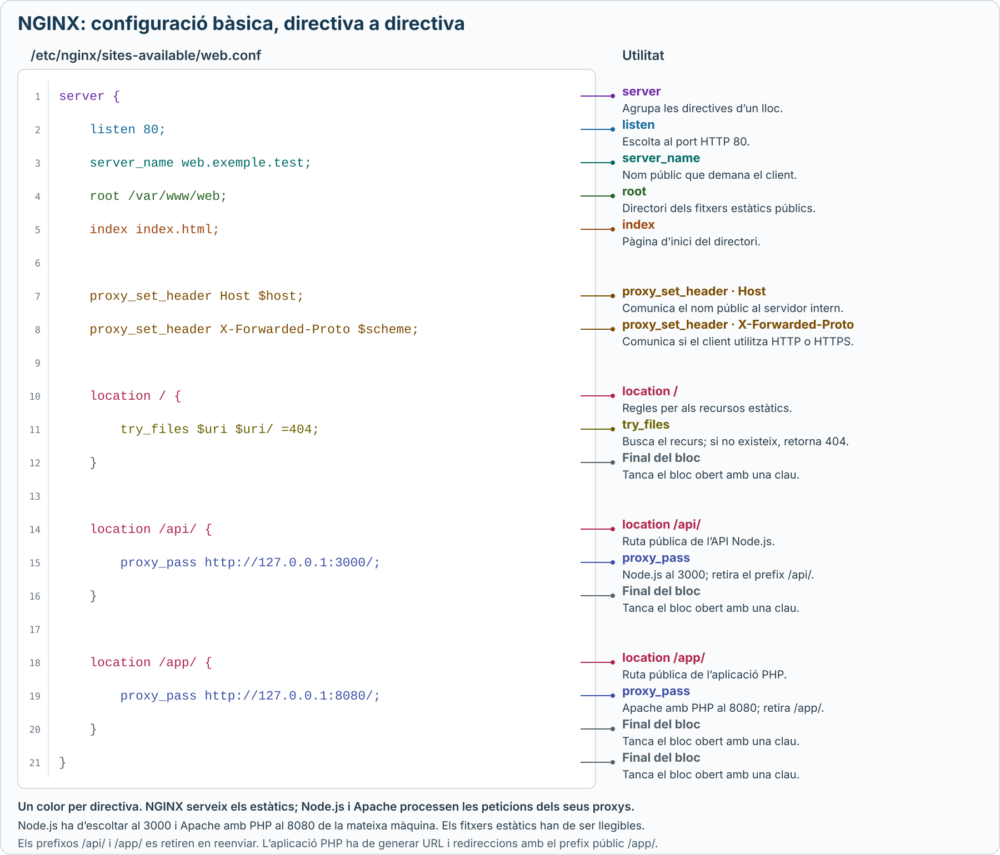

# Configuració bàsica de NGINX

NGINX pot servir fitxers estàtics i actuar com a **proxy invers** davant d’altres servidors. En aquest apartat es recullen les ordres i les directives essencials a **Ubuntu**.

## 1. Organització dels llocs

| Ruta | Funció |
| --- | --- |
| `/etc/nginx/nginx.conf` | Configuració general que inclou els llocs habilitats. |
| `/etc/nginx/sites-available/` | Fitxers originals dels llocs web. |
| `/etc/nginx/sites-enabled/` | Enllaços als llocs habilitats. |

En l’organització habitual d’Ubuntu, cada fitxer de lloc conté un o més blocs `server`. Els blocs utilitzen claus `{ }` i les directives simples acaben amb **punt i coma `;`**.

### Crear i retirar els enllaços

<details class="command-card" markdown="1">
<summary><code>ln -s</code>, <code>unlink</code><span class="command-description">Habilitar o deshabilitar un lloc mitjançant un enllaç simbòlic</span></summary>

Amb el fitxer `/etc/nginx/sites-available/web.conf` ja creat:

```bash
sudo ln -s /etc/nginx/sites-available/web.conf /etc/nginx/sites-enabled/web.conf
```

El primer camí és l’original i el segon, l’enllaç. Si l’enllaç ja existeix, no cal tornar-lo a crear.

Per deshabilitar el lloc, es retira només l’enllaç:

```bash
sudo unlink /etc/nginx/sites-enabled/web.conf
```

El fitxer de `sites-available` es conserva. Després de qualsevol canvi, cal validar i aplicar la configuració al servei.

</details>

[Organització dels llocs a Ubuntu](https://ubuntu.com/server/docs/how-to/web-services/configure-nginx/).

## 2. Ordres del servei

<details class="command-card" markdown="1">
<summary><code>nginx -t</code><span class="command-description">Comprovar la configuració abans d’aplicar-la</span></summary>

```bash
sudo nginx -t
```

Valida la sintaxi i comprova que NGINX pot obrir els fitxers referenciats. Si indica un error, cal corregir el fitxer i la línia assenyalats abans de recarregar.

Quan la comprovació és correcta i el servei està actiu:

```bash
sudo systemctl reload nginx
```

La validació no comprova que Node.js o Apache responguin; aquests serveis s’han de comprovar per separat.

</details>

<details class="command-card" markdown="1">
<summary><code>systemctl</code><span class="command-description">Engegar, aturar i consultar NGINX</span></summary>

| Ordre | Funció |
| --- | --- |
| `sudo systemctl status nginx` | Consultar l’estat. |
| `sudo systemctl start nginx` | Engegar el servei ara. |
| `sudo systemctl stop nginx` | Aturar-lo ara. |
| `sudo systemctl reload nginx` | Aplicar els canvis sense una aturada completa. |
| `sudo systemctl restart nginx` | Aturar-lo i tornar-lo a engegar. |
| `sudo systemctl enable nginx` | Habilitar l’arrencada automàtica amb el sistema. |

`enable` no engega immediatament el servei. Si està aturat, s’utilitza `start`, després de validar la configuració.

</details>

<details class="command-card" markdown="1">
<summary><code>journalctl</code>, <code>tail -f</code><span class="command-description">Consultar errors del servei i seguir les peticions</span></summary>

```bash
sudo journalctl -u nginx -b -n 50 --no-pager
sudo tail -f /var/log/nginx/access.log
sudo tail -f /var/log/nginx/error.log
```

El journal ajuda a entendre errors d’arrencada o recàrrega. `access.log` registra peticions i estats HTTP; `error.log`, errors de NGINX i de connexió amb els servidors interns.

Cada ordre `tail -f` es manté en execució fins que es prem `Ctrl+C`. Un `502 Bad Gateway` pot indicar que NGINX no rep una resposta vàlida del servidor al qual ha reenviat la petició.

</details>

## 3. Directives bàsiques

### Definició del lloc

<details class="command-card" markdown="1">
<summary><code>server</code>, <code>listen</code>, <code>server_name</code><span class="command-description">Definir el lloc, el port i el nom públic</span></summary>

```nginx
server {
    listen 80;
    server_name web.exemple.test;
}
```

`server` agrupa les directives del lloc; `listen` estableix el port d’escolta i `server_name` identifica el nom demanat pel client. El nom ha de resoldre a la IP del servidor.

</details>

### Fitxers estàtics

<details class="command-card" markdown="1">
<summary><code>root</code>, <code>index</code>, <code>autoindex</code><span class="command-description">Indicar el directori públic, la pàgina d’inici i els llistats</span></summary>

```nginx
root /var/www/web;
index index.html;
```

Una petició a `/imatges/logo.png` correspon a `/var/www/web/imatges/logo.png`. En demanar un directori, `index` indica la pàgina d’inici que s’intenta servir.

`autoindex` controla si NGINX mostra un llistat dels fitxers quan es demana un directori que no conté cap fitxer d’índex. Està desactivat per defecte. Per activar-lo només en un directori concret:

```nginx
location /descarregues/ {
    autoindex on;
    autoindex_exact_size off;
    autoindex_localtime on;
}
```

`autoindex_exact_size off` mostra mides més llegibles i `autoindex_localtime on` mostra les dates en l’hora local del servidor. No convé activar `autoindex` a tota l’arrel del lloc si el directori pot contenir fitxers privats o de configuració.

Aquest directori conté només fitxers estàtics públics, com HTML, CSS, JavaScript i imatges. Els fitxers PHP de l’aplicació es desen i s’executen al servidor Apache.

</details>

<details class="command-card" markdown="1">
<summary><code>location</code>, <code>try_files</code><span class="command-description">Seleccionar una ruta i comprovar si existeix el recurs estàtic</span></summary>

```nginx
location / {
    try_files $uri $uri/ =404;
}
```

`location` agrupa regles per a un camí URL. `try_files` comprova les alternatives **d’esquerra a dreta** i s’atura en trobar-ne una que existeixi.

Amb `root /var/www/web;`, aquesta línia s’interpreta així:

1. **`$uri`: buscar un fitxer.** És el camí de la petició, sense els paràmetres de consulta. Per a `/css/estils.css?v=2`, el valor és `/css/estils.css` i es comprova `/var/www/web/css/estils.css`.
2. **`$uri/`: buscar un directori.** La barra final indica que aquesta alternativa comprova si existeix un directori. Si es troba, NGINX continua el tractament del directori i pot servir-ne la pàgina indicada per `index`.
3. **`=404`: retornar un error.** Si cap alternativa existeix, respon amb l’estat HTTP `404 Not Found`. `=404` és un codi de resposta, no un nom de fitxer.

**Exemples amb `root /var/www/web;` i `index index.html;`:**

| Petició | Què comprova? | Resultat |
| --- | --- | --- |
| `/css/estils.css` | Existeix el fitxer `/var/www/web/css/estils.css`. | Serveix el CSS; no cal comprovar les altres alternatives. |
| `/guies/` | Existeix el directori `/var/www/web/guies/` i conté `index.html`. | Serveix `/var/www/web/guies/index.html`. |
| `/inexistent` | No existeix ni el fitxer ni el directori corresponent. | Retorna `404`. |

Un directori existent sense `index.html` pot donar **`403 Forbidden`**: s’ha trobat el directori, però no hi ha pàgina d’inici i el llistat automàtic no està activat en aquest exemple.

En aquest exemple, els blocs més específics `/api/` i `/app/` tenen preferència sobre `/`.

[Documentació de try_files](https://nginx.org/en/docs/http/ngx_http_core_module.html#try_files) i [pàgines índex](https://nginx.org/en/docs/http/ngx_http_index_module.html).

</details>

### Proxy invers

<details class="command-card" markdown="1">
<summary><code>proxy_pass</code><span class="command-description">Passar una petició a Node.js o a Apache amb PHP</span></summary>

```nginx
location /api/ {
    proxy_pass http://127.0.0.1:3000/;
}

location /app/ {
    proxy_pass http://127.0.0.1:8080/;
}
```

| Petició pública | Destinació interna |
| --- | --- |
| `/api/usuaris` | Node.js: `http://127.0.0.1:3000/usuaris` |
| `/app/index.php` | Apache amb PHP: `http://127.0.0.1:8080/index.php` |

**La barra final de `proxy_pass` substitueix el prefix del `location` per `/`.** Sense aquesta barra, es conserva el camí complet, com `/api/usuaris`.

L’aplicació PHP ha de generar els enllaços i les redireccions amb el seu prefix públic `/app/`.

</details>

<details class="command-card" markdown="1">
<summary><code>proxy_set_header</code><span class="command-description">Comunicar el nom públic i el protocol al servidor intern</span></summary>

```nginx
proxy_set_header Host $host;
proxy_set_header X-Forwarded-Proto $scheme;
```

`$host` és el nom del lloc demanat; `$scheme` indica `http` o `https`. Aquestes capçaleres ajuden les aplicacions a construir les URL públiques quan estan configurades per confiar en aquest proxy.

A l’exemple complet van dins de `server` i s’hereten als blocs de proxy que no redefineixen aquestes capçaleres.

</details>

[Directives de proxy invers](https://nginx.org/en/docs/http/ngx_http_proxy_module.html#proxy_pass) i [directives del lloc](https://nginx.org/en/docs/http/ngx_http_core_module.html).

## 4. Fitxer d’exemple

El fitxer `/etc/nginx/sites-available/web.conf` correspon a aquest esquema, amb els serveis a la mateixa màquina:

| Funció | Destinació |
| --- | --- |
| Web estàtica | `/var/www/web` |
| API Node.js | `127.0.0.1:3000` |
| Aplicació Apache amb PHP | `127.0.0.1:8080` |

NGINX ocupa el port `80`; Apache ha d’estar configurat al `8080` i tenir PHP operatiu. NGINX només li passa les peticions. Els fitxers estàtics han d’existir i ser llegibles.

```nginx
server {
    listen 80;
    server_name web.exemple.test;
    root /var/www/web;
    index index.html;

    proxy_set_header Host $host;
    proxy_set_header X-Forwarded-Proto $scheme;

    location / {
        try_files $uri $uri/ =404;
    }

    location /api/ {
        proxy_pass http://127.0.0.1:3000/;
    }

    location /app/ {
        proxy_pass http://127.0.0.1:8080/;
    }
}
```

En aquests blocs de proxy, NGINX redirigeix `/api` a `/api/` i `/app` a `/app/`. El nom `web.exemple.test` és un exemple per a un entorn local.

[](../assets/images/nginx-configuracio-basica.svg)

*Clica el gràfic per obrir-lo a mida completa i ampliar-lo.*
